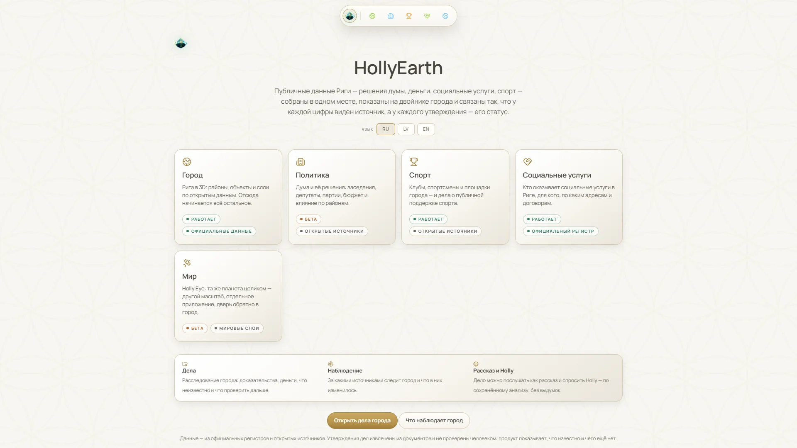
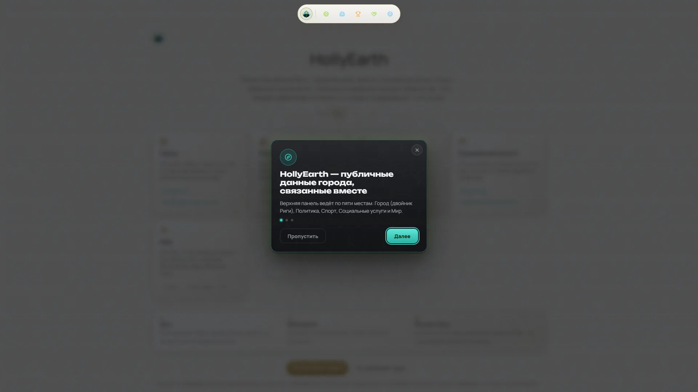
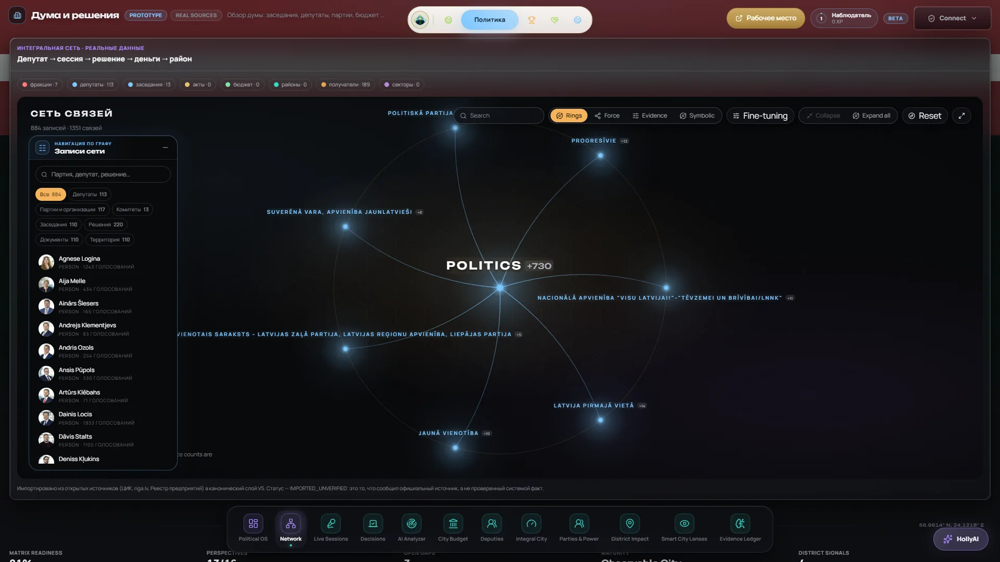
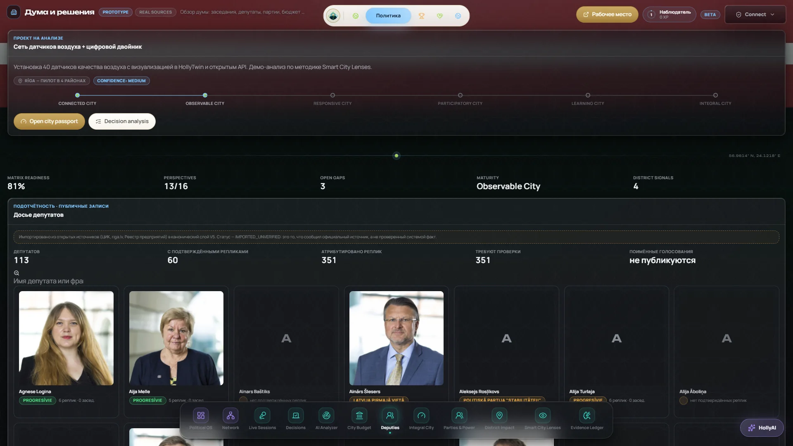
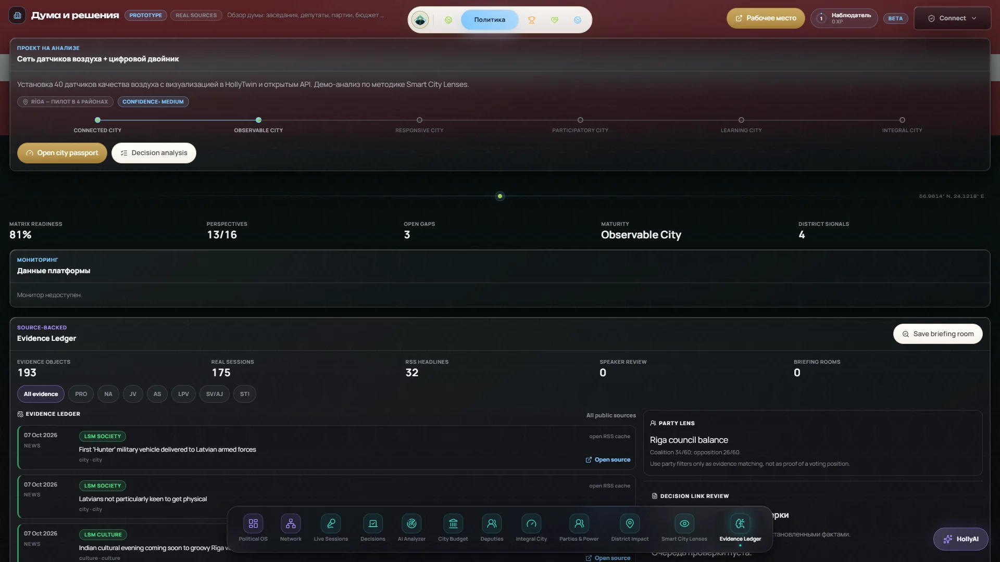
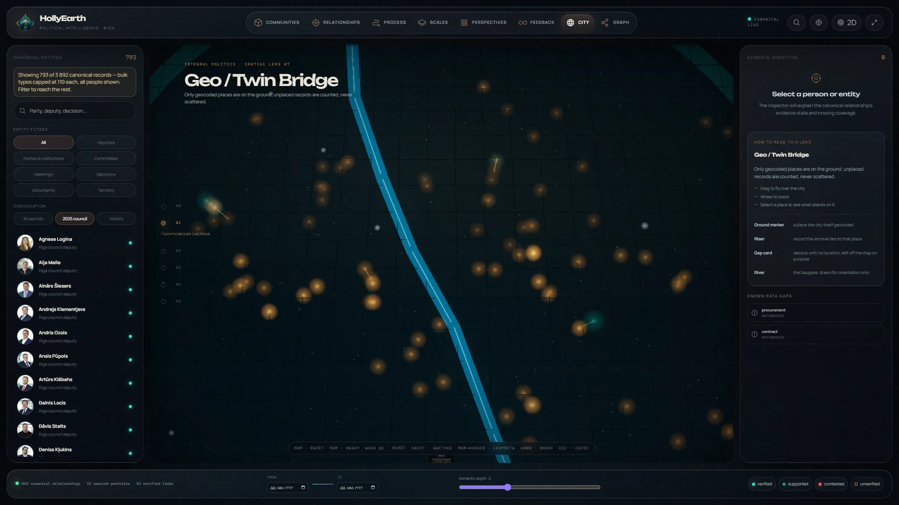
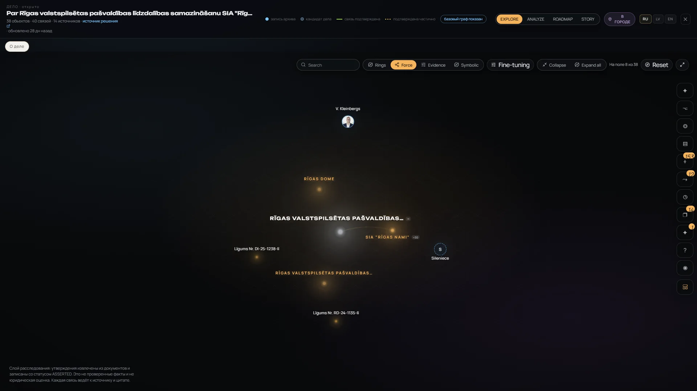
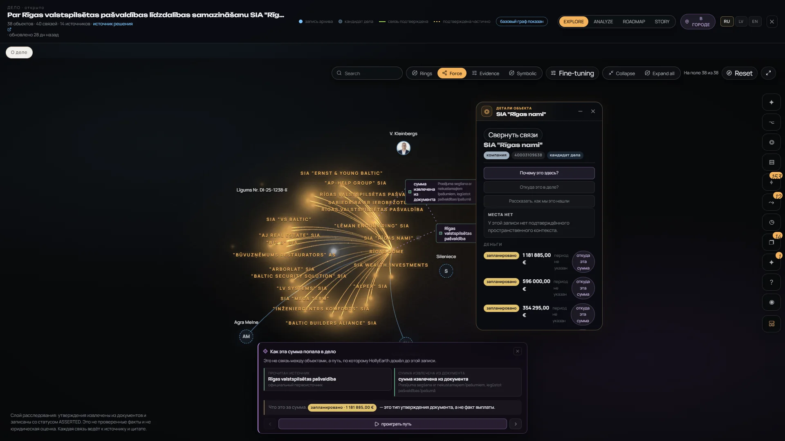
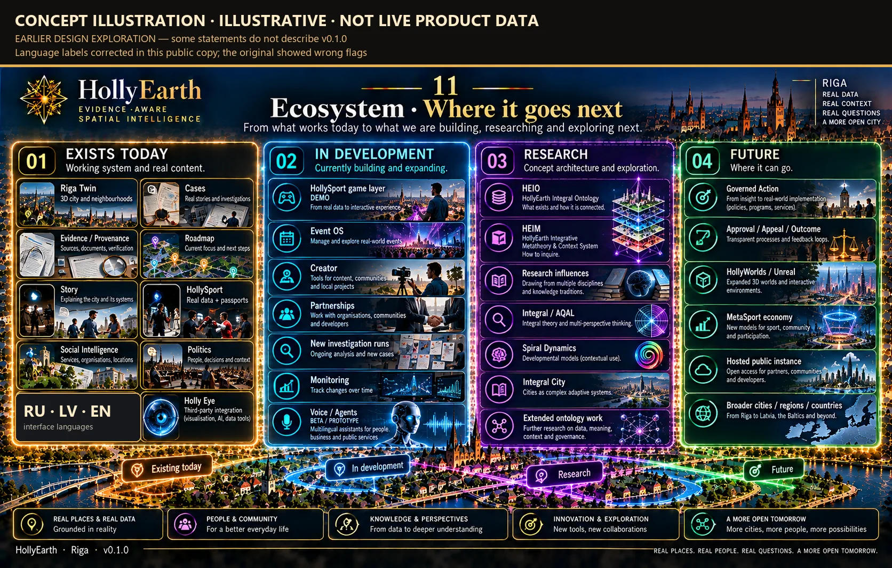

# HOLLYEARTH VISUAL ATLAS

### ONE SYSTEM. MANY WORLDS.

Real screens of HollyEarth v0.1.0 — a pilot and research & development project in Riga — from working modules to prototypes, demos and research concepts, each labelled.

[← README](../README.md) · [Feature status](FEATURE_STATUS.md) · [Media index](../media/README.md)

**How to read the atlas.** Every screenshot is a real capture of the product (October 2026, mostly Russian interface; English versions will follow). Each screen carries its status: `WORKING` · `SHOWCASE_READY` · `BETA` · `PROTOTYPE` · `DEMO` · `RESEARCH` · `FUTURE`. A beautiful screen can still be a prototype — that is exactly what the labels are for. Concept illustrations are kept in their own section and are never presented as the product. A few public copies carry a visible correction or have personal data blurred; each is noted on the image or in the caption.

| | Section | Images | Gallery |
|---|---|---|---|
| 01 | [HollyEarth](#01--hollyearth) | 3 | — |
| 02 | [Riga Twin](#02--riga-twin) | 19 | [RIGA_TWIN.md](gallery/RIGA_TWIN.md) |
| 03 | [Politics](#03--politics) | 12 | [POLITICS.md](gallery/POLITICS.md#political-intelligence) |
| 04 | [Political Workspace](#04--political-workspace) | 11 | [POLITICS.md](gallery/POLITICS.md#integral-political-workspace) |
| 05 | [HollySport](#05--hollysport) | 35 | [HOLLYSPORT.md](gallery/HOLLYSPORT.md) |
| 06 | [Social Intelligence](#06--social-intelligence) | 10 | [SOCIAL.md](gallery/SOCIAL.md) |
| 07 | [Investigation](#07--investigation) | 12 | [INVESTIGATION.md](gallery/INVESTIGATION.md) |
| 08 | [Evidence & Provenance](#08--evidence--provenance) | — | [INVESTIGATION.md](gallery/INVESTIGATION.md#source-trace-and-money-trace) |
| 09 | [Monitoring / Observatory](#09--monitoring--observatory) | 11 | [MONITORING.md](gallery/MONITORING.md) |
| 10 | [Holly AI](#10--holly-ai) | 3 | [HOLLY_AI.md](gallery/HOLLY_AI.md) |
| 11 | [Story / Voice](#11--story--voice) | 4 | [HOLLY_AI.md](gallery/HOLLY_AI.md#story) |
| 12 | [Holly Eye](#12--holly-eye) | 46 | [HOLLY_EYE.md](gallery/HOLLY_EYE.md) |
| 13 | [Research Foundations](#13--research-foundations) | 2 | [RESEARCH_CONCEPTS.md](gallery/RESEARCH_CONCEPTS.md) |
| 14 | [Concept Art](#14--concept-art) | 9 | [RESEARCH_CONCEPTS.md](gallery/RESEARCH_CONCEPTS.md#concept-art--design-explorations) |
| 15 | [Future Worlds](#15--future-worlds) | — | [ROADMAP.md](../ROADMAP.md) |

---

## 01 — HollyEarth

One top bar over five areas — City, Politics, Sport, Social services, World — plus Cases, Monitoring, and Story & Holly. Each area shows its maturity and where its data comes from. Russian, Latvian and English.

<table>
<tr>
<td width="50%"> The start screen in Russian.</td>
<td width="50%"> The three-step welcome tour.</td>
</tr>
</table>

## 02 — Riga Twin

A photorealistic 3D Riga used as the shared map: districts, 428 council decisions, sport plots, 177 social-service buildings, news, the council panel, AQAL and research mode. `WORKING`; research mode and AQAL `PROTOTYPE`; Wellbeing `DEMO`.

<table>
<tr>
<td width="33%"></td>
<td width="33%"></td>
<td width="33%"></td>
</tr>
</table>

→ **[Riga Twin gallery](gallery/RIGA_TWIN.md)** — 19 screens: layers, decisions, council panel, objects, AQAL, research mode.

## 03 — Politics

Political Holly OS: twelve modules over Riga City Council — 175 sessions, 456 decisions, 113 deputies, 7 parties, election results, budget and an evidence ledger. Modules range from `WORKING` (Network, Deputies, Parties & Power) to `DEMO` (District Impact, Smart City Lenses).

<table>
<tr>
<td width="33%"></td>
<td width="33%"></td>
<td width="33%"></td>
</tr>
</table>

→ **[Politics gallery — Political Intelligence](gallery/POLITICS.md#political-intelligence)** — all 12 modules.

## 04 — Political Workspace

The integral political research workspace — eight ways of reading the same canonical records: **Political Archipelago · Focus Orbit · Evidence & Influence Flow · Holarchic Observatory · Integral Lens Field · Living City Torus · Geo / Twin Bridge · Relationship Graph.** `PROTOTYPE`, internal research tool; the integral views are research lenses.

<table>
<tr>
<td width="33%"> Focus Orbit</td>
<td width="33%"> Evidence & Influence Flow</td>
<td width="33%"> Holarchic Observatory</td>
</tr>
<tr>
<td width="33%"> Integral Lens Field</td>
<td width="33%"> Living City Torus</td>
<td width="33%"> Geo / Twin Bridge</td>
</tr>
</table>

→ **[Politics gallery — Integral Political Workspace](gallery/POLITICS.md#integral-political-workspace)** — each view in its own section.

## 05 — HollySport

18,143 athletes, 227 events, 1,326 bouts, 297 clubs and federations, 133 venues from official sources, and a game-styled sport city. Passports for clubs, athletes, events and venues are `WORKING` / `SHOWCASE_READY`; the City Game is `DEMO`; Event OS and Creator are `PROTOTYPE`; the MetaSport economy is `FUTURE`.

<table>
<tr>
<td width="33%"></td>
<td width="33%"></td>
<td width="33%"></td>
</tr>
</table>

→ **[HollySport gallery](gallery/HOLLYSPORT.md)** — city, clubs, athletes, events, venues, rankings, graph, map, City Game, Event OS, Creator, MetaSport.

## 06 — Social Intelligence

256 services, 106 providers, 177 buildings and 28 at-home services from the official register. **Registered ≠ delivered · unknown ≠ zero.** `SHOWCASE_READY`.

<table>
<tr>
<td width="33%"></td>
<td width="33%"></td>
<td width="33%"></td>
</tr>
</table>

→ **[Social Intelligence gallery](gallery/SOCIAL.md)**

## 07 — Investigation

Cases with claims, sources, exact quotations, case graphs, typed money, open questions, roadmap, analysis, Story and monitoring. **Claim ≠ verified fact:** all 111 claims are asserted and none has been checked by a person.

<table>
<tr>
<td width="33%"></td>
<td width="33%"></td>
<td width="33%"></td>
</tr>
</table>

→ **[Investigation gallery](gallery/INVESTIGATION.md)**

## 08 — Evidence & Provenance

Every figure leads back to the source that was read and the quotation it came from: "planned — a type of statement the document makes, not a fact of payment". → [Source trace and money trace](gallery/INVESTIGATION.md#source-trace-and-money-trace) · [evidence-and-provenance.md](evidence-and-provenance.md)

## 09 — Monitoring / Observatory

18 watches on official registers, 26 runs, stored snapshots and change detection — **run by hand, no automatic scheduler yet**. Plus the internal Project Observatory (a snapshot from August 2026; some statements are out of date).

<table>
<tr>
<td width="33%"></td>
<td width="33%"></td>
<td width="33%"></td>
</tr>
</table>

→ **[Monitoring / Observatory gallery](gallery/MONITORING.md)**

## 10 — Holly AI

Deterministic analysis on the left; **model-generated** hypotheses on the right, labelled as such. Holly answers inside a case from the case's own records; a global assistant and autonomous agents are not part of v0.1.0. → **[Holly AI gallery](gallery/HOLLY_AI.md)**

## 11 — Story / Voice

A case told as chapters in Russian, Latvian or English, assembled from the case's records, with optional voices (local, hosted with confirmation, browser). → **[Story and voice](gallery/HOLLY_AI.md#story)**

## 12 — Holly Eye

The World door opens Holly Eye — a 3D globe and 3D cities with 14 live public data layers: flights, military flights, satellites, space missions, earthquakes, active fires, vessels, radio, CCTV and more, plus scenes, visual styles and voice commands. **A third-party integration (God's Eye View by Bilawal Sidhu, MIT), not HollyEarth's own technology.** `BETA`

<table>
<tr>
<td width="33%"> Satellites</td>
<td width="33%"> Riga in 3D</td>
<td width="33%"> Live flights</td>
</tr>
<tr>
<td width="33%"> Earthquakes</td>
<td width="33%"> Orbital Watch scene</td>
<td width="33%"> NVG style</td>
</tr>
</table>

→ **[Holly Eye gallery](gallery/HOLLY_EYE.md)** — planetary view, world layers, space & satellites, environmental data, scenes, voice, the door · [media provenance](../media/HOLLY_EYE_PROVENANCE.md): authorship, sources, licences and terms of every image.

## 13 — Research Foundations

<table>
<tr>
<td width="50%"> HEIO — concept illustration. `RESEARCH`, not implemented as a system.</td>
<td width="50%"> HEIM — concept illustration. `RESEARCH`, not implemented in v0.1.0.</td>
</tr>
</table>

→ **[Research & Concepts gallery](gallery/RESEARCH_CONCEPTS.md)**

## 14 — Concept Art

Nine concept illustrations from the design history of HollyEarth — **concept, illustrative, not live product data**; some use fictional example data or describe earlier ideas, and each copy says so on the image. → **[Concept art](gallery/RESEARCH_CONCEPTS.md#concept-art--design-explorations)**

## 15 — Future Worlds

What the screens above point towards, all `FUTURE`: governed action with appeals and recorded outcomes · HollyWorlds (expanded 3D worlds) · the MetaSport economy · a public hosted instance · more cities, regions and countries. → [ROADMAP.md](../ROADMAP.md)
