

# HOLLYEARTH

### A LIVING UNIVERSE

**VIENA SISTĒMA. DAUDZAS PASAULES.**

**Pasaule, ko var izpētīt, izprast un nākotnē arī mainīt.**

No sporta kluba Bolderājā līdz pilsētas lēmumiem, no vienas vietas stāsta līdz planētas datiem. Atklājiet jaunus veidus, kā izzināt apkārtējo pasauli.

`v0.1.0` · izmēģinājuma pētniecības projekts · tikai dokumentācija un mediji · nav atvērtā koda projekts

[English](../README.md) · [Русский](README_RU.md) · **Latviešu** · **[Vizuālais atlants →](GALLERY.md)**

<a href="../media/screenshots/02-riga-twin.png">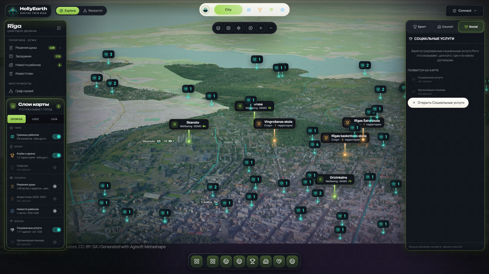</a>

Īsts v0.1.0 ekrānuzņēmums. Riga Twin: apkaimju, sporta un sociālo pakalpojumu slāņi fotoreālistiskā Rīgas 3D modelī. „Wellbeing” atzīmes apzīmētas kā DEMO.

---

## HollyEarth — Dzīvs visums

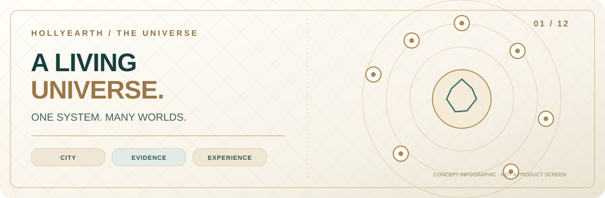

*Oriģināla konceptuāla infografika — vizuāla metafora, nevis produkta ekrānuzņēmums.*

**Pasaule ir daudz plašāka par analītikas ekrānu.** Iedomājieties: jūs sākat Rīgas ielā, iepazīstat sporta kluba vēsturi, atverat domes lēmuma pirmavotu, nonākat pie pētnieciskas lietas — un tad ieraugāt Zemi planētas mērogā.

**HollyEarth — A Living Universe. Dzīvs visums.** Nevis tikai datu krājums vai atsevišķa lietotne, bet augoša vietu, zināšanu, stāstu, pētījumu un interaktīvu pasauļu ekosistēma. Mēs sākam Rīgā, bet domājam **no vienas apkaimes līdz visai planētai**. Mūsu ilgtermiņa mērķis ir palīdzēt cilvēkiem ne vien saprast notiekošo, bet nākotnē arī līdzdarboties pārmaiņās.

**Kas pastāv šodien:** privāts pētniecības pilotprojekts ar darbojošām funkcijām, prototipiem un trešo pušu integrācijām. Publiski pieejamas pilnvērtīgas platformas un reālu pilsētas lēmumu maiņas mehānisma vēl nav — tā ir daļa no nākotnes ieceres.

**Integrālā perspektīva palīdz nepazaudēt cilvēku aiz skaitļiem.** Katrai vietai ir vairākas puses: **Es** — personiskā pieredze; **Mēs** — attiecības un kopiena; **Pierādījumi** — novērojamie un avotos pārbaudāmie fakti; **Sistēmas** — iestādes, infrastruktūra, noteikumi un resursi. Tā ir pieeja domāšanai un projektēšanai, **nevis apgalvojums, ka v0.1.0 automātiski analizē visas četras perspektīvas**.

**Viena vieta, vairākas pasaules:** sporta klubu Bolderājā var aplūkot kartē, izpētīt arhīvu rezultātos un publiskajos ierakstos; nākotnē apkaime varētu kļūt arī par spēles stāsta vidi. Pašlaik tie ir **atsevišķi moduļi un prototipi**, nevis pilnībā savienots ceļš.

**Izvēlieties savu pasauli:** zemāk ir īsti ekrānuzņēmumi, gatavības statusi un detalizētas galerijas.

| Pasaule | Kas tā ir | Statuss | Galerija |
|---|---|---|---|
| **Pilsēta — Riga Twin** | Rīga 3D: apkaimju, domes, sporta un sociālo pakalpojumu slāņi | `WORKING` | [Riga Twin](gallery/RIGA_TWIN.md) |
| **Politika** | Rīgas dome: sēdes, lēmumi, deputāti, partijas, vēlēšanas, budžets, pierādījumi — un integrāla pētniecības darba telpa | `BETA` | [Politika](gallery/POLITICS.md) |
| **Sports — HollySport** | Latvijas klubi, sportisti, pasākumi un norises vietas pēc federāciju un protokolu datiem; sporta pilsēta spēles stilā | `WORKING` · spēles slānis `DEMO` | [HollySport](gallery/HOLLYSPORT.md) |
| **Sociālā joma — Social Intelligence** | Rīgas reģistrētie sociālie pakalpojumi interaktīvā pilsētas skatuvē | `SHOWCASE_READY` | [Social](gallery/SOCIAL.md) |
| **Izmeklēšana** | No dokumentiem veidotas lietas: apgalvojumi, avoti, citāti, nauda pa veidiem, atklāti jautājumi | `WORKING` | [Izmeklēšana](gallery/INVESTIGATION.md) |
| **Analītika** | Deterministiska analīze, Holly, uzraudzība, valodas modeļa spriedumi — pēc izvēles | `BETA` | [Holly AI](gallery/HOLLY_AI.md) · [Uzraudzība](gallery/MONITORING.md) |
| **Pieredze** | Stāsts trīs valodās, pases, dosjē; Holly Eye — trešās puses 3D globuss ar dzīviem pasaules datu slāņiem | `WORKING` · Holly Eye `BETA` | [Story](gallery/HOLLY_AI.md#story) · [Holly Eye](gallery/HOLLY_EYE.md) |

<b>Kā tas ir veidots · v0.1.0 fakti un ierobežojumi</b>

HollyEarth savieno publiskās zināšanas, interaktīvas pasaules un pārbaudāmus avotus. Tā apvieno pilsētu, tās iestādes un organizācijas, politiskos lēmumus, publisko naudu, sociālos pakalpojumus, sportu, dokumentus, avotus un pierādījumus — un ļauj tos pētīt kartē, kā grafu, kā izmeklēšanu vai kā stāstu.

**Realitāte → Pierādījumi → Analītika → Pieredze → Rīcība** — tas, ko publicē reģistri, dome, federācijas un arhīvi; tiek glabāts kopā ar avotu, citātu, statusu un trūkstošo informāciju; tiek sasaistīts lietās, analīzē un atklātos jautājumos; tiek piedzīvots kā 3D pilsēta, sporta pilsēta, sociālo pakalpojumu karte, lietu darba telpas un ierunāti stāsti. *„Rīcība” ir `FUTURE`: versijā v0.1.0 sistēma neko neieraksta atpakaļ pasaulē.*

> **Vīzija un šodiena ir nošķirtas.**
> Mērķis ir viens savienots pilsētas modelis. **Šodien HollyEarth ir viens produkts pār vairākiem savienotiem datu modeļiem, nevis vienots realitātes grafs.** Politikas un sporta ieraksti atrodas vienā kanoniskajā grafā, bet vēl nav savstarpēji saistīti; sociālo pakalpojumu reģistram ir savs modelis; katrai izmeklēšanai ir savs pierādījumu grafs; Riga Twin rāda vairākus no šiem modeļiem vienā kartē. Sīkāk: [ARCHITECTURE.md](../ARCHITECTURE.md).

Statusi: `SHOWCASE_READY` · `WORKING` · `BETA` · `PROTOTYPE` · `DEMO` · `RESEARCH` · `FUTURE` — katra funkcija dokumentā **[FEATURE_STATUS.md](FEATURE_STATUS.md)**. Visi produkta ekrāni ar statusiem: **[HollyEarth vizuālais atlants](GALLERY.md)**. Galerijas un detalizētie dokumenti ir angļu valodā.

---

## Pilsēta

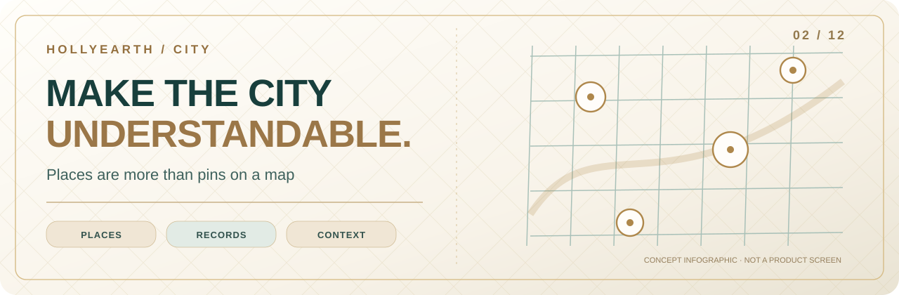

*Oriģināla konceptuāla infografika — vizuāla metafora, nevis produkta ekrānuzņēmums.*

### Ja jūsu apkaime varētu pastāstīt savu stāstu

Ejot gar sporta laukumu vai sabiedrisku iestādi Rīgā, rodas jautājums: **kas par šo vietu atbild, un kuros dokumentos tā pieminēta?** Atbilde parasti ir izkaisīta vairākās tīmekļvietnēs un reģistros.

**Riga Twin pārvērš pilsētu par izpētes sākumpunktu.** 3D vidē iespējams aplūkot apkaimes, domes ierakstus, sporta vietas un reģistrētu sociālo pakalpojumu ēkas, atverot konteksta paneļus un avotus. Tā ir iespēja **ieraudzīt pazīstamu vietu citā kontekstā**.

**Kāpēc tas ir svarīgi:** iedzīvotājiem ir vieglāk orientēties informācijā, pētniekiem — formulēt jautājumus, partneriem — iztēloties jaunus pilsētas datu lietojumus. Dati vēl **nav vienots starpnozaru grafs**.

<a href="../media/storycards/en/city.svg">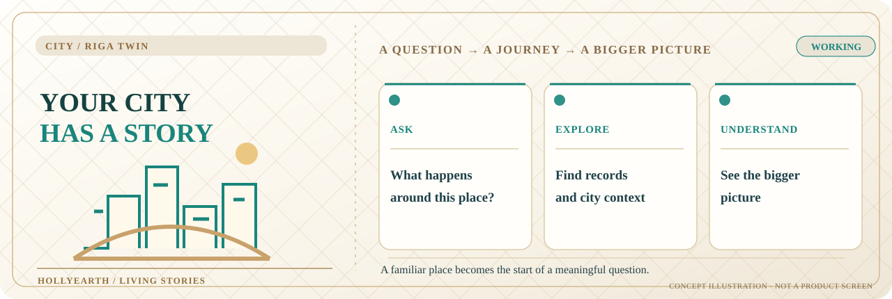</a>

*Vizuāls stāsts — cilvēka jautājums, trīs soļi un ieguvums. Koncepts, nevis ekrānuzņēmums; uzraksti pagaidām angļu valodā.*

<b>🔎 Riga Twin faktiskie dati, funkcijas un ierobežojumi</b>

**Pilsēta ir vairāk nekā karte.** Rīga kļūst par telpu, kurā vietas, iestādes un publiskie ieraksti iegūst kontekstu. Sāciet ar pilsētu un, kad rodas jautājums, atveriet pirmavotu.

**Riga Twin** — kopējā 3D karte: 58 apkaimes, 428 domes lēmumi ar adresi, 14 pilsētas piešķirtas sporta teritorijas, 177 sociālo pakalpojumu ēkas, apkaimju ziņas, domes panelis un pārejas uz visām pārējām pasaulēm. `WORKING`; pētniecības režīms un AQAL slānis — `PROTOTYPE`; Wellbeing — `DEMO`.

<table>
<tr>
<td width="33%"><a href="../media/gallery/twin/01-default-council.webp">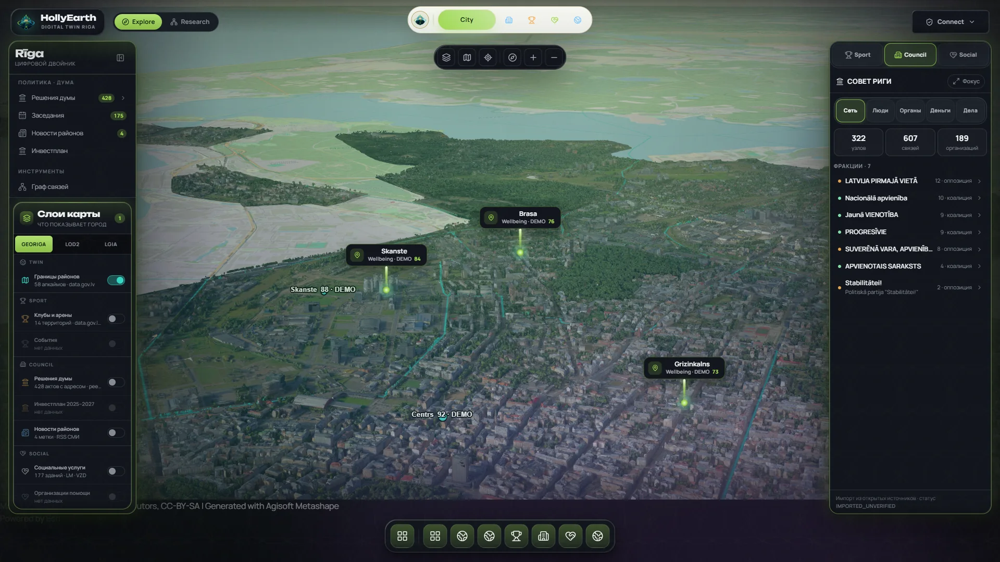</a> Domes panelis blakus pilsētai</td>
<td width="33%"><a href="../media/gallery/twin/03-layer-council-decisions.webp">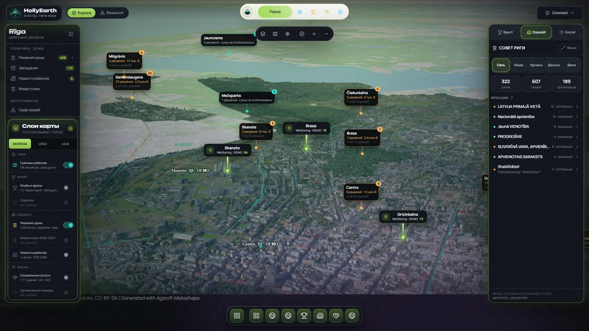</a> Domes lēmumi pa apkaimēm</td>
<td width="33%"><a href="../media/gallery/twin/17-aqal-overlay.webp">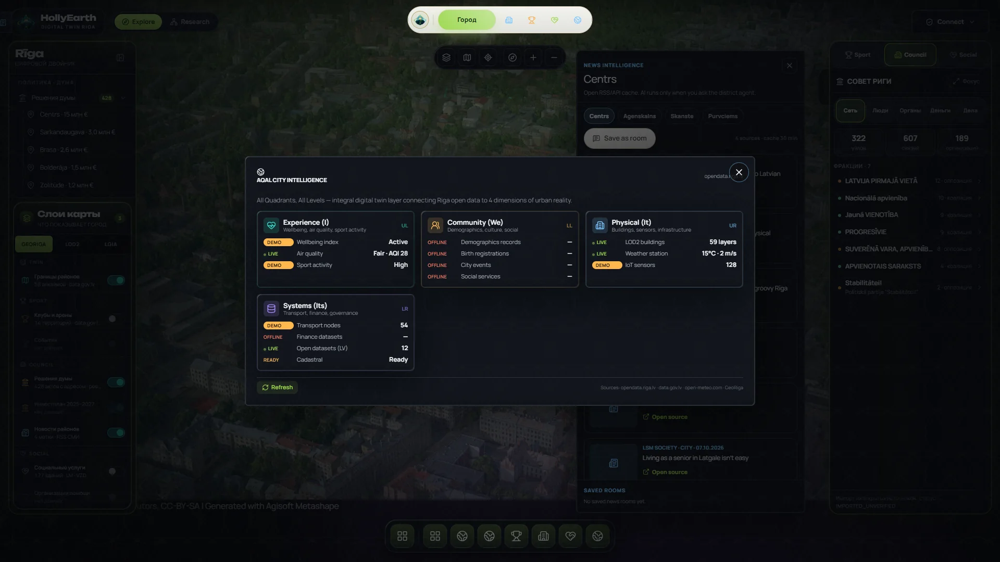</a> AQAL slānis — `PROTOTYPE`</td>
</tr>
</table>

Vēl nav: kopējas vietu identitātes starp jomām; lietu kartē; pētniecības režīma, kas atbild uz jautājumiem. → **[Riga Twin galerija](gallery/RIGA_TWIN.md)** · [twin.md](twin.md)

---

## Politika

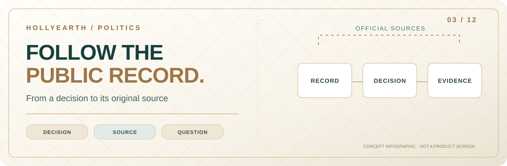

*Oriģināla konceptuāla infografika — vizuāla metafora, nevis produkta ekrānuzņēmums.*

### Aiz katra lēmuma ir cilvēki, dokumenti un sekas

Ziņās rakstīts, ka dome apstiprinājusi projektu. **Kas balsoja? Kur ir lēmums? Ko tieši norāda oficiālais avots?** Lai saprastu, bieži jāmeklē vairākās atsevišķās sistēmās.

**Political Holly OS ļauj izpētīt publiskos lēmumu ierakstus:** sēdes, deputātus, balsojumus, dokumentus un to sasaistes. Eksperimentālie pētniecības skati ļauj aplūkot tos pašus datus no dažādām pusēm — neizdarot automatizētus spriedumus par cilvēkiem vai partijām.

**Ieguvums:** cilvēks var ne tikai lasīt svešu kopsavilkumu, bet pats izsekot publicētajiem avotiem un pamanīt neatbildētos jautājumus. Tas nepierāda lēmumu faktisko ietekmi vai cilvēku godīgumu.

<a href="../media/storycards/en/politics.svg">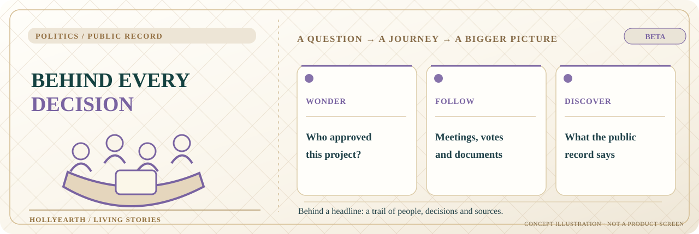</a>

*Vizuāls stāsts — cilvēka jautājums, trīs soļi un ieguvums. Koncepts, nevis ekrānuzņēmums; uzraksti pagaidām angļu valodā.*

<b>🔎 Domes datu tvērums, moduļi un gatavība</b>

**Katram lēmumam ir sava vēsture.** No virsraksta līdz oficiālai sēdei, lēmumam, balsojumam un dokumentam. Automātiska analīze netiek pasniegta kā politisks spriedums.

**Political Holly OS** — divpadsmit moduļi pār Rīgas domes datiem: 175 sēdes, 456 lēmumi, 113 deputāti, 7 partijas, 2025. gada vēlēšanu oficiālie rezultāti, pašvaldības izdevumi un pierādījumu reģistrs. Moduļi ir no `WORKING` (Network, Deputies, Parties & Power) caur `BETA` līdz `DEMO` (District Impact, Smart City Lenses) un `RESEARCH` (Integral City).

<a href="../media/gallery/politics/01-political-os.webp">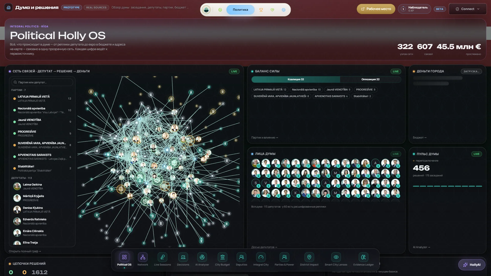</a>

**Integral Political Workspace** — astoņi pētnieciski skati uz tiem pašiem kanoniskajiem ierakstiem, `PROTOTYPE`: Political Archipelago · Focus Orbit · Evidence & Influence Flow · Holarchic Observatory · Integral Lens Field · Living City Torus · Geo / Twin Bridge · Relationship Graph.

<table>
<tr>
<td width="33%"><a href="../media/gallery/workspace/01-political-archipelago.webp">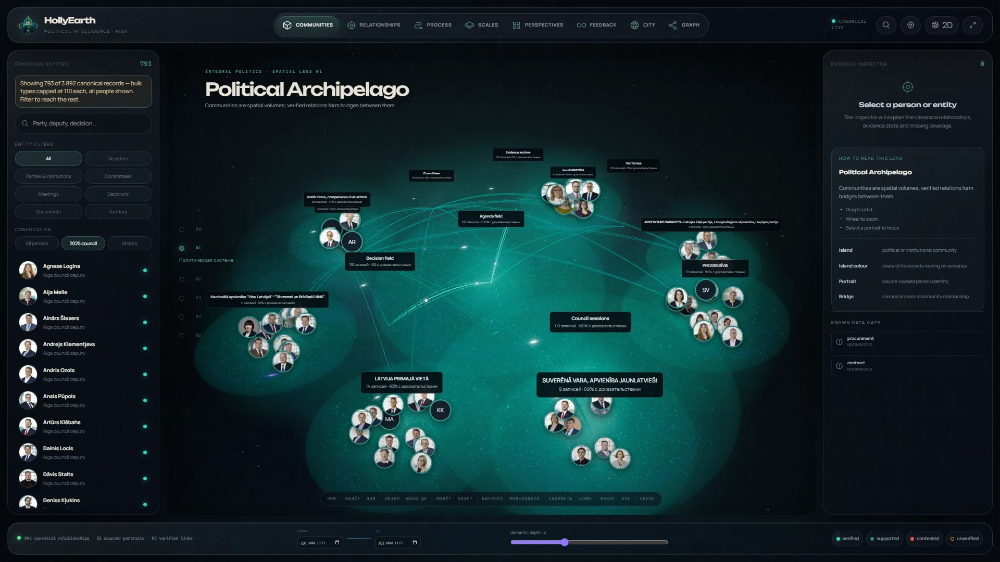</a> Political Archipelago</td>
<td width="33%"><a href="../media/gallery/workspace/02b-focus-orbit-selected.webp">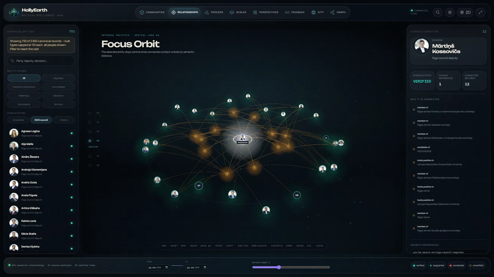</a> Focus Orbit</td>
<td width="33%"><a href="../media/gallery/workspace/03-evidence-influence-flow.webp">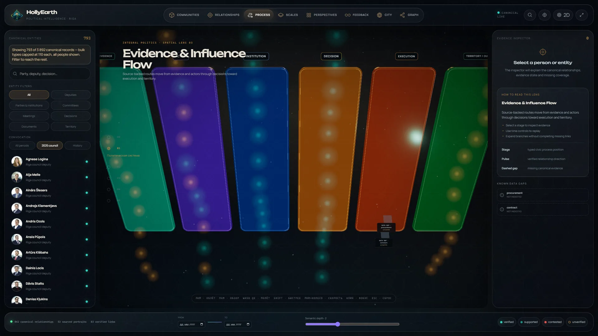</a> Evidence &amp; Influence Flow</td>
</tr>
<tr>
<td width="33%"><a href="../media/gallery/workspace/04-holarchic-observatory.webp">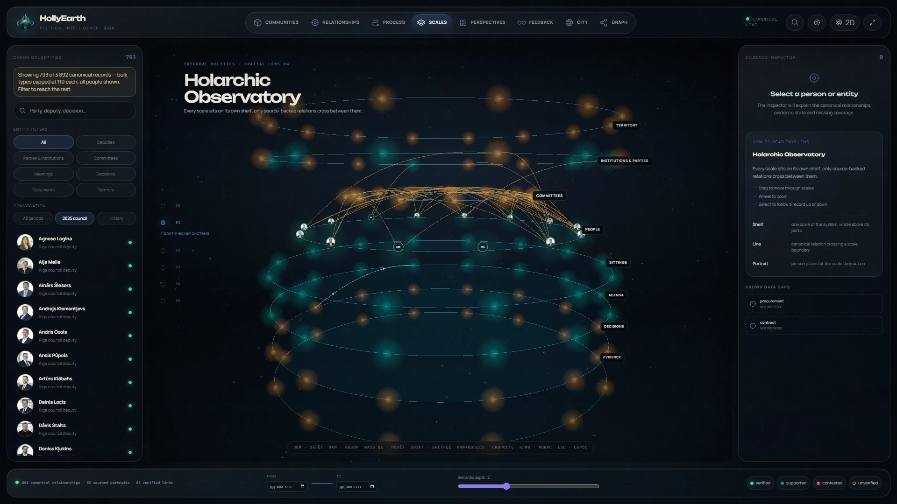</a> Holarchic Observatory</td>
<td width="33%"><a href="../media/gallery/workspace/05-integral-lens-field.webp">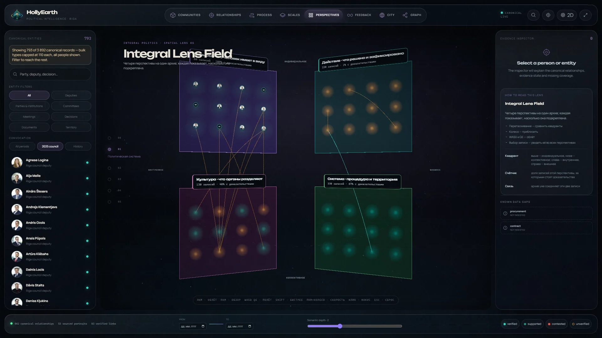</a> Integral Lens Field</td>
<td width="33%"><a href="../media/gallery/workspace/06-living-city-torus.webp">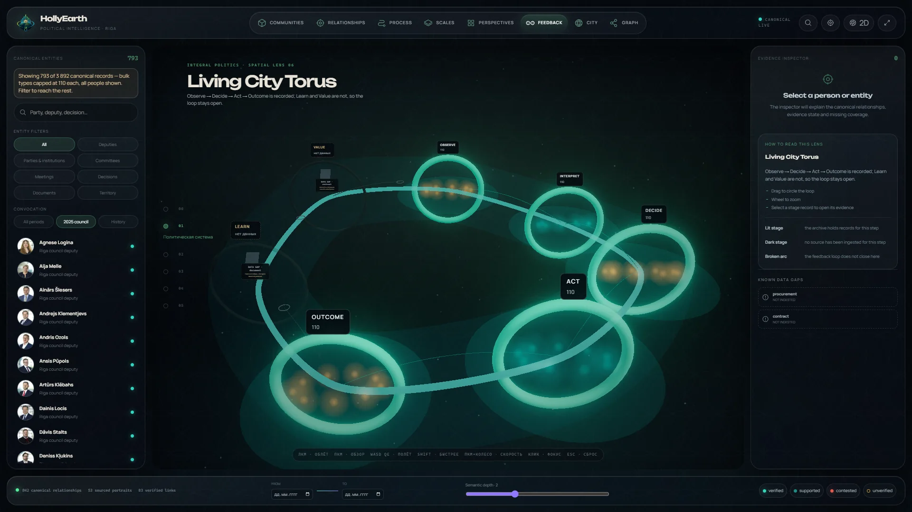</a> Living City Torus</td>
</tr>
</table>

Dati ir īsti un ar avotiem; vairākiem moduļiem ir zināmi trūkumi (budžeta rindas nav importētas, sēžu dati — līdz 2026. gada jūlijam), un virs lielākās daļas moduļu redzams apzīmēts demonstrācijas analīzes projekts. → **[Politikas galerija](gallery/POLITICS.md)** · [politics.md](politics.md)

---

## Sports

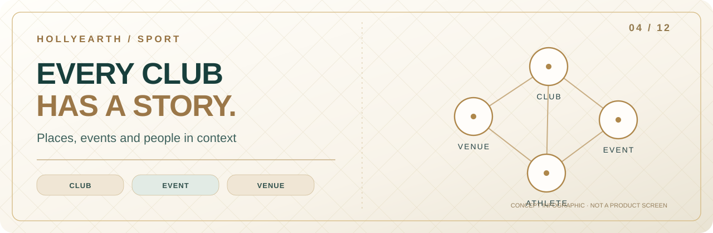

*Oriģināla konceptuāla infografika — vizuāla metafora, nevis produkta ekrānuzņēmums.*

### Aiz vienas rindas sacensību protokolā ir vesela kopiena

Jaunietis sāk trenēties klubā. Pēc vairākiem gadiem oficiālajā protokolā paliek rezultāts, bet kluba, sacensību un sporta kopienas vēsture ir izkaisīta pa arhīviem.

**HollySport palīdz šo pasauli izpētīt.** Publiski dokumentētie klubi, sacensības, vietas un rezultāti kļūst par profiliem, karti un savstarpējām saitēm — ne tikai tabulas rindām.

**Kam tas noderētu:** klubiem, lai parādītu savu vēsturi; rīkotājiem, lai demonstrētu sacensības; interesentiem, lai iepazītu sporta vidi. Spēļu slānis, maks un ekonomika vēl ir **demonstrācijas, prototipi vai nākotnes ieceres**, nevis pieejami komercpakalpojumi.

<a href="../media/storycards/en/sport.svg">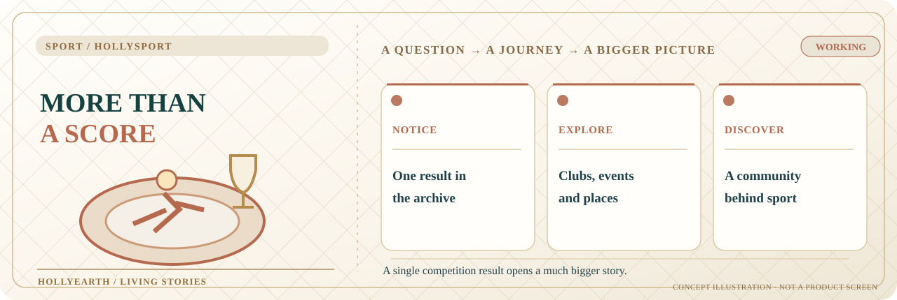</a>

*Vizuāls stāsts — cilvēka jautājums, trīs soļi un ieguvums. Koncepts, nevis ekrānuzņēmums; uzraksti pagaidām angļu valodā.*

<b>🔎 Sporta datu tvērums, profili un gatavība</b>

**Aiz katra rezultāta ir cilvēki un kopiena.** Klubi, norises vietas, sacensības un sportisti kļūst par savstarpēji saistītiem profiliem, kuru pamatā ir publiski arhīvi. Spēles slānis ir `DEMO`, organizatoru rīki vēl ir prototipi.

**HollySport** — **18 143 sportisti · 227 pasākumi · 1 326 cīņas · 8 401 vieta protokolos · 297 klubi un federācijas · 133 norises vietas** pēc federāciju reģistru, oficiālo protokolu un publisko arhīvu datiem; nepilngadīgo rezultāti netiek glabāti. Pases — `WORKING` / `SHOWCASE_READY`; City Game — `DEMO`; Event OS un Creator — `PROTOTYPE`; MetaSport ekonomika — `FUTURE`.

<a href="../media/screenshots/07-hollysport-city.png">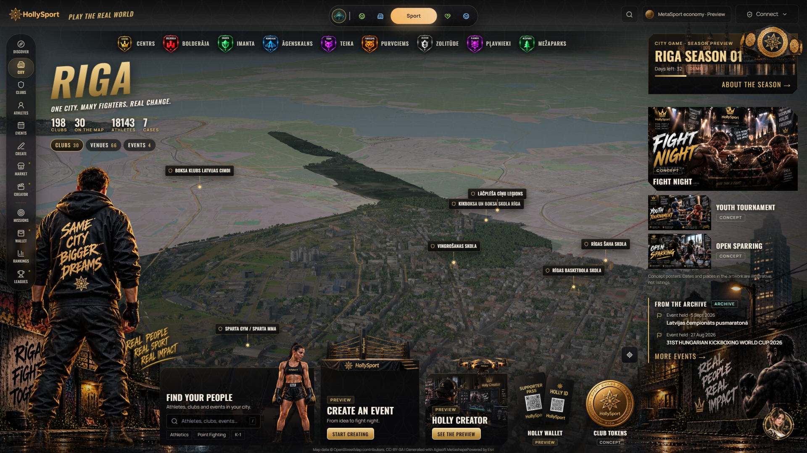</a>

<table>
<tr>
<td width="33%"><a href="../media/screenshots/08-club-passport.png">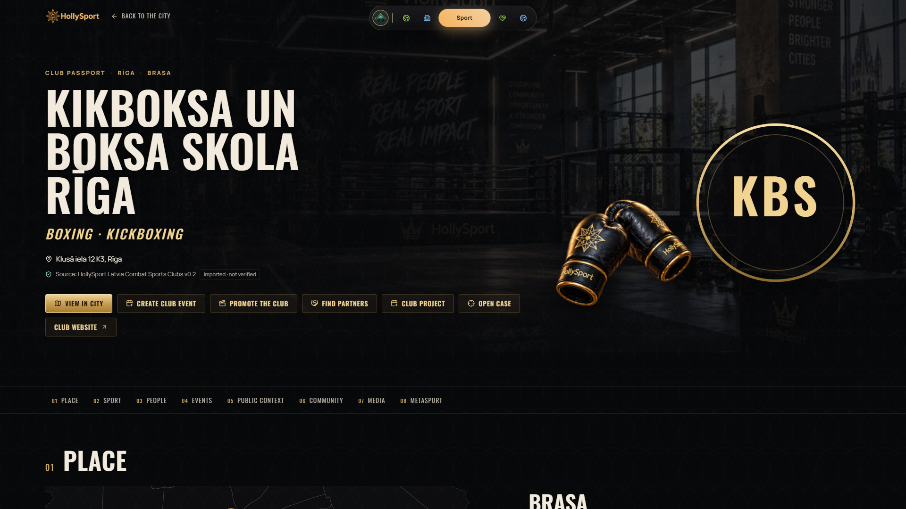</a> Kluba pase</td>
<td width="33%"><a href="../media/gallery/sport/12-athlete-passport.webp">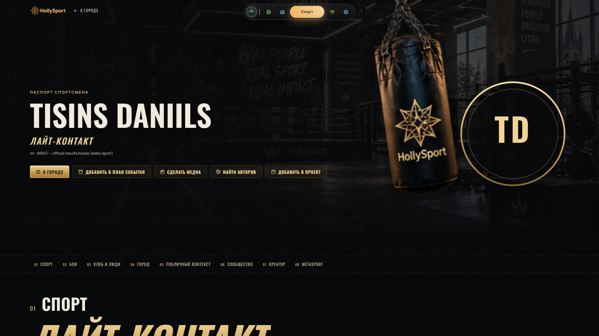</a> Sportista pase</td>
<td width="33%"><a href="../media/gallery/sport/15-event-results.webp">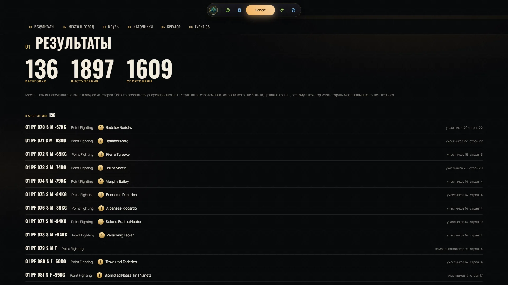</a> Pasākuma rezultāti — tikai pieaugušie</td>
</tr>
<tr>
<td width="33%"><a href="../media/gallery/sport/19-sport-graph.webp">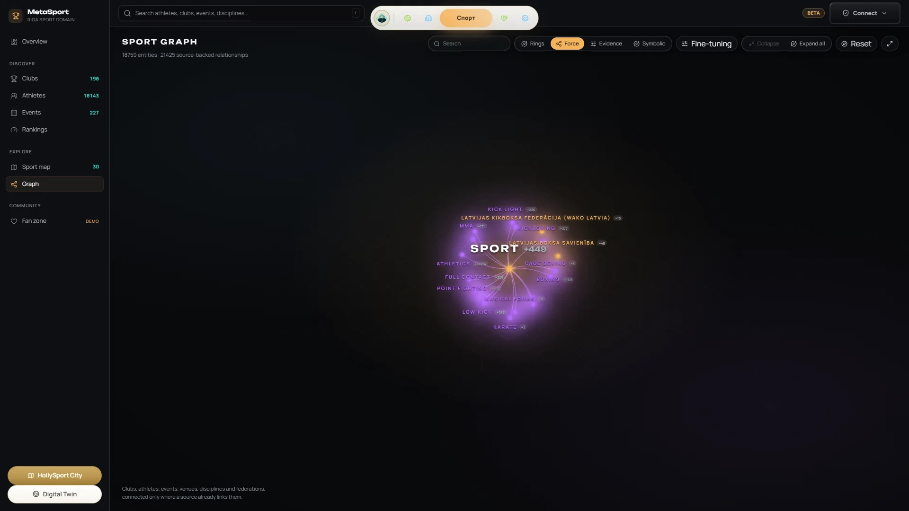</a> Sporta grafs</td>
<td width="33%"><a href="../media/screenshots/16-hollysport-missions-demo.png">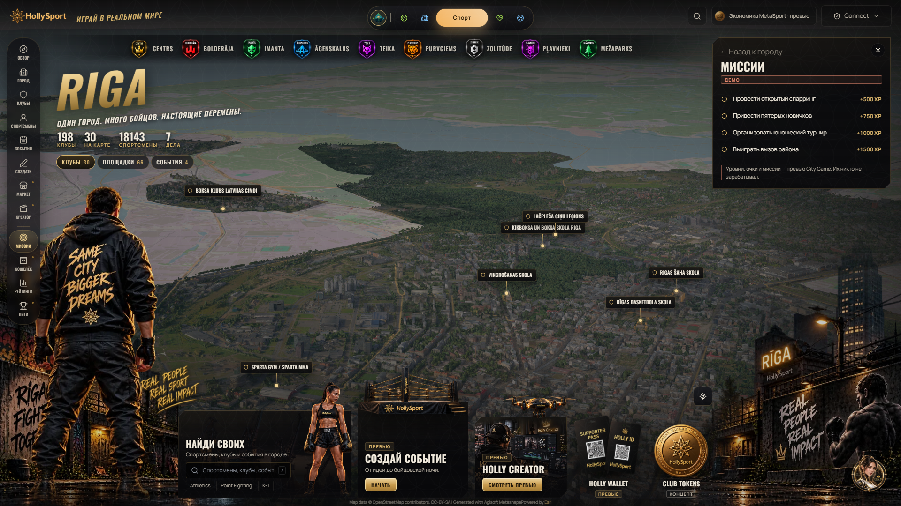</a> Misijas — `DEMO`</td>
<td width="33%"><a href="../media/gallery/sport/25-wallet-preview.webp">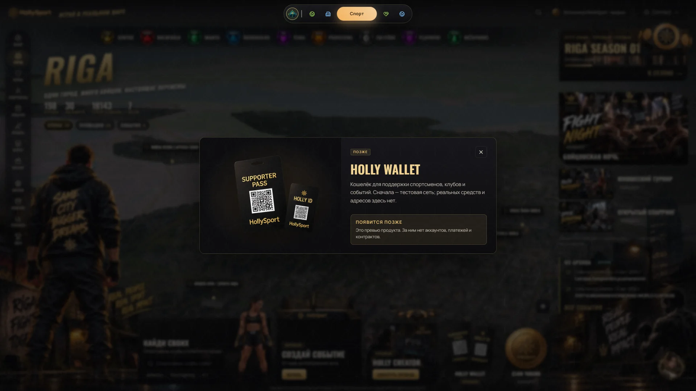</a> Maks — `FUTURE` priekšskatījums</td>
</tr>
</table>

Spēles un ekonomikas slāņi rāda, kurp attīstās platforma; tie nav strādājoši komerciāli pakalpojumi. Event OS ir plānošanas prototips, nevis pasākumu reģistrācijas pakalpojums. → **[HollySport galerija](gallery/HOLLYSPORT.md)** · [sport.md](sport.md)

---

## Sociālā joma

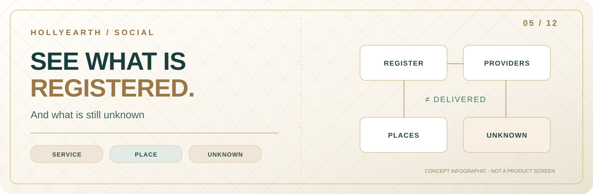

*Oriģināla konceptuāla infografika — vizuāla metafora, nevis produkta ekrānuzņēmums.*

### Palīdzības meklēšanai nepietiek ar adrešu sarakstu

Iedomājieties ģimeni, kas meklē sociālo pakalpojumu. Reģistrā var būt sniedzēja nosaukums, bet **vai pakalpojums konkrētajam cilvēkam šeit un tagad ir pieejams?** Publiskie dati to bieži neatklāj.

**Social Intelligence attēlo reģistrētos pakalpojumus saprotamā pilsētas vidē.** Var apskatīt sniedzējus, adreses, dokumentus un dosjē, redzot gan zināmos faktus, gan **informācijas trūkumus**.

**Vērtība ir arī godīgumā:** reģistrēts nenozīmē saņemts, plānotā kapacitāte nav faktiski sniegts pakalpojums, un nezināmi maksājumi nav nulle. Šī ir pētniecības vide, **nevis ārkārtas palīdzības vai brīvo vietu pārbaudes pakalpojums**.

<a href="../media/storycards/en/social.svg">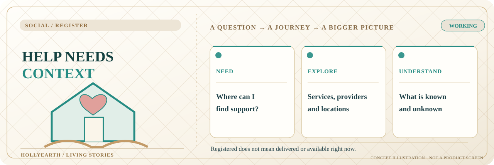</a>

*Vizuāls stāsts — cilvēka jautājums, trīs soļi un ieguvums. Koncepts, nevis ekrānuzņēmums; uzraksti pagaidām angļu valodā.*

<b>🔎 Reģistra tvērums, skaitļi un ierobežojumi</b>

**Reģistrēts pakalpojums vēl nenozīmē saņemtu pakalpojumu.** Izpētiet reģistrētos sniedzējus, to dosjē un to, ko publiskie dati pagaidām neatklāj par pieejamību, maksājumiem un rezultātiem.

**Social Intelligence** — Rīgas sociālie pakalpojumi pēc Labklājības ministrijas oficiālā reģistra (dati uz 2026. gada 14. septembri): **256 pakalpojumi · 106 sniedzēji · 177 ēkas · 28 pakalpojumi dzīvesvietā.** `SHOWCASE_READY`.

<a href="../media/screenshots/10-social-stage.png">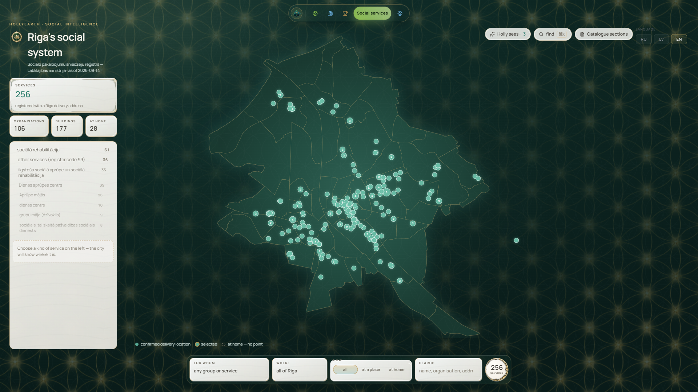</a>

<table>
<tr>
<td width="33%"><a href="../media/screenshots/11-social-dossier.png">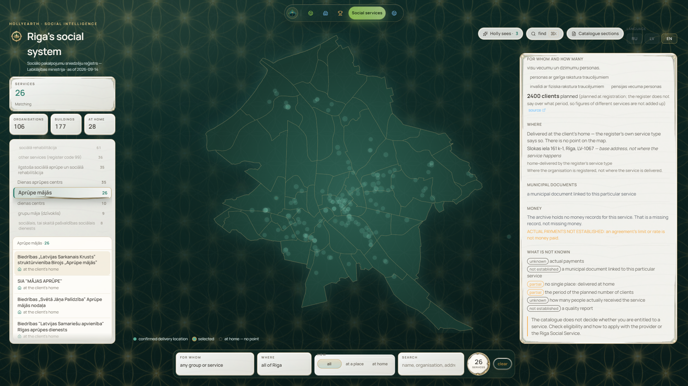</a> Pakalpojuma dosjē — kas nav zināms</td>
<td width="33%"><a href="../media/gallery/social/05-holly-sees.webp">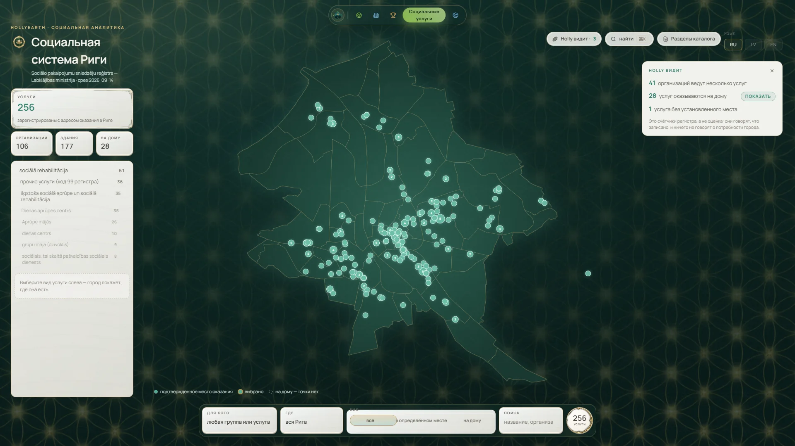</a> „Holly redz” — reģistra skaitītāji, nevis vērtējums</td>
<td width="33%"><a href="../media/gallery/social/06-agreements.webp">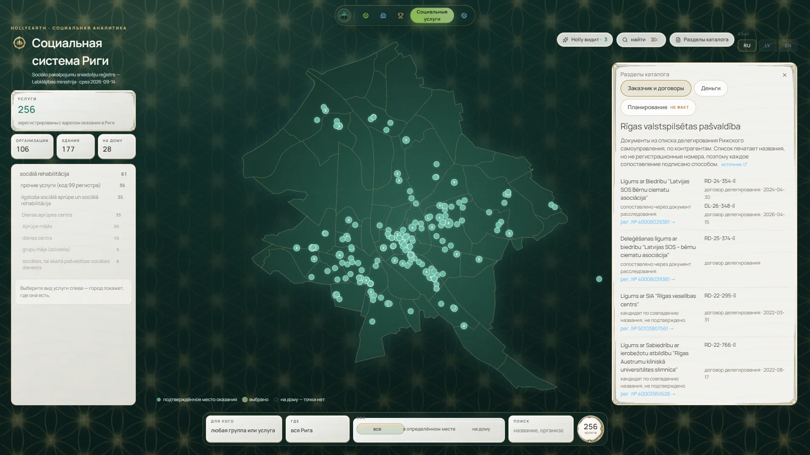</a> Deleģēšanas līgumi</td>
</tr>
</table>

**Reģistrēts ≠ sniegts · nav zināms ≠ nulle.** Pakalpojumu saņēmēju skaits, faktiskie maksājumi un kvalitāte nav zināmi nevienam no 256 pakalpojumiem un ir parādīti kā nezināmi. Sniedzēji vēl nav saistīti ar galveno grafu. → **[Sociālās jomas galerija](gallery/SOCIAL.md)** · [social.md](social.md)

---

## Izmeklēšana

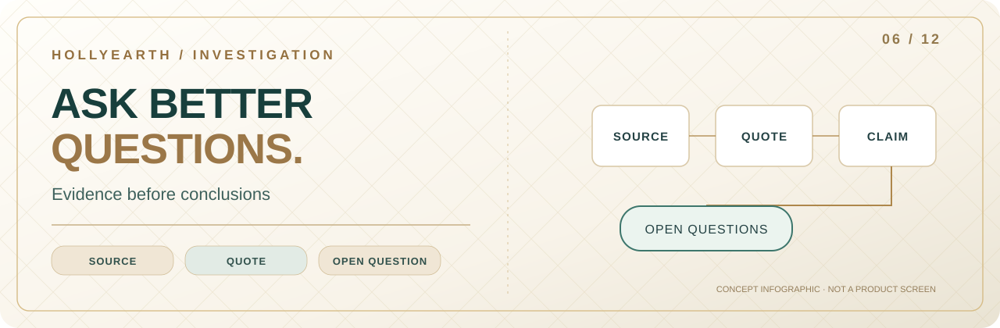

*Oriģināla konceptuāla infografika — vizuāla metafora, nevis produkta ekrānuzņēmums.*

### Miljons eiro dažādos dokumentos var nozīmēt dažādas lietas

Vienā dokumentā minēta **plānotā summa**, citā — **līguma vērtība**, vēl citā — **piešķīrums**. Ja tos vienkārši saskaita, var iegūt iespaidīgu, bet maldinošu skaitli.

**HollyEarth vispirms seko pierādījumiem.** Lietā vienuviet redzami dokumenti, precīzi citāti, apgalvojumi, atšķirīgi naudas veidi un neatbildēti jautājumi. Var izpētīt ne tikai secinājumu, bet arī **to, uz ko tas balstās un kas vēl nav zināms**.

Pētniekiem un žurnālistiem tas palīdz saglabāt kontekstu. Automatizēts apstiprinājums **nav cilvēka veikta pārbaude**.

<a href="../media/storycards/en/investigation.svg">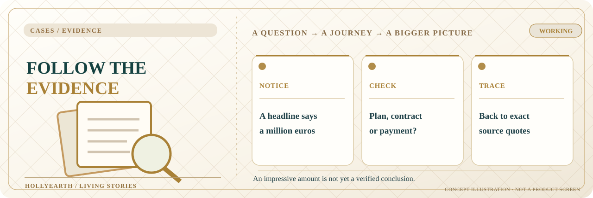</a>

*Vizuāls stāsts — cilvēka jautājums, trīs soļi un ieguvums. Koncepts, nevis ekrānuzņēmums; uzraksti pagaidām angļu valodā.*

<b>🔎 Lietu skaits, pierādījumi un ierobežojumi</b>

**Ne tikai secinājums — arī ceļš līdz tam.** Lieta apvieno citātus, dokumentus, dažādu veidu summas un atklātus jautājumus pārskatāmā pētniecības pieredzē.

Lieta apvieno domes lēmumu, iepirkumu vai organizāciju ar tās avotiem, precīziem citātiem, apgalvojumiem, naudu pa veidiem, atklātiem jautājumiem un izmeklēšanas gaitu. Versijā v0.1.0 ir 9 lietas.

<a href="../media/screenshots/03-case-overview.png">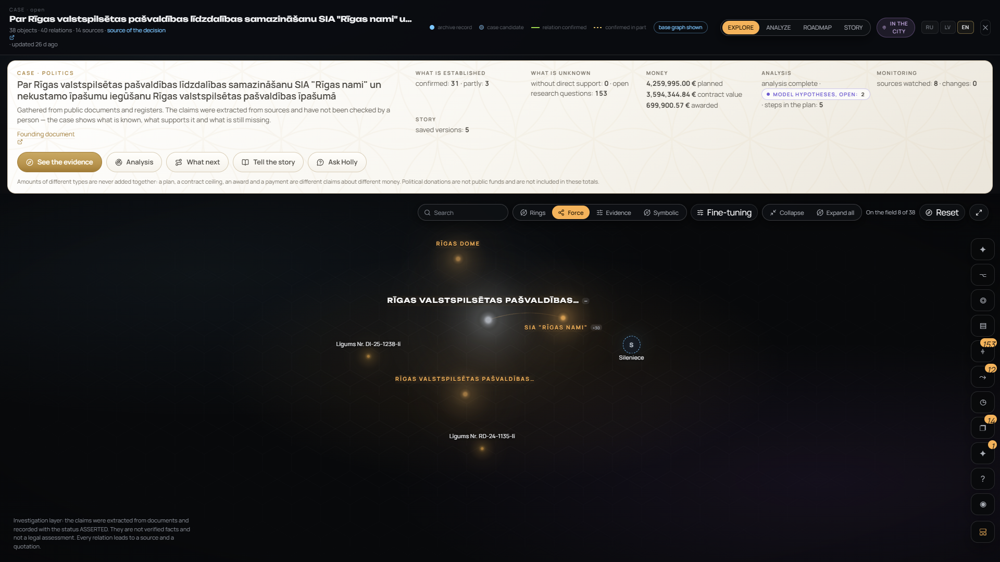</a>

<table>
<tr>
<td width="25%"><a href="../media/gallery/investigation/01-case-gallery.webp">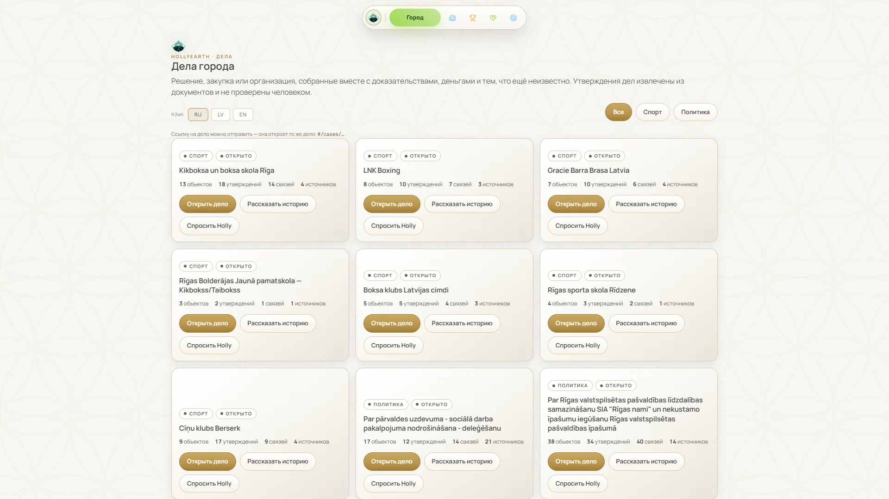</a> Lietu galerija</td>
<td width="25%"><a href="../media/screenshots/04-evidence.png">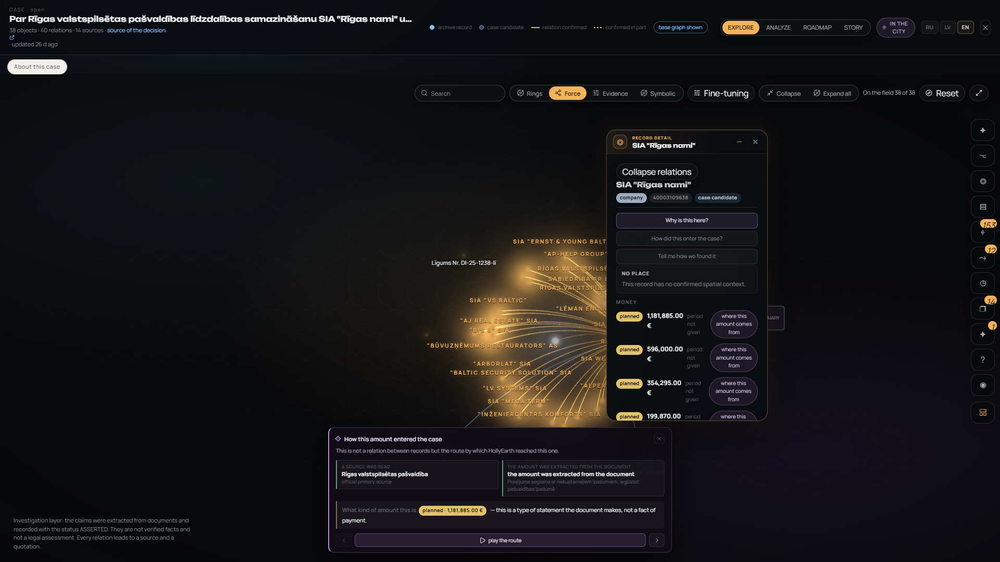</a> No kurienes ir summa</td>
<td width="25%"><a href="../media/screenshots/05-roadmap.png">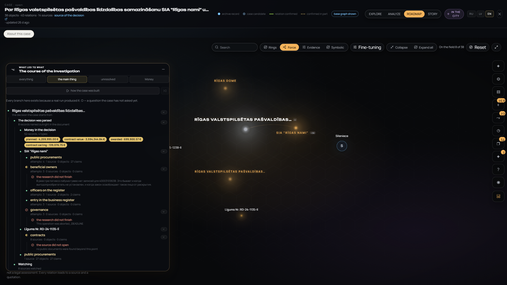</a> Izmeklēšanas gaita</td>
<td width="25%"><a href="../media/gallery/investigation/06-kbs-explore.webp">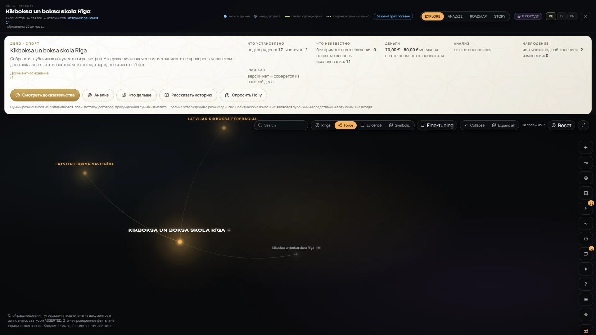</a> Sporta kluba lieta</td>
</tr>
</table>

**Apgalvojums ≠ pārbaudīts fakts.** Visiem 111 lietu apgalvojumiem ir statuss „apgalvots”, katram ir avots un citāts; „apstiprināts” nozīmē „tieši apstiprināts ar citātu”; neviens nav pārbaudīts cilvēka. **Plānots ≠ izmaksāts:** nauda ir sadalīta pa veidiem un nekad netiek saskaitīta starp veidiem; lietās un sociālajā jomā nav ierakstu par maksājumiem. → **[Izmeklēšanas galerija](gallery/INVESTIGATION.md)** · [cases.md](cases.md)

---

## Analītika

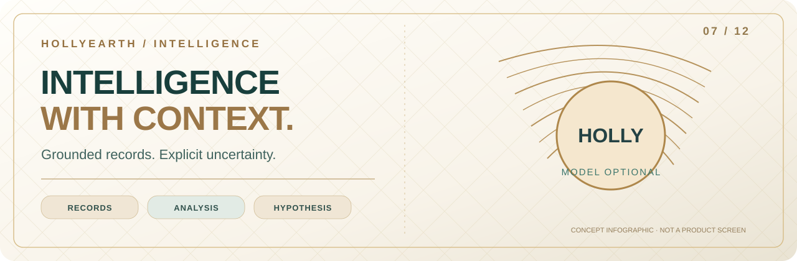

*Oriģināla konceptuāla infografika — vizuāla metafora, nevis produkta ekrānuzņēmums.*

### MI atbilde var skanēt pārliecinoši. Bet vai to var pārbaudīt?

Ja runa ir par publisko naudu, institūcijām vai cilvēkiem, raita atbilde bez avota nav priekšrocība.

**Holly palīdz pētīt, nevis izliekas par viszinošu.** Esošajās lietās tiek izmantoti saglabātie ieraksti un deterministiska analīze; modeļa spriedumi var piedāvāt hipotēzes, bet tās neuzskata par pierādītiem faktiem. Avotu uzraudzība pastāv, taču pārbaudes vēl jāpalaiž manuāli.

**Mērķis:** labāki jautājumi, izsekojams pamatojums un skaidri norādīta nenoteiktība. Universāls autonoms Holly aģents versijā v0.1.0 **vēl nepastāv**.

<a href="../media/storycards/en/intelligence.svg">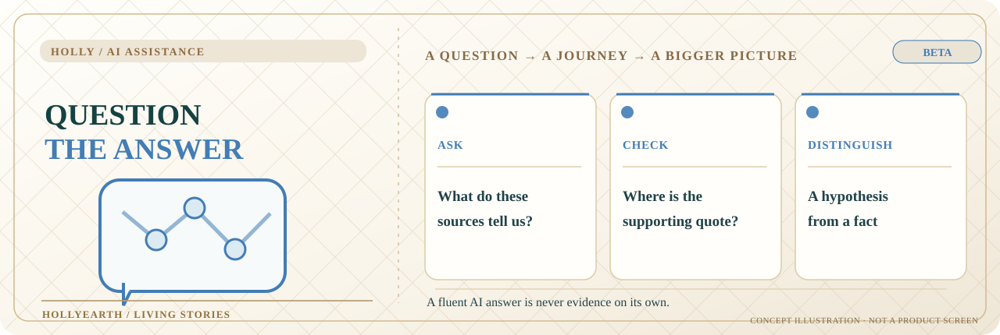</a>

*Vizuāls stāsts — cilvēka jautājums, trīs soļi un ieguvums. Koncepts, nevis ekrānuzņēmums; uzraksti pagaidām angļu valodā.*

<b>🔎 Holly reālās iespējas versijā v0.1.0</b>

**MI jāpalīdz uzdot labākus jautājumus, nevis jārada viszinības iespaids.** HollyEarth apvieno izsekojamus ierakstus, deterministisku analīzi un izvēles modeļu hipotēzes. Versijā v0.1.0 Holly darbojas konkrētas lietas ietvaros, nevis kā universāls autonoms aģents.

HollyEarth darbojas bez valodas modeļa. Holly ir deterministiski palīgi un asistents lietas ietvaros; modeļa spriedumi ir pēc izvēles un vienmēr apzīmēti kā hipotēzes. Uzraudzība seko oficiālajiem lietu avotiem — pārbaudes tiek palaistas manuāli, automātiska grafika vēl nav. Globāla asistenta un autonomu aģentu versijā v0.1.0 nav.

<table>
<tr>
<td width="50%"><a href="../media/gallery/holly/01-analysis-model-hypotheses.webp">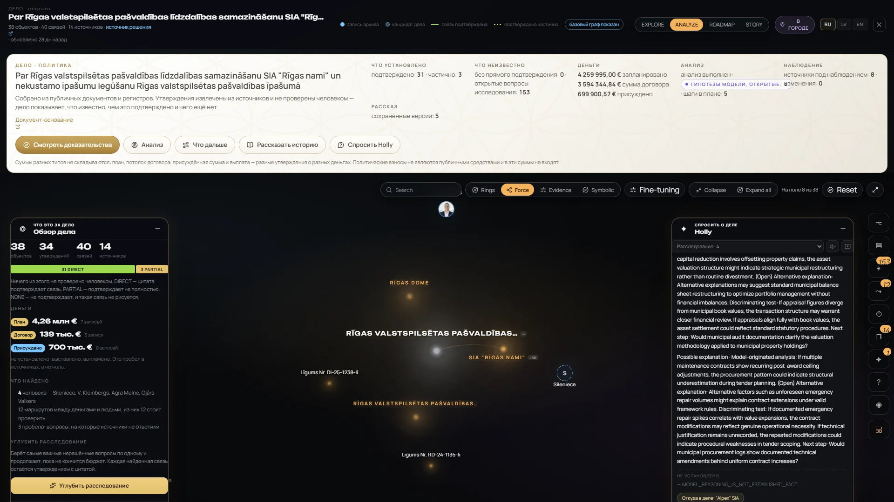</a> Deterministiska analīze blakus <b>modeļa ģenerētām</b> hipotēzēm — `BETA`</td>
<td width="50%"><a href="../media/screenshots/18-monitoring.png">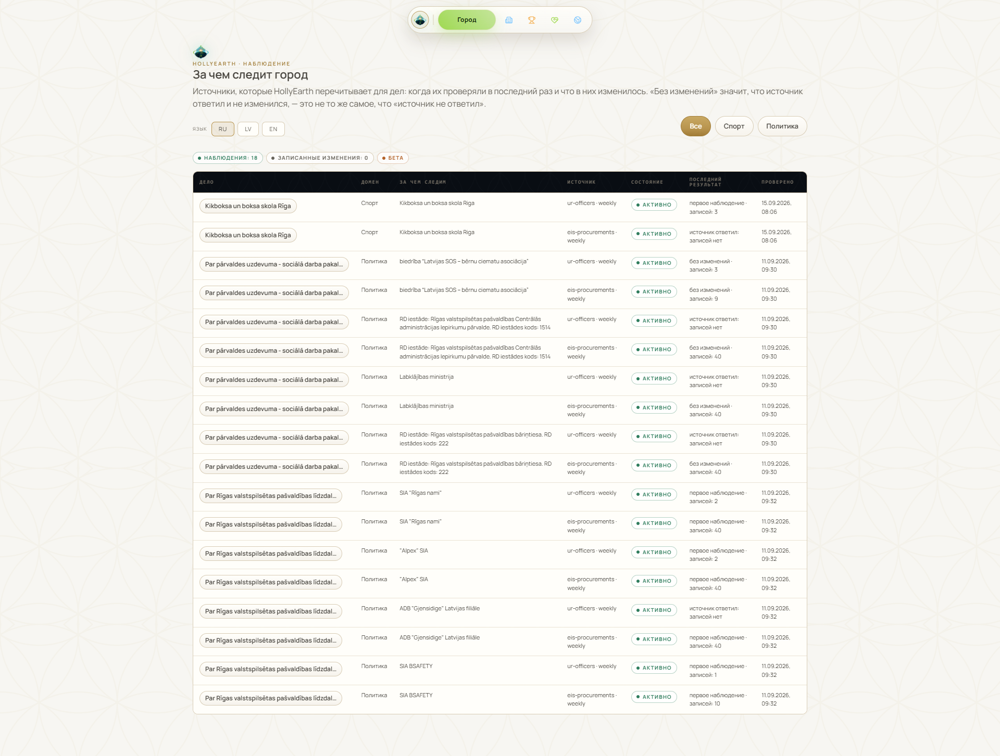</a> Uzraudzība: 18 novērojumi, 26 palaidieni — `BETA`</td>
</tr>
</table>

→ **[Holly AI galerija](gallery/HOLLY_AI.md)** · **[Uzraudzības un Observatory galerija](gallery/MONITORING.md)** · [holly-ai.md](holly-ai.md) · [monitoring.md](monitoring.md)

---

## Pieredze

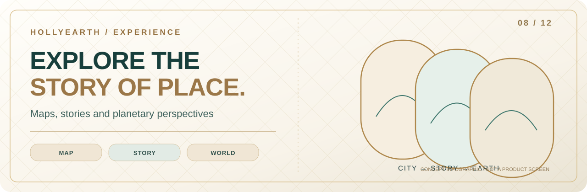

*Oriģināla konceptuāla infografika — vizuāla metafora, nevis produkta ekrānuzņēmums.*

### Informāciju var ne tikai izlasīt — to var arī piedzīvot

Ne visi vēlas lasīt tabulas un dokumentus. Dažiem sarežģīta tēma kļūst saprotama kā **stāsts nodaļās**, citiem — kā vieta kartē.

HollyEarth jau ir **Story**, kas pētnieciskās lietas izstāsta krievu, latviešu un angļu valodā. Ir 3D Rīgas vide, kā arī **Holly Eye** — skats planētas mērogā ar satelītiem, lidojumiem un citiem pasaules datiem, izmantojot skaidri norādītu **trešās puses integrāciju**.

Tās ir vairākas pieredzes ar navigācijas saitēm, **nevis vēl viena pilnībā vienota realitātes sistēma**.

<a href="../media/storycards/en/experience.svg">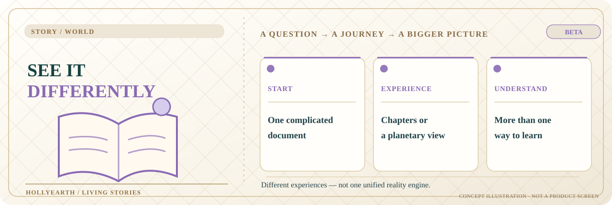</a>

*Vizuāls stāsts — cilvēka jautājums, trīs soļi un ieguvums. Koncepts, nevis ekrānuzņēmums; uzraksti pagaidām angļu valodā.*

<b>🔎 Story, balss, Holly Eye un integrācijas robežas</b>

**Informācija iegūst jēgu, kad to var piedzīvot.** Pārejiet no pilsētas uz dokumentētu lietu un stāstu trīs valodās. Holly Eye piedāvā planētas mērogu kā skaidri norādīta **trešās puses integrācija**.

<table>
<tr>
<td width="33%"><a href="../media/screenshots/06-story.png">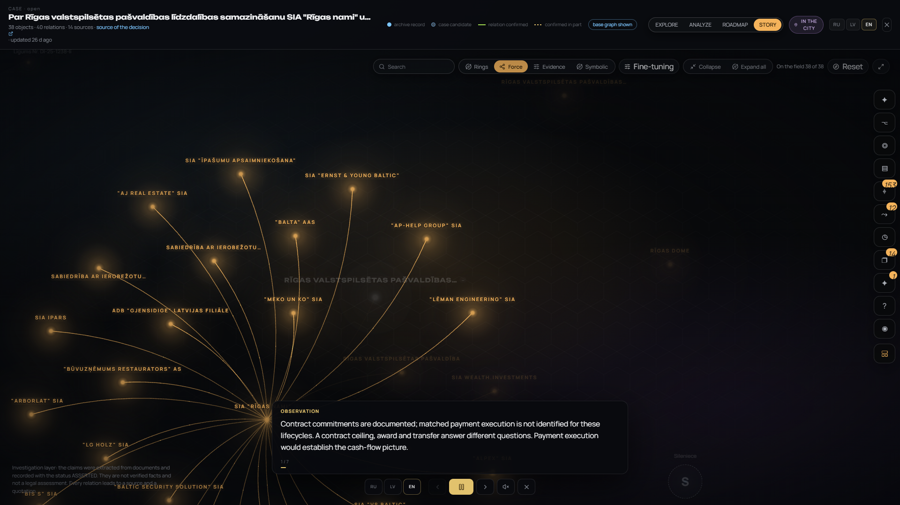</a> <b>Story</b> — lieta, izstāstīta nodaļās RU / LV / EN un salikta no tās ierakstiem. `WORKING`</td>
<td width="33%"><a href="../media/gallery/holly/04-story-versions.webp">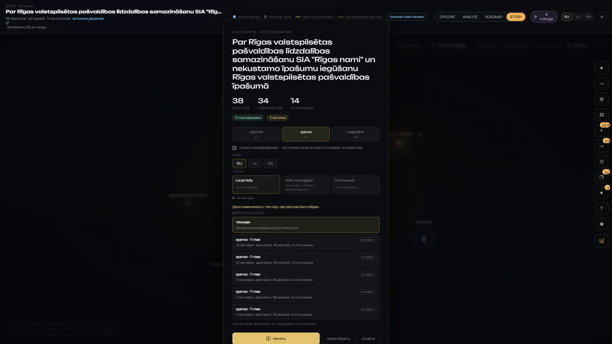</a> <b>Versijas un balsis</b> — lokālā, mākoņa (ar apstiprinājumu) vai pārlūka balss. `BETA`</td>
<td width="33%"><a href="../media/gallery/holly-eye/01-planet-europe-3d.webp">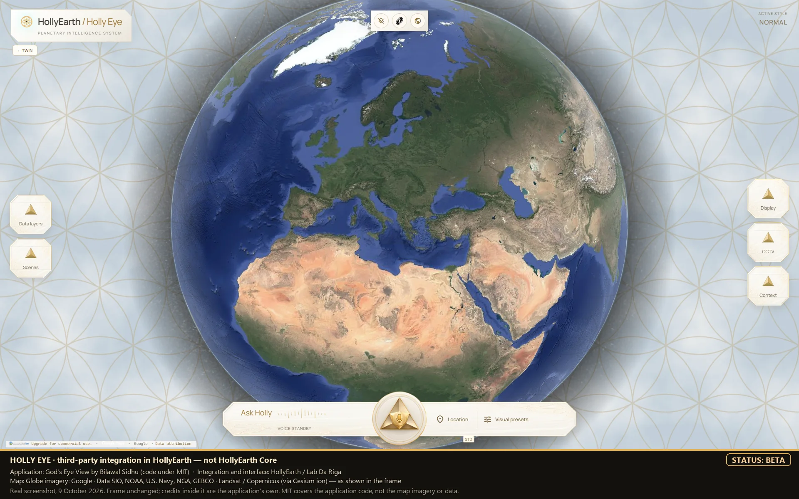</a> <b>Pasaule — Holly Eye</b> — 3D globuss ar dzīviem publiskiem datu slāņiem. <b>Trešās puses integrācija</b> (God's Eye View, autors Bilawal Sidhu), nevis HollyEarth tehnoloģija. `BETA`</td>
</tr>
<tr>
<td width="33%"><a href="../media/gallery/holly-eye/40-satellites.webp">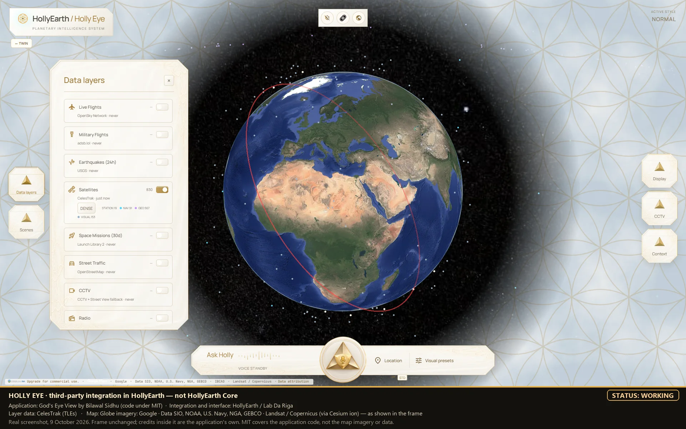</a> Holly Eye — 830 pavadoņi pēc CelesTrak datiem</td>
<td width="33%"><a href="../media/gallery/holly-eye/03-riga-3d-old-town.webp">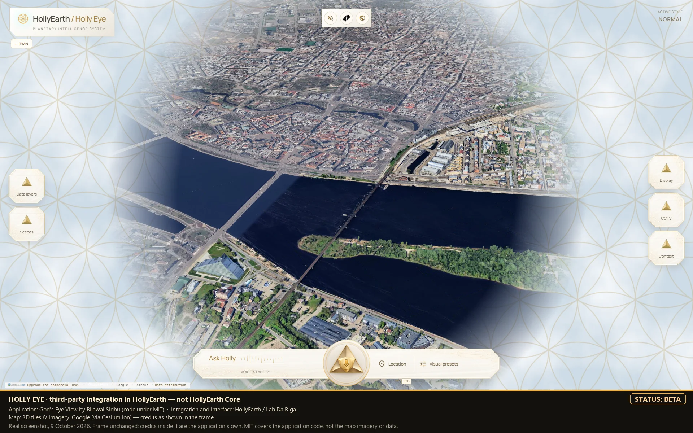</a> Holly Eye — Rīga 3D</td>
<td width="33%"><a href="../media/gallery/holly-eye/21-live-flights.webp">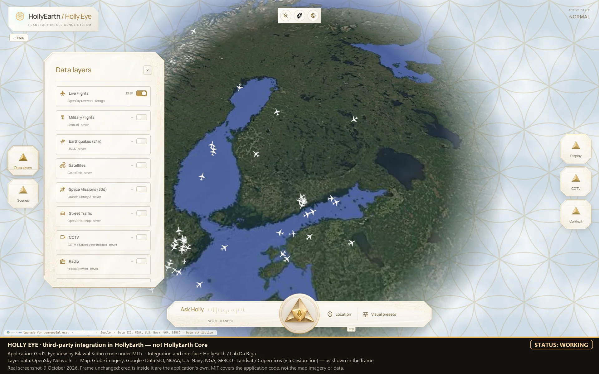</a> Holly Eye — lidojumi reāllaikā</td>
</tr>
<tr>
<td width="33%"> Holly Eye — kuģi pēc AIS datiem</td>
<td width="33%"> Holly Eye — aktīvie ugunsgrēki pēc NASA FIRMS datiem</td>
<td width="33%"><b>Vēl Holly Eye:</b> 14 pasaules datu slāņi — lidojumi, militārie lidojumi, pavadoņi, kosmosa misijas, zemestrīces, ugunsgrēki, kuģi, radio, datu centri, dambji un citi; stili NVG / FLIR / CRT / Anime / Noir / Snow; ainas; balss panelis; pāreja HollyEarth ↔ Holly Eye. → <a href="gallery/HOLLY_EYE.md">46 kadri Holly Eye galerijā</a></td>
</tr>
</table>

Ne katra Story nodaļa vēl ir piesaistīta konkrētiem apgalvojumiem. → [Story](gallery/HOLLY_AI.md#story) · [Holly Eye galerija](gallery/HOLLY_EYE.md) · [Holly Eye mediju izcelsme](../media/HOLLY_EYE_PROVENANCE.md) · [story.md](story.md)

---

## HollyWorlds — Unreal Engine eksperimenti

*Konceptuāla infografika, nevis Unreal Engine ekrānuzņēmums.*

### Ko darīt, ja pa šo pasauli varētu izbraukt?

Iedomājieties Bolderāju ne tikai kartē, bet arī kā nākotnes spēles misijas vidi: tēls pārvietojas pa ielām, pēta vietas un piedalās stāstā.

Divi atsevišķi **Unreal Engine eksperimenti** rāda iespējamo virzienu. **Planetary Sandbox** pēta planētas mēroga vidi ar vadāmu tēlu un transportu. **AGLS / Bolderāja** ir vietējā karte, kurai paredzētas misijas un scenāriji.

Pašlaik tie ir **atsevišķi prototipi**. Gatavas Bolderājas misijas vai funkcionējoša sasaiste ar HollyEarth Core **netiek apgalvota**.

*Vizuāls stāsts — cilvēka jautājums, trīs soļi un ieguvums. Koncepts, nevis ekrānuzņēmums; uzraksti pagaidām angļu valodā.*

<b>🎮 Prototipu faktiskās iespējas un nākamie soļi</b>

**Ne tikai vērot pasauli — ieiet tajā.** HollyWorlds ir atsevišķs eksperimentāls virziens ārpus v0.1.0 tīmekļa platformas. Vienā Unreal Engine prototipā ir planētas mēroga ģeogrāfiska vide, vadāms tēls, braukšanas un šaušanas mehānikas (pēc autoru sniegtās informācijas). Otrs prototips — **AGLS / Bolderāja** — ir vietējā karte, kurai vēl jāizveido misijas un stāsta scenāriji. Tie ir **atsevišķi prototipi**: misijas Bolderājā un sasaiste ar HollyEarth Core vēl nav pabeigtas.

---

## Pētījumi

*Oriģināla konceptuāla infografika — vizuāla metafora, nevis produkta ekrānuzņēmums.*

### Pilsētu nevar saprast tikai no viena skatpunkta

Sporta klubs vienam cilvēkam ir personisks ceļš, citam — kopiena; pētniekam tie ir rezultāti un dokumenti, pilsētai — infrastruktūra un noteikumi.

Mūs iedvesmo **integrālā perspektīva**: **Es — personiskā pieredze; Mēs — kopīgā nozīme; Tas — novērojamie fakti; Sistēmas — institūcijas, vietas un procesi**. Tā palīdz nepārvērst vienu skaitli par visas realitātes mēru.

**HEIO un HEIM ir pētniecības virzieni**, nevis pilnībā īstenotas ontoloģijas vai rīki cilvēku, apkaimju vai politisko uzskatu vērtēšanai.

*Vizuāls stāsts — cilvēka jautājums, trīs soļi un ieguvums. Koncepts, nevis ekrānuzņēmums; uzraksti pagaidām angļu valodā.*

<b>🔎 Īstenotie pamati un HEIO / HEIM pētījumi</b>

**Lielām idejām vajadzīgas precīzas atzīmes.** Jau īstenota ierakstu izcelsmes izsekojamība, epistemiskie statusi, grafa ieraksti un telpiskie skati. HEIO, HEIM un integrālās pieejas ir **pētniecības virzieni**, nevis pilnībā gatavas tehnoloģijas.

Ieviests versijā v0.1.0: epistēmiskais modelis (nav beznosacījuma „fakta”), izcelsme katram ierakstam, kanoniskais grafs un telpiskais attēlojums. HEIO un HEIM ir iekšēji pētniecības dokumenti — **konceptuāla arhitektūra, nevis ieviestas funkcijas**. Integral / AQAL, Spiral Dynamics un Integral City ir pētniecības ietekmes; tās nekad netiek izmantotas cilvēku, partiju vai apkaimju vērtēšanai.

<table>
<tr>
<td width="50%"> <b>Konceptuāla ilustrācija.</b> HEIO — HollyEarth Integral Ontology (v0.1). `RESEARCH`</td>
<td width="50%"> <b>Konceptuāla ilustrācija.</b> HEIM — HollyEarth Integrative Metatheory &amp; Context System (v0.2). `RESEARCH`</td>
</tr>
</table>

→ **[Pētījumu un konceptmākslas galerija](gallery/RESEARCH_CONCEPTS.md)** — arī deviņas konceptuālas ilustrācijas no projekta vēstures, katra apzīmēta kā koncepts / ilustrācija / nav produkta dzīvie dati · [research.md](research.md)

---

## Nākotne

*Oriģināla konceptuāla infografika — vizuāla metafora, nevis produkta ekrānuzņēmums.*

### Ja izpratne par vietu kļūtu par līdzdalību?

Šodien var iepazīt publiskos ierakstus un jaunu pieredžu prototipus. Nākotnē vēlamies vairāk: cilvēkiem būtu iespēja ierosināt uzlabojumus, sadarboties vietējos projektos un redzēt īstus rezultātus.

Tam vajadzīga gan tehnoloģija, gan **ilgtspējīgs ekonomiskais modelis**. Mēs paredzam apvienot īpašumā saglabātu intelektuālo kodolu ar izvēlētiem atvērtā pirmkoda rīkiem un neatkarīgiem kopienas projektiem, lai atvērtība varētu pastāvēt līdzās apmaksātam izstrādes darbam.

Līdzdalības mehānismi, maki un ekonomiskie rīki ir **nākotnes ieceres**, nevis pašlaik pieejami pakalpojumi.

*Vizuāls stāsts — cilvēka jautājums, trīs soļi un ieguvums. Koncepts, nevis ekrānuzņēmums; uzraksti pagaidām angļu valodā.*

<b>🗺️ Ceļvedis pēc statusa: darbojas / izstrādē / pētījumi / nākotne</b>

**Atvērta sadarbība. Ilgtspējīgs intelektuālais kodols.** Iecerētais modelis apvieno īpašumā saglabātu komerciālu kodolu ar izvēlētiem atvērtā pirmkoda kopienas rīkiem un atsevišķiem projektiem. Šajā repozitorijā pagaidām ir **tikai dokumentācija**, nevis kodola pirmkods.

| Ir šodien | Izstrādē | Pētījumi | Nākotne |
|---|---|---|---|
| Riga Twin · lietas, pierādījumi, izmeklēšanas gaita, Story · HollySport dati un pases · Social Intelligence · politikas dati un darba telpa · uzraudzība (manuāla) · RU / LV / EN · pāreja uz Holly Eye (trešās puses integrācija) | Kopēja identitāte starp jomām · sociālā joma galvenajā grafā · naudas semantika (plānots → līgumā noteikts → piešķirts → izmaksāts) · uzraudzība pēc grafika · pārbaude, ko veic cilvēks · Story nodaļas, piesaistītas apgalvojumiem · izmēģinājuma mitināšana · Event OS, Creator un partnerības (prototipi) | HEIO · HEIM · Integral / AQAL · Spiral Dynamics (tikai konteksts) · Integral City | Pārvaldīta rīcība un pārsūdzības · HollyWorlds · MetaSport ekonomika · publiska mitināšana · citas pilsētas |

HollySport spēles slānis paliek `DEMO`, kamēr tas nav balstīts uz reālu mehāniku. → [ROADMAP.md](../ROADMAP.md)

---

## Pašreizējās iespējas

*Oriģināla konceptuāla infografika — vizuāla metafora, nevis produkta ekrānuzņēmums.*

### Skaistai vīzijai vajadzīgi pārbaudāmi rezultāti

Sarežģītam projektam ir viegli runāt tikai par nākotni. Mēs izvēlamies skaidri nošķirt, **kas jau darbojas**, kas vēl ir prototips un kas ir tikai pētnieciska iecere.

Tālāk redzamā tabula palīdz topošajiem partneriem un pētniekiem saprast, **ko var demonstrēt jau tagad un ko vēl būtu iespējams veidot kopā**.

*Vizuāls stāsts — cilvēka jautājums, trīs soļi un ieguvums. Koncepts, nevis ekrānuzņēmums; uzraksti pagaidām angļu valodā.*

<b>🔎 Kā lasīt iespēju matricu</b>

**Redzams gan solījums, gan pierādījums.** Detalizētajā matricā skaidri nošķirtas darbojošās iespējas, beta versijas, demonstrācijas, pētījumi un nākotnes ieceres. Koncepts netiek uzdots par gatavu funkciju.

| Joma | Gatavs demonstrēšanai | Darbojas | Beta / prototips | Demo / pētījumi / nākotne |
|---|---|---|---|---|
| Kodols | — | Izcelsme · nauda pa veidiem · apgalvojumi ar statusu · telpiskie slāņi · RU / LV / EN | Saites starp jomām (daļēji) | Vienots realitātes grafs (`FUTURE`) |
| Pilsēta | — | 3D Twin · lēmumu, sporta un sociālo pakalpojumu slāņi | Pētniecības režīms · AQAL (`PROTOTYPE`) | Wellbeing vērtējumi (`DEMO`) |
| Politika | — | Network · Deputies · Parties & Power | Political OS · sēdes · lēmumi · budžets · Evidence Ledger · darba telpa | District Impact · Smart City Lenses (`DEMO`) · Integral City (`RESEARCH`) |
| Sports | Kluba pase · pasākuma pase | Sport City · arhīvs · pases · karte · grafs | Reitingi · Event OS · Creator · partnerības | Spēles slānis (`DEMO`) · ekonomika (`FUTURE`) |
| Sociālā joma | Skatuve · pakalpojuma dosjē | Katalogs · karte · organizācijas dosjē · līgumi | Nauda · plānošana | Vajadzības, rezultāti, maksājumi (`RESEARCH`) |
| Izmeklēšana | Lietu galerija · pierādījuma ceļš | Lietas darba telpa · izmeklēšanas gaita · analīze · Story | Holly · pētniecības palaidieni · balss · uzraudzība | Cilvēka pārbaudes process (`FUTURE`) |

Pilna matrica: **[FEATURE_STATUS.md](FEATURE_STATUS.md)** · [CAPABILITIES.md](../CAPABILITIES.md) · [MODULES.md](../MODULES.md)

## Arhitektūra un datu principi

**Katram ierakstam ir izcelsme** · **apgalvojums ≠ pārbaudīts fakts** („verified” datos nekad nenozīmē cilvēka pārbaudi, ja tas nav tieši pateikts) · **nav ieraksta ≠ nav realitātes** · **nav zināms ≠ nulle** · **plānots ≠ izmaksāts** · **reģistrēts ≠ sniegts** · **modeļa rezultāts ≠ pierādījums** · **nepilngadīgo sacensību rezultāti netiek glabāti** · **demonstrācijas dati apzīmēti DEMO**. → [ARCHITECTURE.md](../ARCHITECTURE.md) · [DATA_PRINCIPLES.md](../DATA_PRINCIPLES.md) · [DATA_SOURCES.md](../DATA_SOURCES.md)

Visi publicētie attēli ar parakstiem, statusiem un atsaucēm uz avotiem: [media/README.md](../media/README.md).

---

## Autori / Lab Da Riga

**HollyEarth** veido **Stanislav Petrovsky** un **Irina Petrovskaya**, Rīga, Latvija.

© 2026 Lab Da Riga. Visas tiesības aizsargātas.

Repozitorijā ir tikai dokumentācija un mediji. Tas **nav atvērtā koda projekts**, un pirmkoda šeit nav — sk. [LICENSE.md](../LICENSE.md) un [NOTICE.md](../NOTICE.md). Trešo pušu kartes, dati un komponenti paliek to īpašnieku noteikumos.

## Kontakti un jaunumi

**Mūsu princips:** rādām paveikto, godīgi atzīmējam eksperimentus un aicinām partnerus veidot nākamo posmu kopā.

- **Sekot projektam** — sekojiet šim repozitorijam un [HollyEarth organizācijai](https://github.com/HollyEarth), lai saņemtu laidienus un dokumentācijas atjauninājumus.
- **Video** — dibinātāju video (kāpēc veidojam HollyEarth, ko tas spēj šodien, kurp tas virzās tālāk) tiek gatavoti.
- **Kontakti** — oficiālos saziņas kanālus publicēs HollyEarth / Lab Da Riga. Drošības un personas datu jautājumi: sk. [SECURITY.md](../SECURITY.md).

Laidienu vēsture: [CHANGELOG.md](../CHANGELOG.md).
