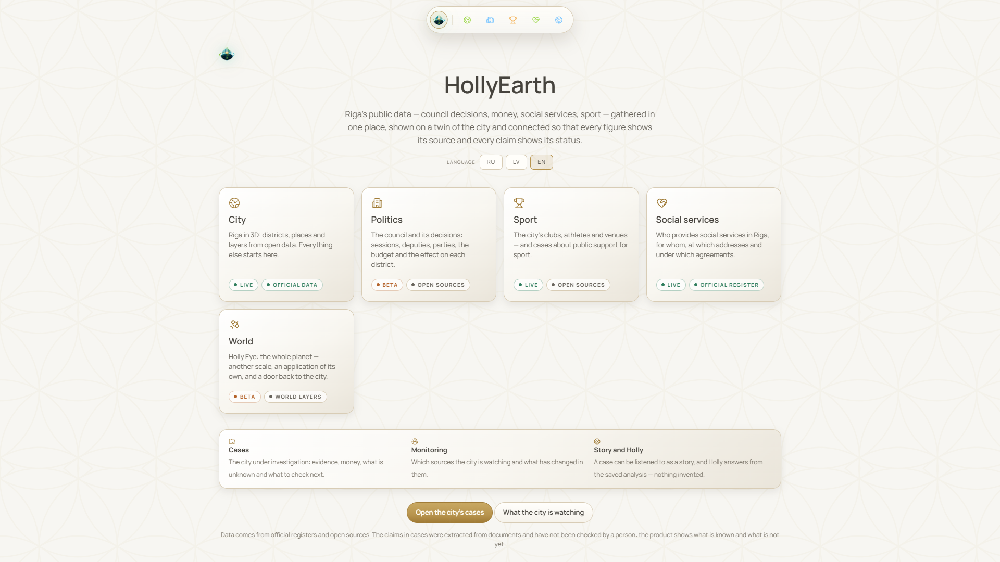
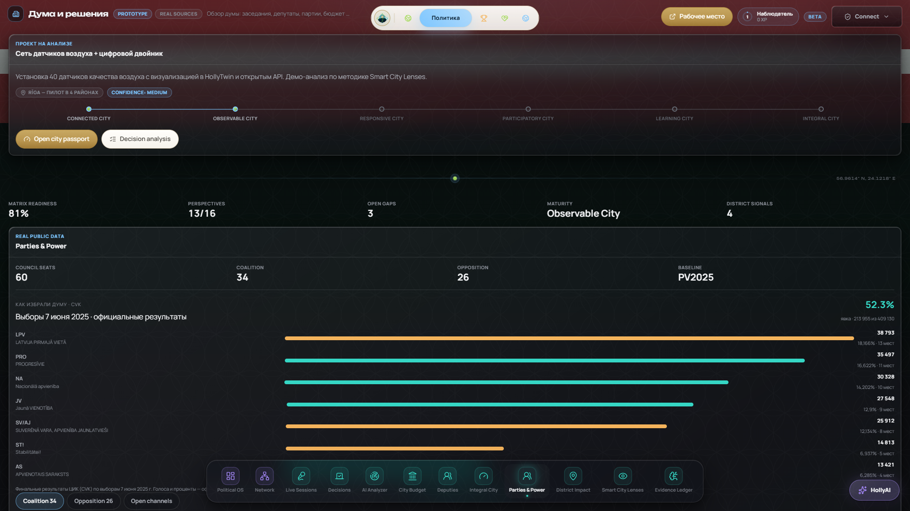

# HOLLYEARTH

### ОДНА СИСТЕМА. МНОГО МИРОВ.

**Город · Политика · Спорт · Социальная сфера · Расследования · Аналитика · Опыт**

Реальные места, публичные записи, источники, доказательства и открытые вопросы — как одна система. Начинаем с Риги.

`v0.1.0` · только документация и медиа · не open source

[English](../README.md) · **Русский** · [Latviešu](README_LV.md)

Настоящий скриншот v0.1.0. Стартовый экран: пять направлений, у каждого — метка зрелости и происхождения данных.

## Что такое HollyEarth

HollyEarth — AI-native платформа пространственной, городской и исследовательской аналитики. Она собирает вместе город, его учреждения и организации, политические решения, публичные деньги, социальные услуги, спорт, документы, источники и доказательства — и позволяет исследовать их на карте, как граф, как расследование или как рассказ.

Направление — одна цепочка:

**Реальность → Доказательства → Аналитика → Опыт → Действие**

«Действие» — это **будущее**: в v0.1.0 система ничего не записывает обратно в мир.

> **Видение и сегодняшний день разделены.**
> Цель — одна связанная модель города: одно место, одна организация, одно решение — со всех сторон.
> **Сегодня HollyEarth — один продукт над несколькими связанными моделями данных, а не единый граф реальности.** Политика и спорт лежат в одном каноническом графе, но пока не связаны между собой; у реестра социальных услуг своя модель; у каждого расследования — свой граф доказательств; 3D-двойник Риги показывает несколько моделей на одной карте. Связи между ними настоящие, но частичные.

## Миры HollyEarth

| Мир | Что это | Статус |
|---|---|---|
| **Город — Riga Twin** | Рига в 3D: районы, решения думы, спорт, социальные здания | `WORKING` |
| **Политика** | Рижская дума: заседания, решения, депутаты, партии, выборы, бюджет | `BETA` |
| **Спорт — HollySport** | Клубы, спортсмены, события и площадки Латвии из федераций и протоколов | `WORKING`, игровой слой `DEMO` |
| **Social Intelligence** | Зарегистрированные социальные услуги Риги на интерактивной карте | `SHOWCASE_READY` |
| **Расследования** | Дела: утверждения, источники, цитаты, деньги по типам, открытые вопросы | `WORKING` |
| **Аналитика** | Детерминированный анализ, Holly, наблюдение за источниками, модель — по желанию | `BETA` |
| **Опыт** | Story на трёх языках, паспорта, досье, дверь в Holly Eye | `WORKING` |

Подробная матрица статусов (на английском): [FEATURE_STATUS.md](FEATURE_STATUS.md).

## Riga Twin

> Скриншоты 3D-города появятся после подтверждения условий использования 3D-модели Риги.

3D-Рига: 58 районов из открытых данных, 428 решений думы с адресом, 14 спортивных территорий, 177 зданий социальных услуг, новости районов, панель думы и переходы во все остальные миры.
**Пока нет:** общей пространственной идентичности (спорт и социальная сфера открывают свои карты), дел на карте, работающего режима «спросить город». Оценки «Wellbeing» — `DEMO`, не измерения.

## Политика

175 заседаний, 456 решений, 113 депутатов, 7 партий, официальные итоги выборов 2025 года (60 мест). **Political Holly OS** — 12 модулей: часть работает на реальных данных (Network, Deputies, Parties & Power), часть в бете (Political OS, Live Sessions, Decisions, City Budget, Evidence Ledger), AI Analyzer — прототип, District Impact и Smart City Lenses — `DEMO`, Integral City — исследование. **Political Workspace** — внутренний исследовательский инструмент с 8 видами, `PROTOTYPE`.
Модуль City Budget читает отдельный открытый набор данных о муниципальных расходах; как его записи соотносятся с конкретными платежами — ещё устанавливается.

## HollySport

<table>
<tr>
<td width="50%"> Паспорт события по официальным протоколам: «место не записано» сказано прямо.</td>
<td width="50%"> Паспорт клуба: спорт, место, источник и вход в дело клуба.</td>
</tr>
</table>

18 143 спортсмена, 227 событий, 1 326 боёв, 297 клубов и федераций, 133 площадки. Работают Sport City, архив, паспорта клубов, спортсменов, событий и площадок, карта, граф; рейтинг посчитан по архиву боёв и прямо помечен «не рейтинг федерации». Результаты всех, кому на день соревнования могло быть меньше 18, не хранятся.
`DEMO` — сезон, миссии, XP, прогнозы. `PROTOTYPE` — Event OS (план события хранится только в браузере, это не сервис регистрации мероприятий), Creator, партнёрства. `FUTURE` — маркет, кошелёк, лиги, токены, билеты.

## Social Intelligence

<table>
<tr>
<td width="50%"> Социальная система Риги по официальному регистру.</td>
<td width="50%"> Досье услуги: «что неизвестно».</td>
</tr>
</table>

Регистр поставщиков социальных услуг Министерства благосостояния (срез 14.09.2026): **256 услуг · 106 поставщиков · 177 зданий · 28 услуг на дому**. Каталог, карта, фильтры, досье услуги и организации, договоры делегирования, деньги, планирование («не факт»).
**Зарегистрировано ≠ оказано.** Сколько людей реально получили помощь, сколько реально выплачено и каково качество — неизвестно для всех 256 услуг, и система говорит об этом прямо. Поставщики пока не связаны с основным графом.

## Расследования и доказательства

<table>
<tr>
<td width="50%"> Решение думы как дело: что установлено, что неизвестно, деньги по типам.</td>
<td width="50%"> Откуда эта сумма: источник, цитата и тип суммы — план, а не выплата.</td>
</tr>
</table>

9 дел (7 о спортивных клубах, 2 о решениях думы). Утверждения, источники, точные цитаты, граф дела, деньги по типам, открытые вопросы, roadmap, анализ, Story, наблюдение, Holly.
**Утверждение ≠ проверенный факт.** Все 111 утверждений имеют статус «заявлено»; у каждого есть цитата и источник; 106 прямо подтверждены цитатой, 4 частично, 1 нет. **Человеком не проверено ни одно.** «Подтверждено» в интерфейсе значит «прямо подтверждено цитатой».
**Деньги по типам** никогда не складываются. В делах и в социальной сфере нет записей о фактических платежах; отсутствие записи — не отсутствие денег.

## Holly AI, Story и мониторинг

- **Holly** — детерминированные помощники, ассистент внутри дела, модель — только по желанию. Модель не может писать в канонический граф и ставить «проверено». Глобального Holly и автономных агентов в v0.1.0 нет.
- **Story** — рассказ дела на русском, латышском и английском, собранный из записей дела. Не каждая глава пока привязана к конкретным утверждениям.
- **Мониторинг** — 18 наблюдений за официальными источниками, 26 запусков. Проверки запускаются вручную; автоматического расписания нет.

## Holly Eye

Дверь «Мир» открывает Holly Eye — планетарный 3D-вид. Это **стороннее приложение** God's Eye View (автор — Bilawal Sidhu), интегрированное в HollyEarth, а **не собственная технология HollyEarth**.

## Исследования

HEIO (HollyEarth Integral Ontology, v0.1) и HEIM (HollyEarth Integrative Metatheory & Context System, v0.2) — внутренние исследовательские документы, **концептуальная архитектура, а не реализованные функции**. AQAL, Spiral Dynamics и Integral City — исследовательские влияния; они никогда не используются для оценки людей, партий или районов. Подробнее: [research.md](research.md).

## Что дальше

| Есть сегодня | В разработке | Исследование | Будущее |
|---|---|---|---|
| Riga Twin · дела и доказательства · HollySport · Social Intelligence · данные политики · мониторинг вручную · RU / LV / EN | Общая идентичность между доменами · социальная сфера в основном графе · семантика денег (план → договор → присуждено → выплачено) · расписание мониторинга · проверка человеком · пилотный хостинг | HEIO · HEIM · Integral / AQAL · Spiral Dynamics (только контекст) · Integral City | Управляемые действия и обжалования · HollyWorlds · экономика MetaSport · публичный хостинг · другие города |

## Авторы

**HollyEarth** создают **Stanislav Petrovsky** и **Irina Petrovskaya**, Рига, Латвия.

© 2026 Lab Da Riga. Все права защищены. Репозиторий содержит только документацию и медиа и не является open source — см. [LICENSE.md](../LICENSE.md).
