# HollySport — gallery

[← Visual Atlas](../GALLERY.md) · Feature status: [HollySport](../FEATURE_STATUS.md#hollysport) · Overview: [sport.md](../sport.md)

Latvian sport from official sources — **18,143 athletes · 227 events · 1,326 bouts · 8,401 placings · 297 clubs and federations · 133 venues** — turned into a game-styled sport city with passports for clubs, athletes, events and venues. Competition results of anyone who may have been under 18 are not stored. Real screenshots of v0.1.0 (Russian and English interface). Click an image to open it full size.

Every section is labelled: `WORKING` real data · `DEMO` invented content · `PROTOTYPE` / `PREVIEW` exists but not in real use · `FUTURE` preview of what is planned. **DEMO and PREVIEW screens show where the platform is going; they are not working commercial services.** Posters, fighter figures and "atmosphere" backgrounds are product illustrations, not photographs of real events, clubs or people.

**Contents** — [Sport City](#hollysport-city) · [Clubs](#clubs-and-club-passport) · [Athletes](#athletes-and-athlete-passport) · [Events](#events-and-event-passport) · [Venues](#venues-and-venue-passport) · [Archive, rankings, graph, map](#archive-rankings-graph-and-map) · [City Game](#city-game--missions--season) · [Event OS and Creator](#event-os-and-creator) · [Business and partnerships](#business-and-partnerships) · [MetaSport economy](#metasport-economy) · [Sport → investigation](#sport--investigation)

---

## HollySport City

`WORKING` real layer + `DEMO` game layer

The entry to sport: real counts (198 clubs and schools, 30 on the map, 18,143 athletes, 7 cases), real clubs and venues on the 3D city, real archive events — with a game layer on top (season, missions, district levels, posters) that is a labelled `DEMO` / `CONCEPT`.

<table>
<tr>
<td width="33%"><a href="../../media/gallery/sport/01-city-clubs-panel.webp">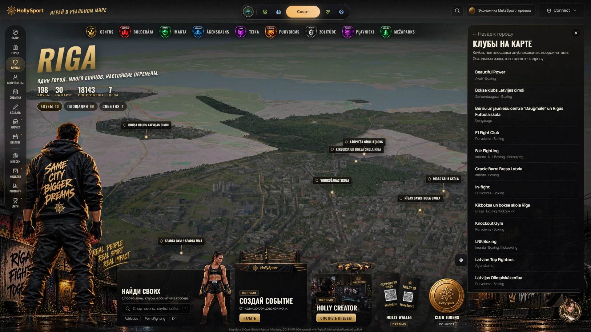</a> Clubs panel — clubs located in Riga by neighbourhood and discipline. `WORKING`</td>
<td width="33%"><a href="../../media/gallery/sport/02-city-athletes-panel.webp">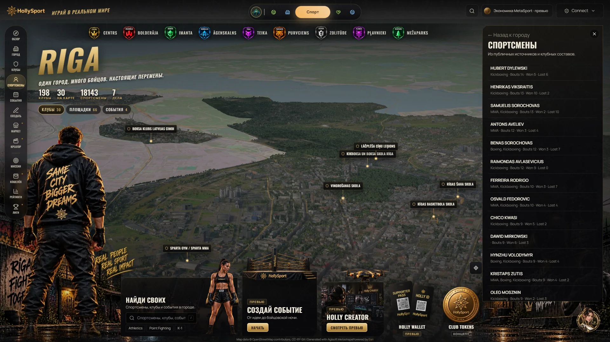</a> Athletes panel — adult fighters from the event archive. `WORKING`</td>
<td width="33%"><a href="../../media/gallery/sport/03-city-events-panel.webp">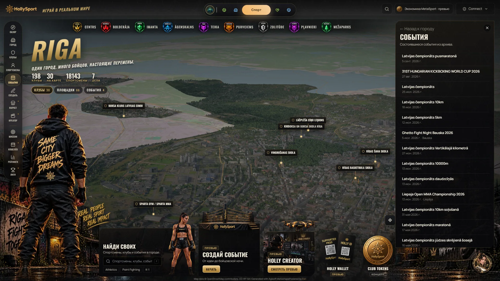</a> Events panel — archived events; some are international, not Riga-only. `WORKING`</td>
</tr>
<tr>
<td width="33%"><a href="../../media/gallery/sport/04-city-club-card.webp">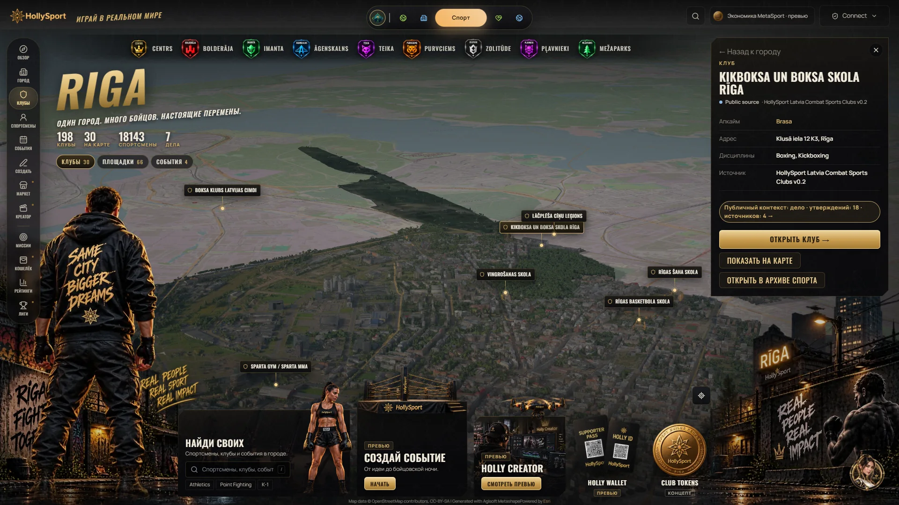</a> Club card in the city — address, disciplines, source, public context and "open club". `WORKING`</td>
<td width="33%"><a href="../../media/gallery/sport/05-city-venues-layer.webp">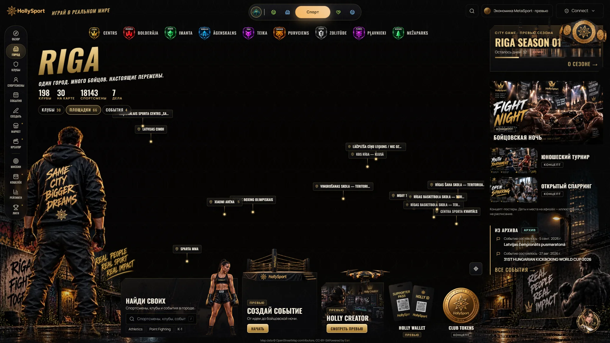</a> Venues layer — 66 venues located in Riga (the base map did not render in this capture). `WORKING`</td>
<td width="33%"><a href="../../media/gallery/sport/07-archive-clubs.webp">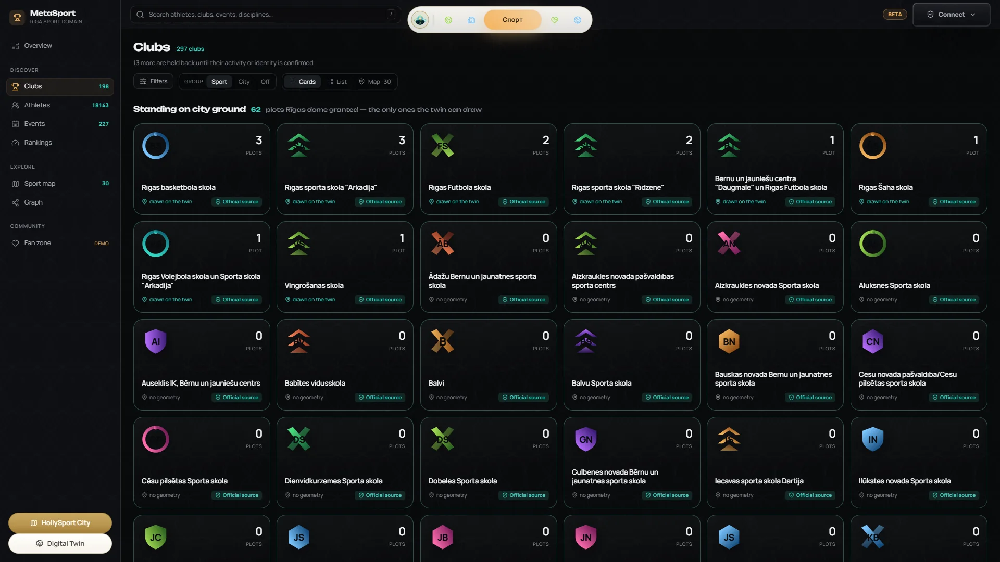</a> Clubs archive — 297 clubs and federations, cards / list / map. `WORKING`</td>
</tr>
</table>

## Clubs and club passport

`SHOWCASE_READY` — eight chapters: place, sport, people, events, public context, community, media, MetaSport.

<table>
<tr>
<td width="50%"> Club passport — sport, place, source, and the door into the club's case.</td>
<td width="50%"> What a family pays — "a price, not income".</td>
</tr>
<tr>
<td width="50%"><a href="../../media/gallery/sport/08-club-events-public-context.webp">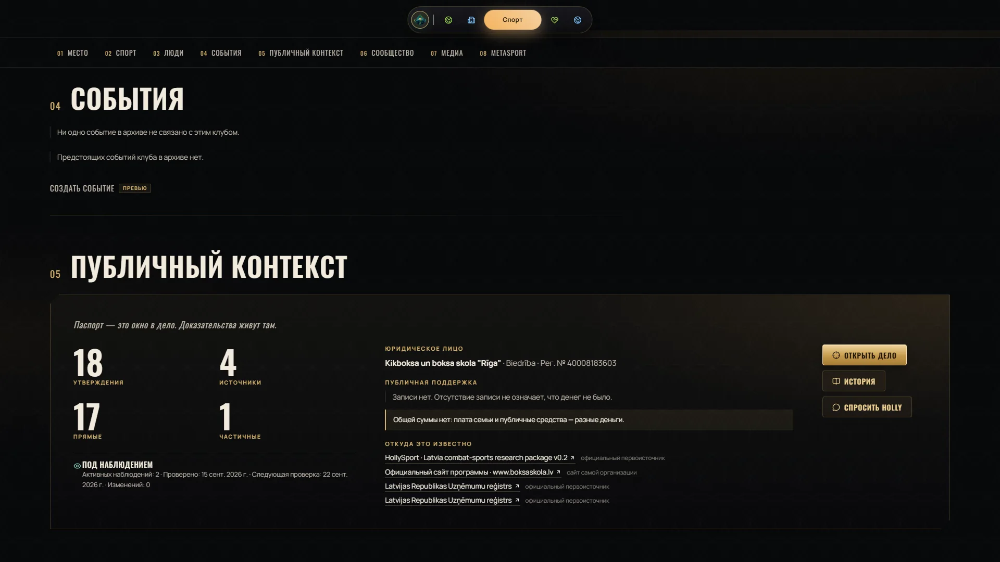</a> Events ("no event in the archive is linked to this club") and public context: 18 claims, 4 sources, monitoring, "no record does not mean no money".</td>
<td width="50%"><a href="../../media/screenshots/13-club-public-context.png">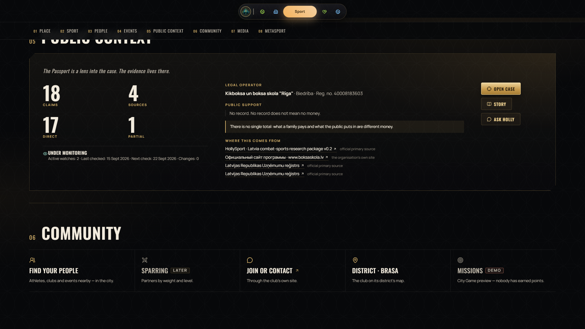</a> Public context in English, with OPEN CASE.</td>
</tr>
<tr>
<td width="50%"><a href="../../media/gallery/sport/09-club-community-media.webp">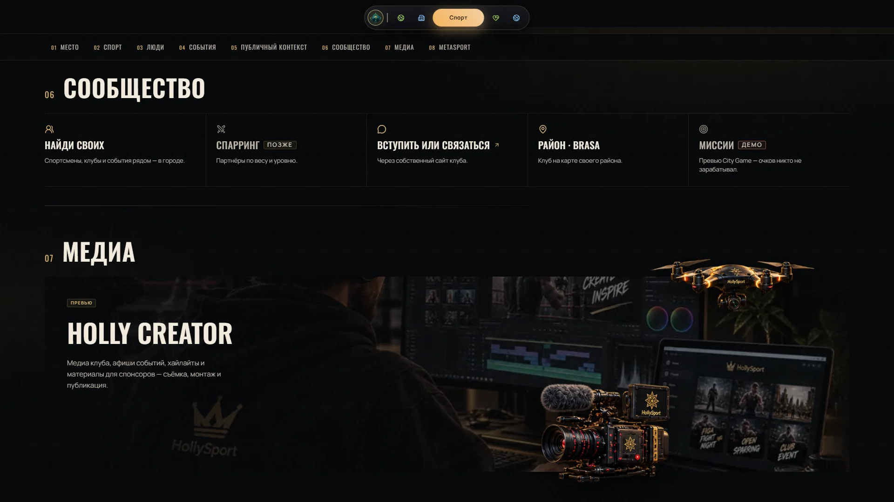</a> Community and media — sparring "later", missions `DEMO`, Holly Creator `PREVIEW`.</td>
<td width="50%"><a href="../../media/gallery/sport/10-club-metasport.webp">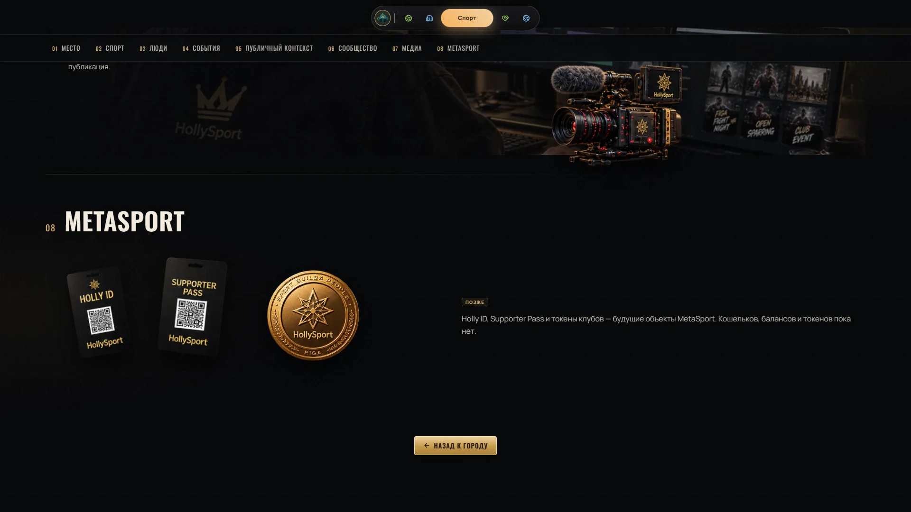</a> MetaSport — Holly ID, Supporter Pass and club tokens: `FUTURE` objects; "no wallets, balances or tokens yet".</td>
</tr>
</table>

## Athletes and athlete passport

`WORKING` — athletes are joined only by stable source identifiers; possible duplicates go to human review.

<table>
<tr>
<td width="50%"> Athlete passport (adult, senior class) — "a placing is a number from the protocol, not a bout"; no club guessed.</td>
<td width="50%"><a href="../../media/gallery/sport/13-athlete-placings.webp">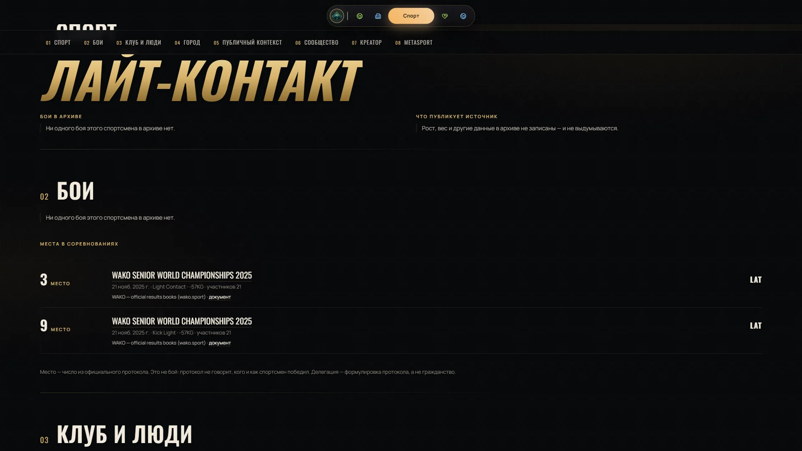</a> Placings from official results books; later chapters marked "later" / preview.</td>
</tr>
</table>

## Events and event passport

`SHOWCASE_READY`

<table>
<tr>
<td width="50%"> WAKO Senior World Championships 2025 — "no venue recorded", "the source names no organiser".</td>
<td width="50%"> Results: 136 categories, 1,897 starts, 1,609 athletes — adult and veteran classes only; the minors policy is explained on screen.</td>
</tr>
<tr>
<td width="50%"><a href="../../media/gallery/sport/16-event-passport-kok.webp">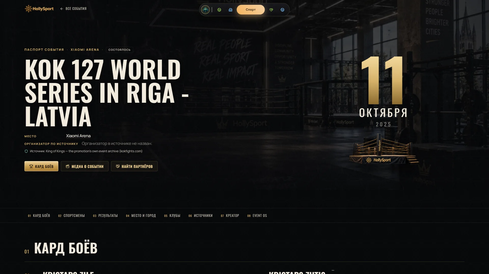</a> A professional event from the promotion's own archive: venue, fight card with methods as printed.</td>
<td width="50%"><a href="../../media/gallery/sport/14-archive-events.webp">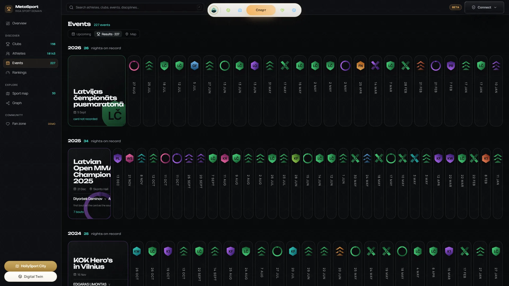</a> Events archive — 227 events.</td>
</tr>
</table>

## Venues and venue passport

`WORKING`

Venue passport — neighbourhood, address-register point, sports seen in events and the events held there; owner, operator and capacity "not recorded".

## Archive, rankings, graph and map

<table>
<tr>
<td width="50%"><a href="../../media/gallery/sport/17-archive-overview.webp">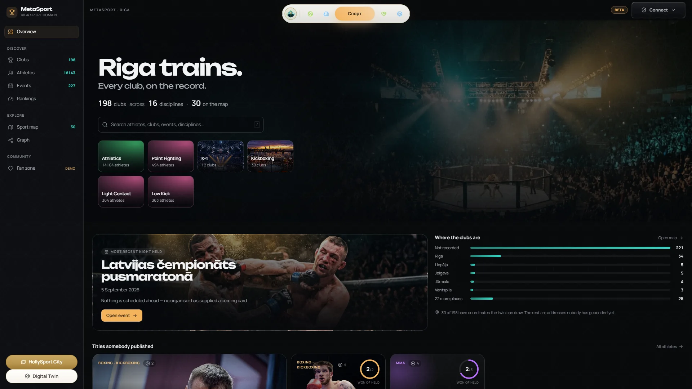</a> Archive overview — `BETA`: "198 clubs" is Latvia-wide, shown under "Riga".</td>
<td width="50%"><a href="../../media/gallery/sport/18-rankings.webp">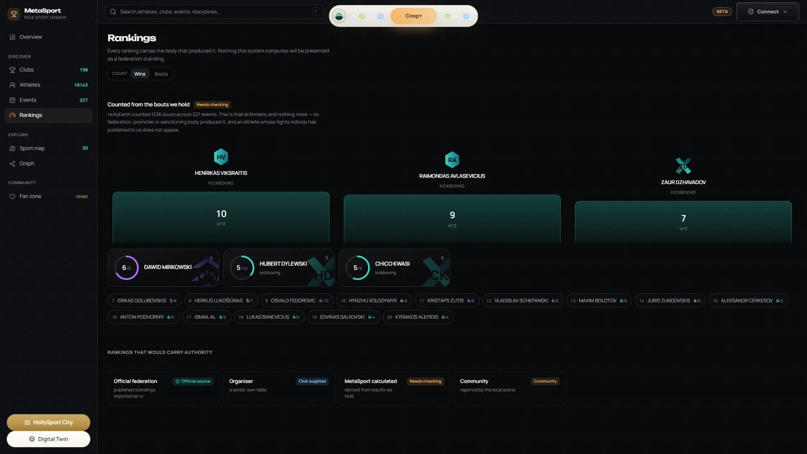</a> Rankings — `BETA`: computed from 1,326 archived bouts, "no federation produced it".</td>
</tr>
<tr>
<td width="50%"> Sport graph — 18,759 entities, 21,425 relationships. `WORKING`</td>
<td width="50%"><a href="../../media/gallery/sport/20-sport-map.webp">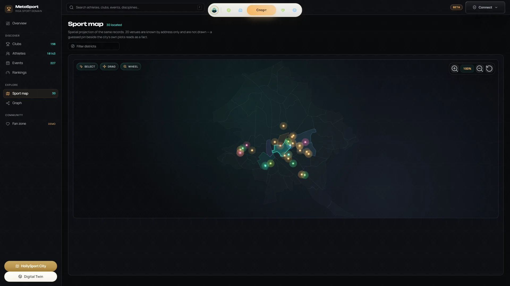</a> Sport map — points only where the address register confirms them. `WORKING`</td>
</tr>
</table>

## City Game — missions — season

`DEMO` — invented content; nobody has earned points and there are no progression mechanics.

<table>
<tr>
<td width="50%"> Missions — "levels, points and missions are a City Game preview. Nobody has earned them."</td>
<td width="50%"><a href="../../media/gallery/sport/06-season-demo.webp">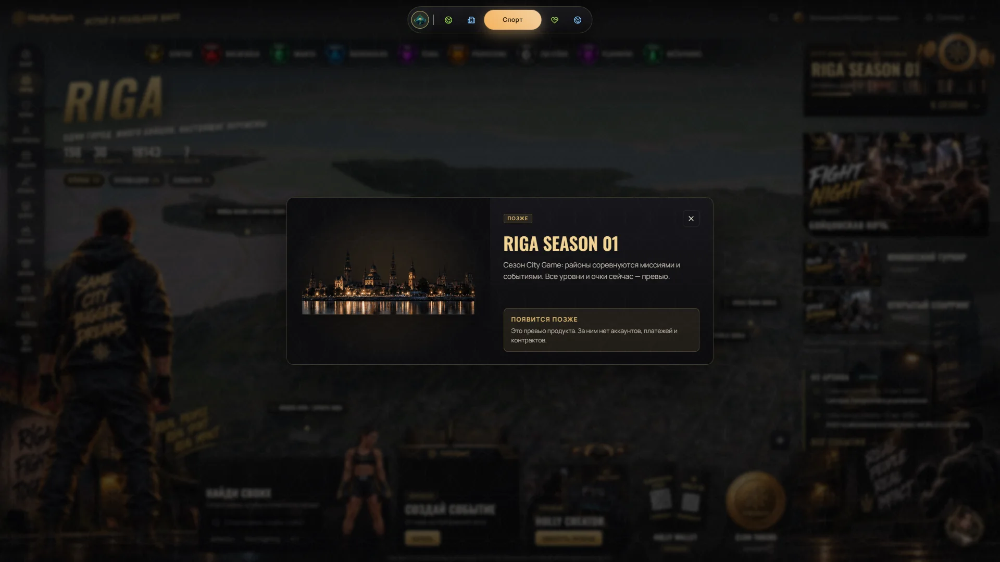</a> Riga Season 01 — labelled DEMO.</td>
</tr>
<tr>
<td width="50%"><a href="../../media/gallery/sport/27-fan-zone-demo.webp">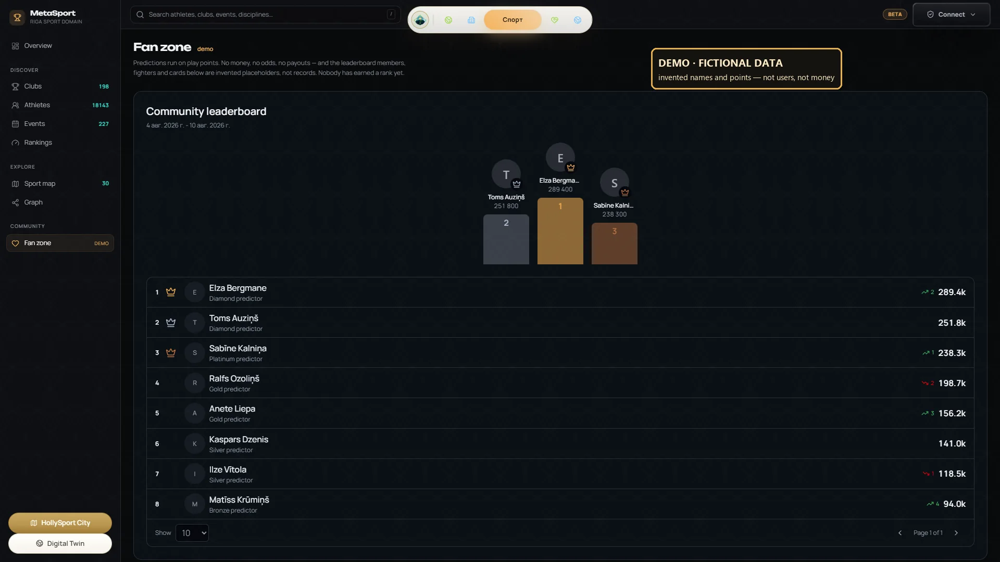</a> Fan zone — predictions on demo points with an invented leaderboard; marked <b>DEMO · FICTIONAL DATA</b> in this public copy.</td>
<td width="50%"></td>
</tr>
</table>

## Event OS and Creator

`PROTOTYPE` / `PREVIEW` — **not an event registration or publishing service.**

<table>
<tr>
<td width="50%"> Event OS — a nine-step planning wizard; the draft stays in the browser and does not reach the archive or the map.</td>
<td width="50%"><a href="../../media/gallery/sport/21-creator-preview.webp">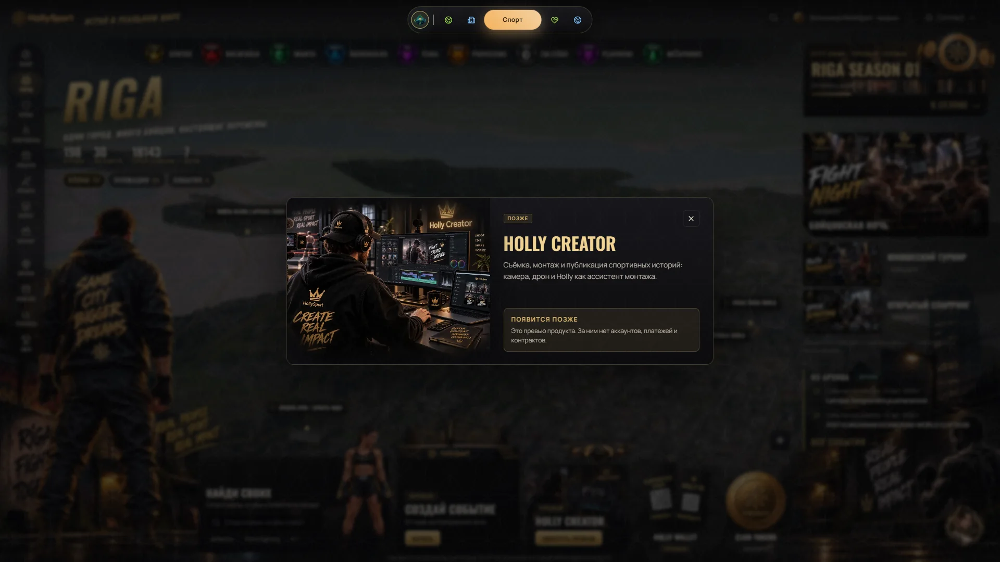</a> Holly Creator — a preview sheet: "no accounts, payments or contracts".</td>
</tr>
<tr>
<td width="50%"><a href="../../media/gallery/sport/22-organiser-sign-in.webp">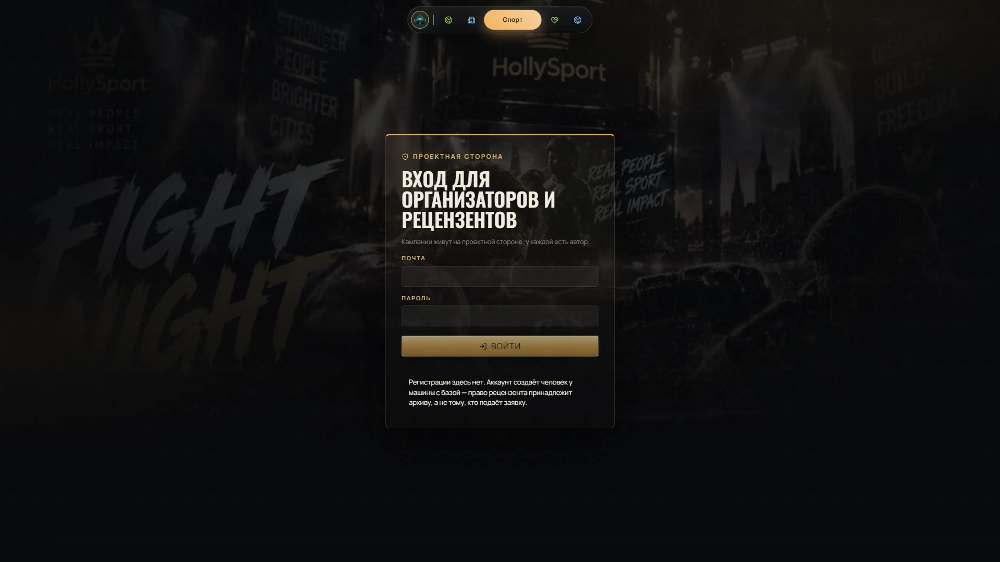</a> The organiser workspace is behind sign-in; there is no public registration.</td>
<td width="50%"></td>
</tr>
</table>

## Business and partnerships

`PROTOTYPE`

<a href="../../media/gallery/sport/23-business-passport.webp">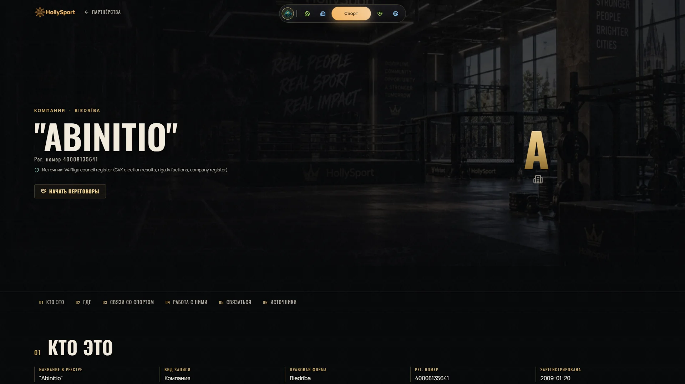</a>

Business passport — opens an organisation record. **Limit:** the organisations here come from the council register and are not sport businesses; partnership and outreach workspaces are in test use only.

## MetaSport economy

`FUTURE` — preview sheets that say there are no accounts, payments or contracts behind them.

<table>
<tr>
<td width="33%"><a href="../../media/gallery/sport/24-market-preview.webp">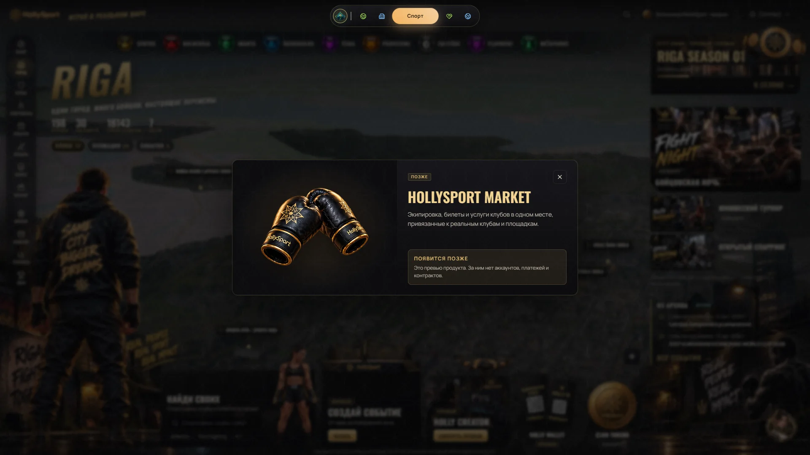</a> Market</td>
<td width="33%"> Wallet — "test network; no real funds"</td>
<td width="33%"><a href="../../media/gallery/sport/26-leagues-preview.webp">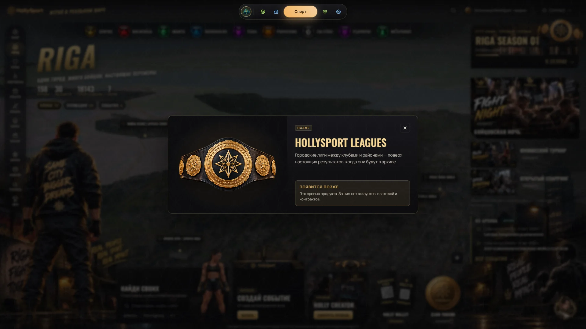</a> Leagues</td>
</tr>
</table>

Club tokens and the Supporter Pass appear on the club passport's MetaSport chapter (above) — also `FUTURE`. Ticketing exists only as a mention in the market preview.

## Sport → investigation

`WORKING`

<a href="../../media/gallery/sport/28-club-case-economy.webp">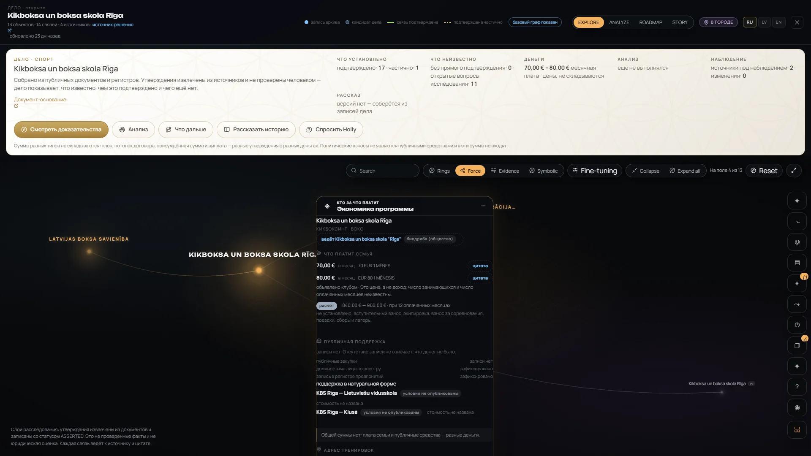</a>

A club's case opened from its passport, with the "programme economy" window: what a family pays (with quotations), a calculated yearly range, and public support "no record — absence of a record does not mean there was no money". See the [Investigation gallery](INVESTIGATION.md).
