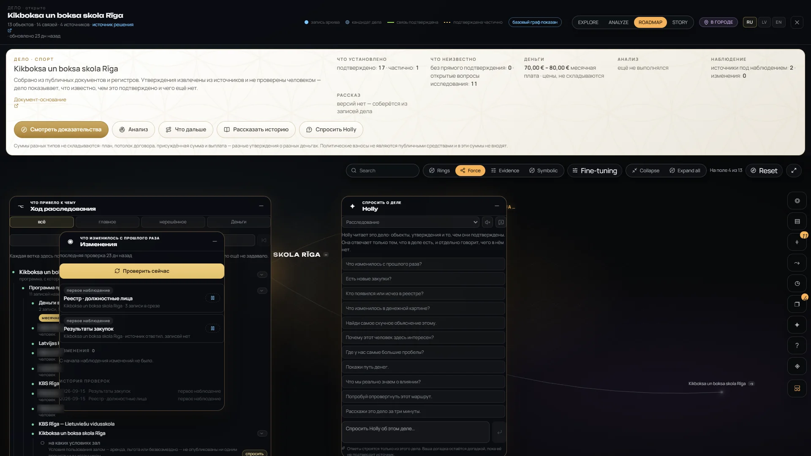
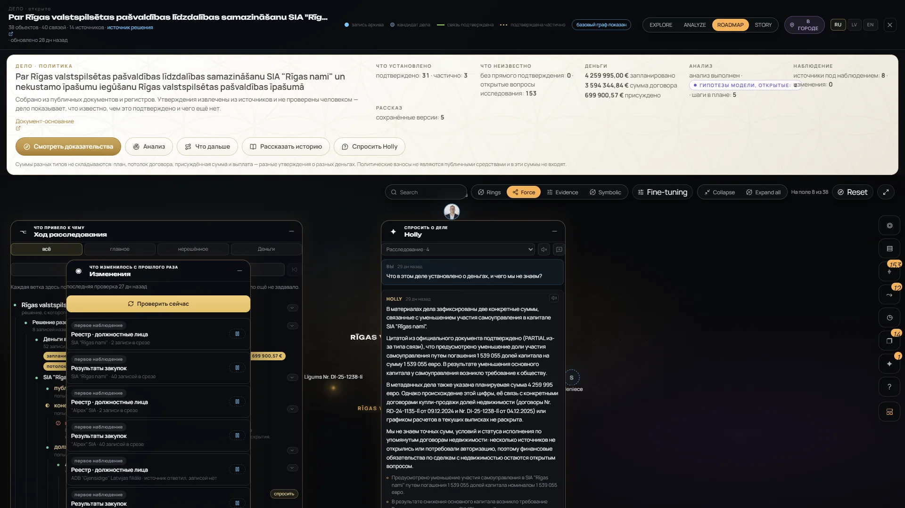
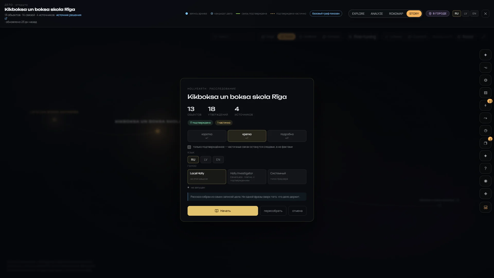
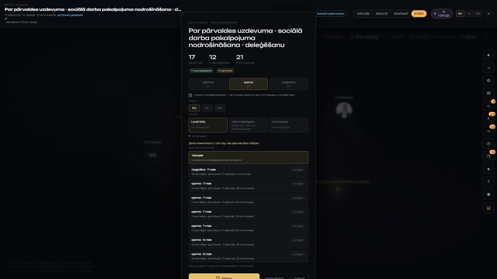

# Holly AI / Story / Voice — gallery

[← Visual Atlas](../GALLERY.md) · Feature status: [Holly AI](../FEATURE_STATUS.md#holly-ai) · [Story and voice](../FEATURE_STATUS.md#story-and-voice) · Overview: [holly-ai.md](../holly-ai.md) · [story.md](../story.md)

HollyEarth works without a language model; Holly is a set of deterministic helpers plus a case-scoped assistant that may use a model when asked. **Model output is labelled as hypothesis and never becomes a fact or a verified record.** Real screenshots of v0.1.0 (Russian and English interface). Click an image to open it full size.

---

## Holly inside an investigation

`BETA` — Holly "reads this case: objects, claims and what supports them; answers only with what the case holds and says separately what it does not know". Quick questions: what changed since last time, new procurements, the money picture, the dullest explanation, the biggest gaps, try to refute this route. Shown with the case's monitoring window and investigation tree (coach names blurred in this public copy).

**Source-backed answer — MODEL-GENERATED.** A saved Holly answer to "what is established about the money and what don't we know?": it quotes the official document, marks the link as partial, and lists what is unknown (exact sums, terms and execution of the property agreements). The answer was written by a language model from the case's records; it is not a verified finding.

## Deterministic analysis and model reasoning

The Analyze mode. Left: the deterministic case overview — 31 direct / 3 partial, money by type, "not established: invoiced, paid — a gap in the sources, not a zero", who and what was found, gaps. Right: **MODEL-GENERATED open reasoning** — possible explanations, alternative explanations and discriminating tests, each labelled model-originated, ending with "not established: model reasoning is not an established fact". Hypotheses, not findings; this stored analysis is older than the case.

## Open questions

The roadmap and the case card carry the open questions the case has not answered yet — 153 in Rīgas nami — and the gaps the sources did not answer. See [Roadmap, unknowns and gaps](INVESTIGATION.md#roadmap-unknowns-and-gaps).

## Story

`WORKING` — a case told as chapters (here 1 of 7, "Observation"), with the network directed on screen. Story is assembled from the case's records; 11 of 12 saved versions contain no model wording. Not every chapter is linked to individual claims yet.

<table>
<tr>
<td width="33%"> <b>Assembled on the fly</b> — "the story is assembled from the case's own records; not one phrase beyond what the case holds".</td>
<td width="33%"> <b>Saved versions</b> — length, language, "only confirmed", and versions marked out of date ("the case has changed since this story was assembled").</td>
<td width="33%"> Versions of another case, including one detailed telling.</td>
</tr>
</table>

## Narration and voice options

The Story setup offers three voices: **Local Holly** (a local voice model, `PROTOTYPE`), **Holly Investigator** (a hosted voice — paid, used only after confirmation, `BETA`) and the **browser's system voice** (free). Visible in the version screens above. Voice is optional; every story can be read without it.
