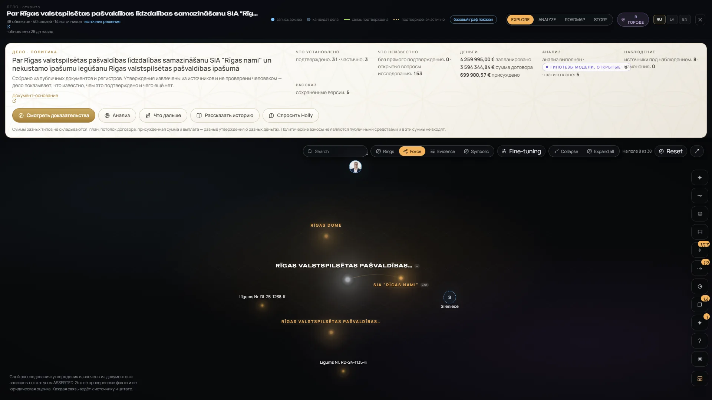
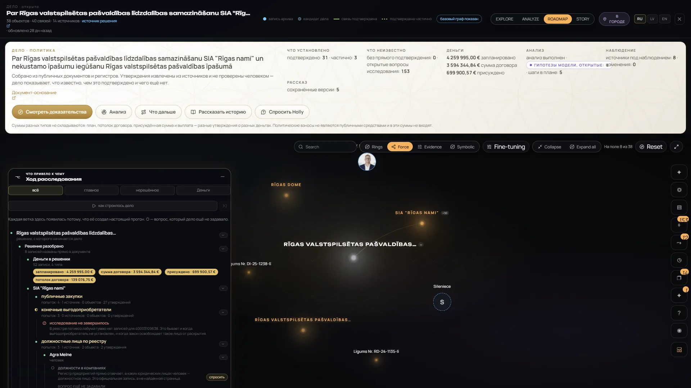
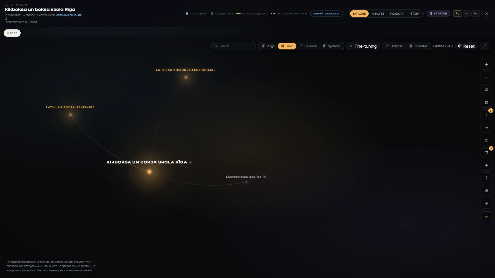
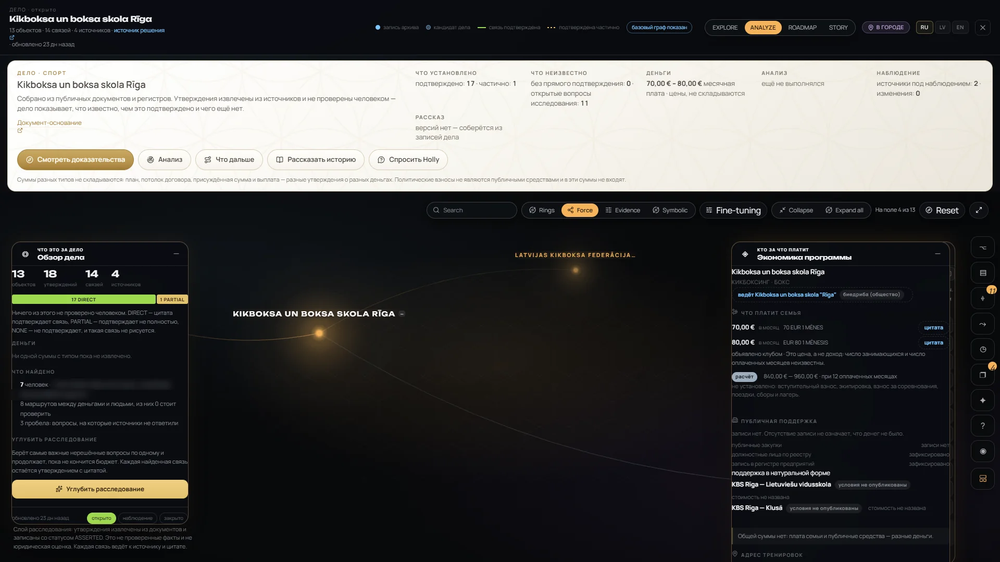
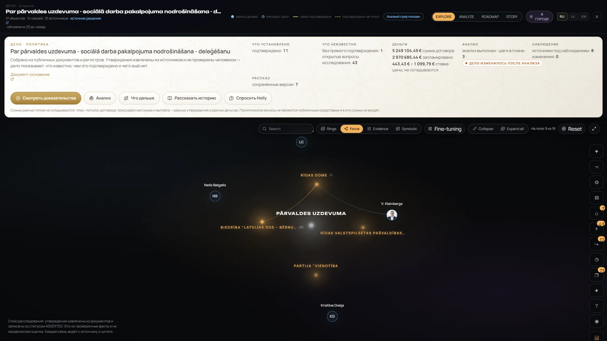

# Investigation / Evidence — gallery

[← Visual Atlas](../GALLERY.md) · Feature status: [Investigation](../FEATURE_STATUS.md#investigation) · Overview: [cases.md](../cases.md) · [evidence-and-provenance.md](../evidence-and-provenance.md)

A **case** gathers a council decision, a procurement or an organisation with its sources, exact quotations, claims, typed money, open questions and the route the investigation took. 9 cases in v0.1.0. Real screenshots (English and Russian interface). Click an image to open it full size.

> **CLAIM ≠ VERIFIED FACT.** All 111 case claims are *asserted*; each carries its source and exact quotation. "Confirmed" (подтверждено) in the interface means **directly supported by a quotation** — no claim has been checked by a person. **PLANNED ≠ PAID:** cases hold planned amounts, contract values, ceilings, awarded amounts, fees and rates — no payment records.

Names visible in these case graphs are public officials and officers of public companies as named in council documents. One coach list is blurred in a public copy.

**Contents** — [Case gallery](#case-gallery) · [Rīgas nami](#rīgas-nami--a-council-decision-on-a-municipal-company) · [KBS](#kbs--a-sport-club) · [Social delegation case](#social-delegation-case) · Analysis, Holly and Story → [Holly AI gallery](HOLLY_AI.md) · Monitoring → [Monitoring gallery](MONITORING.md)

---

## Case gallery

`SHOWCASE_READY` — the city's cases (7 sport, 2 politics) with counts of objects, claims, links and sources, and three actions: open the case, tell the story, ask Holly.

## Rīgas nami — a council decision on a municipal company

38 objects · 34 claims · 14 sources · 31 directly and 3 partially supported · 153 open questions.

### Case workspace — Explore

What is established, what is unknown, money by type — never added together — analysis and monitoring, above the case graph.

The same card in the Russian interface.

### Graph

The case graph alone: archive records, case candidates, supported and partly supported links; layouts Rings / Force / Evidence / Symbolic. A case graph is anchored to one canonical record; most of its entities are still candidates.

### Source trace and money trace

`SHOWCASE_READY` — select an object, open "where does this amount come from": the source that was read → the amount extracted from the document → "planned — a type of statement the document makes, not a fact of payment".

### Roadmap, unknowns and gaps

`WORKING` — the course of the investigation built from real research runs: decision → money → company → beneficial owners / officers / register, with branches marked "the research did not finish" and questions the case has not asked yet. Unknowns are gaps in the sources, never zeros.

## KBS — a sport club

13 objects · 18 claims · 4 sources · monthly fee 70–80 € (a price, not income).

<table>
<tr>
<td width="50%"> Case card: 17 directly and 1 partially supported claims, 11 open questions, the fee as a price.</td>
<td width="50%"> The club, its federations and its programme in the case graph.</td>
</tr>
</table>

Analyze mode with the case overview and the programme-economy window: family price with quotations, a calculated yearly range, public support "no record". Coach names are blurred in this public copy.

## Social delegation case

A council decision delegating social work to a non-governmental organisation — the case that links Politics and Social.

Case card and graph: the decision, the municipality, the organisation and the council deputies named in the decision. Money shown by type (contract value, planned, rates — rates never summed); the card flags "the case changed after the analysis". Shown at the level of the decision only; no data about the people the services are for exists in the system.
