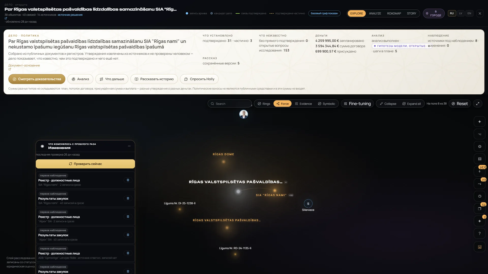
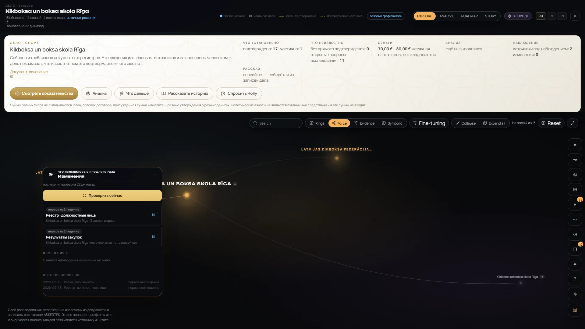
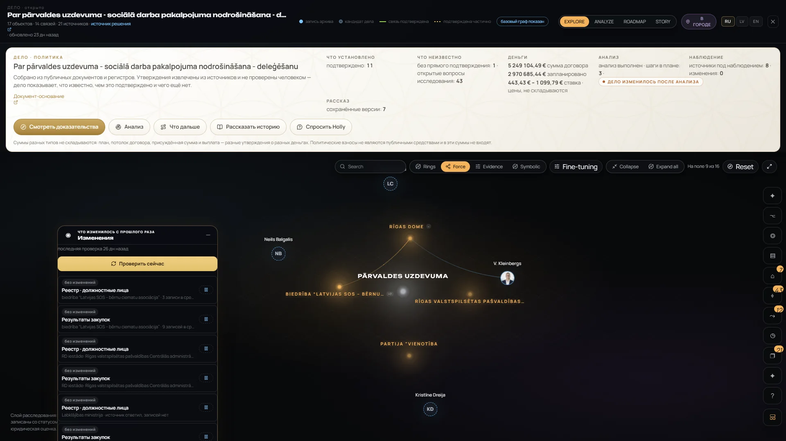
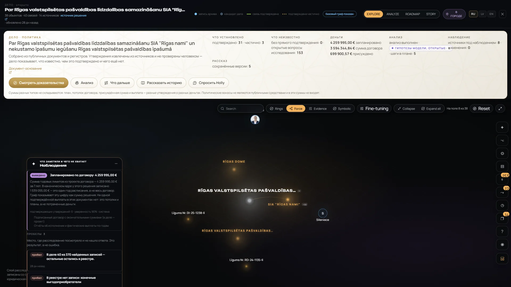
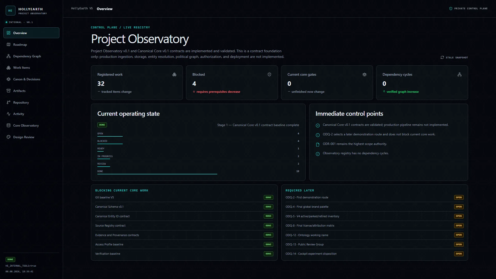
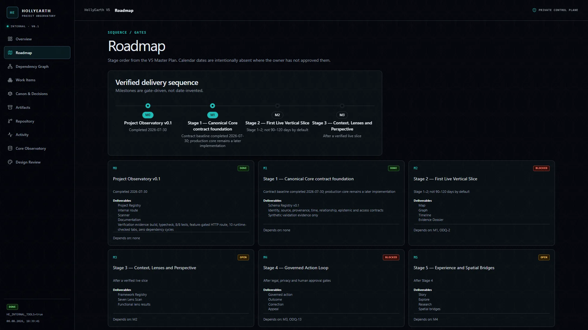
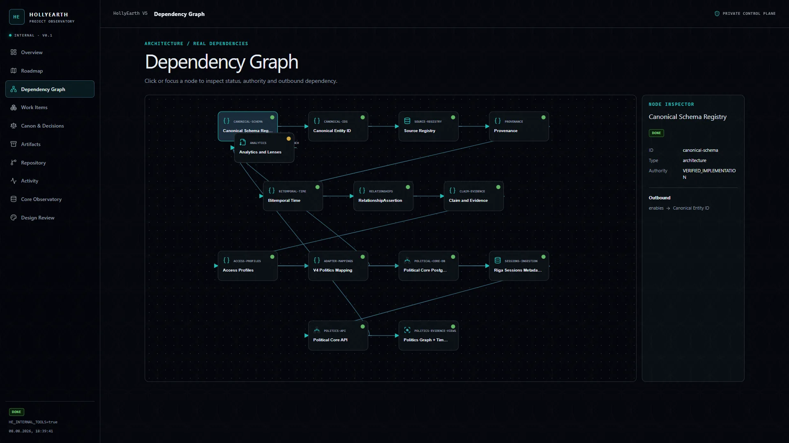
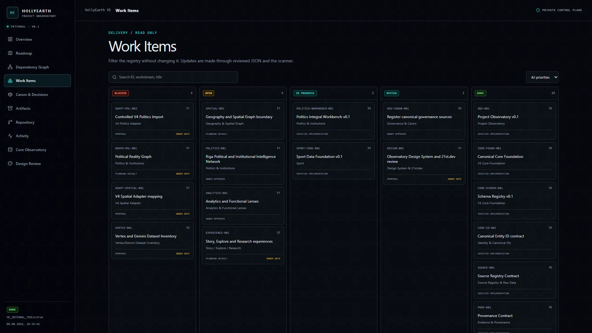
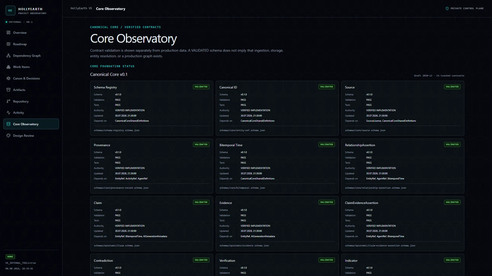
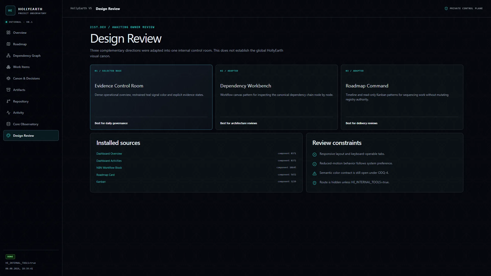

# Monitoring / Observatory — gallery

[← Visual Atlas](../GALLERY.md) · Feature status: [Monitoring](../FEATURE_STATUS.md#monitoring) · Overview: [monitoring.md](../monitoring.md)

Real screenshots of v0.1.0 (Russian and English interface). Click an image to open it full size.

---

## Monitoring — `BETA`

Monitoring watches the official sources behind investigation cases: **18 watches** on two open-data sources (company officers from the Register of Enterprises, procurement results from the Electronic Procurement System), **26 runs**, 26 stored snapshots. Change detection compares records by identity and keeps "no change", "the source did not answer" and "parser changed" apart.

> **Checks are run by hand. There is no automatic scheduler yet**, and no change has been recorded so far.

**Watches** — one table across all cases: case, domain, what is watched, source and cadence, state, last result.

<table>
<tr>
<td width="50%"> <b>Sources and changes inside a case</b> — each watch with source type and records in the snapshot, "Changes 0 — no change since watching began", and "Check now" (manual).</td>
<td width="50%"> <b>Run history</b> — date · source · outcome ("first observation"), for a sport club's two watches.</td>
</tr>
<tr>
<td width="50%"> Watches of the social-delegation case — "no changes" kept apart from "first observation".</td>
<td width="50%"> <b>Findings and gaps</b> — "the case holds 40 of 370 records found; the rest stayed in the register", "no record in the register: final beneficiaries".</td>
</tr>
</table>

---

## Project Observatory — internal

The Observatory is HollyEarth's **internal project control plane** — a registry of work, milestones, architecture contracts and design decisions. **It is a snapshot from August 2026 and several of its statements are out of date** (for example it describes production ingestion and the political graph as not yet implemented, which v0.1.0 has since built). Shown as part of how the project is run, not as current product status. Interface in English.

<table>
<tr>
<td width="50%"> <b>Overview</b> — registered work, blocked items, current operating state; marked "stale snapshot".</td>
<td width="50%"> <b>Roadmap</b> — gate-driven milestones M0–M6 without invented dates.</td>
</tr>
<tr>
<td width="50%"> <b>Dependency graph</b> — architecture nodes from schema and identity to the politics API, with an inspector.</td>
<td width="50%"> <b>Work items</b> — blocked / open / in progress / review / done.</td>
</tr>
<tr>
<td width="50%"> <b>Core observatory</b> — canonical core contracts (schema registry, identity, source, provenance, bitemporal time, claims, evidence) with validation state.</td>
<td width="50%"> <b>Design review</b> — research and design directions for the control room, awaiting owner review.</td>
</tr>
</table>
