# Politics — gallery

[← Visual Atlas](../GALLERY.md) · Feature status: [Politics](../FEATURE_STATUS.md#politics) · [Political Workspace](../FEATURE_STATUS.md#political-workspace) · Overview: [politics.md](../politics.md)

Riga City Council as data: 175 sessions, 456 decisions, 113 deputies, 7 parties, 62,772 recorded votes — each record with its source and an "imported, unverified" status where nobody has checked it. Real screenshots of v0.1.0, Russian interface. Click an image to open it full size.

Deputy portraits are official portraits from the Riga City Council's public pages (riga.lv), shown as the product shows them.

**Contents** — [Political Intelligence](#political-intelligence) · [Integral Political Workspace](#integral-political-workspace)

---

## Political Intelligence

Political Holly OS: twelve modules over the council data. Status of the area: `BETA` — the data is real; the modules range from `WORKING` to `DEMO`.

> Most modules open under a band titled "Проект на анализе · Сеть датчиков воздуха + цифровой двойник". That band is a **labelled demo analysis project** (an illustrative air-sensor scenario), not a real Riga project.

### 01 · Political OS — `BETA`

The council at a glance: a network of deputies, decisions and money (322 nodes, 607 links), the balance of power, the faces of the council and decision chains.
**Works:** network, party and deputy lists, council faces, 456 decisions / 175 sessions. **Limits:** the city-money card does not finish loading; the council pulse keeps reconnecting; this module's seat total (54) differs from Parties & Power (60).

### 02 · Network — `WORKING`

The integrated politics graph: 884 records and 1,351 links, with families (deputies, parties, committees, sessions, decisions, documents, territory) and layouts (Rings, Force, Evidence, Symbolic).
**Limits:** graph sizes differ between modules without explanation.

### 03 · Live Sessions — `BETA`

<a href="../../media/gallery/politics/03-live-sessions.webp">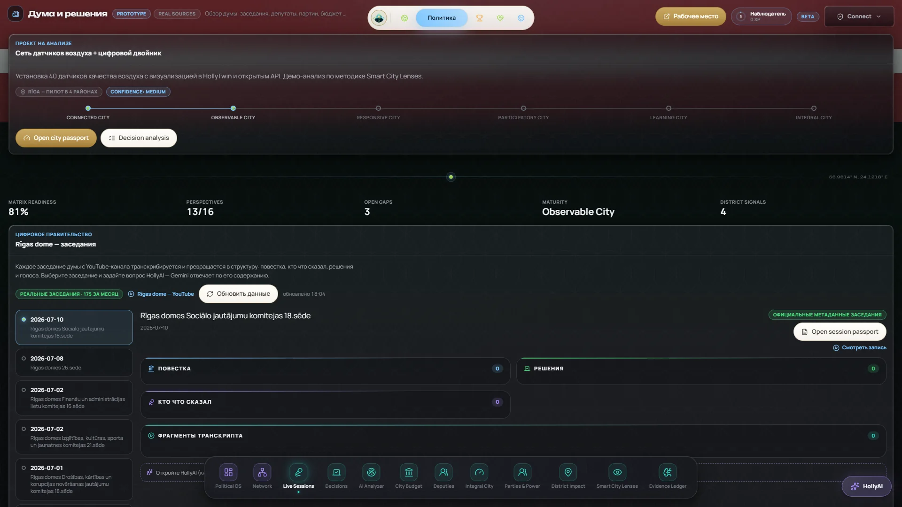</a>

Council sessions from their recordings, meant to become agenda, speakers, decisions and transcript.
**Works:** 175 sessions with links to recordings. **Limits:** latest data July 2026; the selected session has no agenda, speakers or transcript yet.

### 04 · Decisions — `BETA`

<a href="../../media/gallery/politics/04-decisions.webp">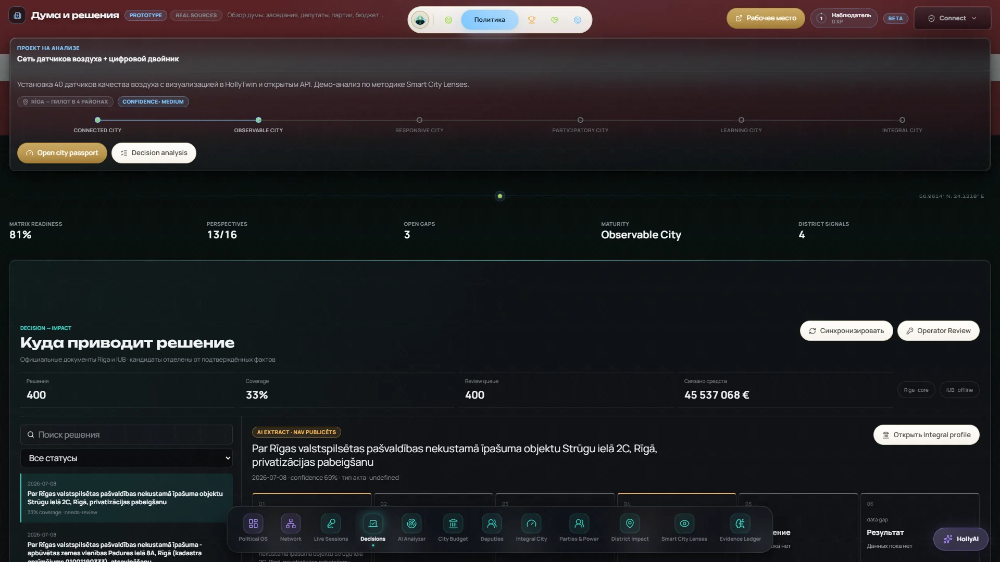</a>

"Decision → impact": 400 decisions with coverage and review state and a six-step chain from decision to result.
**Limits:** act type shows "undefined"; the result step has no data; the procurement source is offline.

### 05 · AI Analyzer — `PROTOTYPE`

<a href="../../media/gallery/politics/05-ai-analyzer.webp">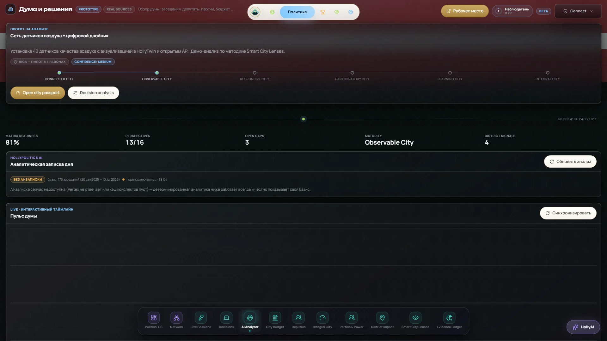</a>

A daily analytic note and council pulse over 175 sessions. **In v0.1.0 the AI brief is not connected** — the screen shows "без AI-записки"; the rest is deterministic.

### 06 · City Budget — `BETA`

<a href="../../media/gallery/politics/06-city-budget.webp">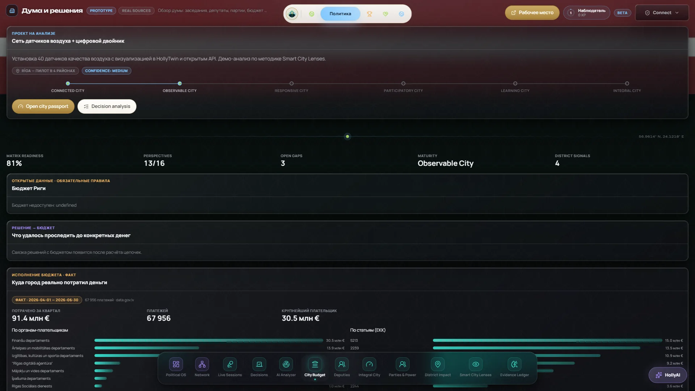</a>

Riga municipal spending from a separate open dataset (data.gov.lv, Q2 2026), by paying body and by expense article.
**Limits:** budget lines are not imported (the screen prints an error text); decision → budget links are not computed; how the dataset's records relate to individual payments is still being established.

### 07 · Deputies — `WORKING`

113 deputy dossiers with attributed remarks, marked "imported, unverified". Individual roll-call votes are not published in the dossier.

### 08 · Integral City — `RESEARCH`

<a href="../../media/gallery/politics/08-integral-city.webp">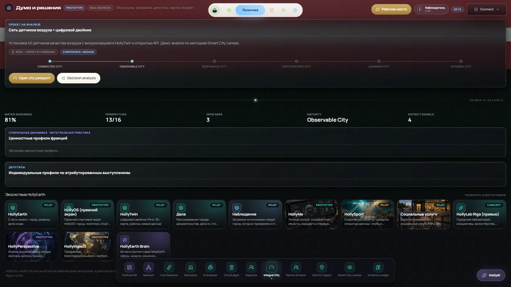</a>

A research lens for value profiles and the HollyEarth ecosystem cards. **No data in v0.1.0** (the profiles keep loading). Value-profile ideas are research and are never used to rate parties or people.

### 09 · Parties & Power — `WORKING`

Official results of the 7 June 2025 council election: votes, percentages and seats per list (60 seats, coalition 34 / opposition 26, turnout 52.3%).

### 10 · District Impact — `DEMO`

<a href="../../media/gallery/politics/10-district-impact.webp">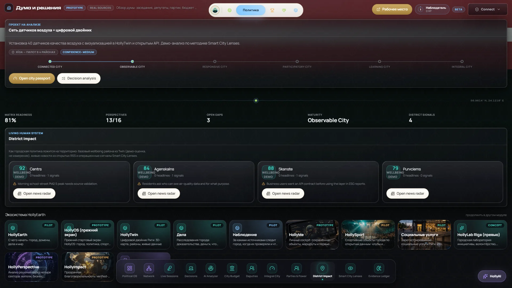</a>

Policy on the territory: a district news radar with wellbeing scores and smart-city signals. **The scores and signals are labelled demo**, not measurements.

### 11 · Smart City Lenses — `DEMO`

<a href="../../media/gallery/politics/11-smart-city-lenses.webp">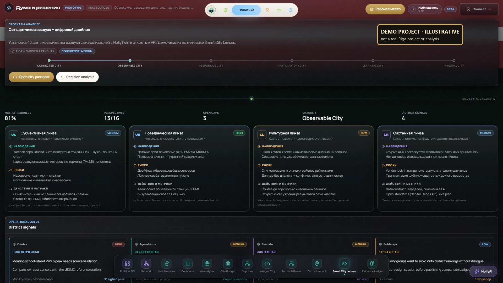</a>

Four quadrant lenses (subjective, behavioural, cultural, systemic) applied to a project. **The whole module analyses the illustrative demo project** — marked in this public copy.

### 12 · Evidence Ledger — `BETA`

A source-backed ledger: 193 evidence objects, 175 sessions, public-broadcaster headlines, with a party lens.
**Limits:** the source monitor is not built; national headlines appear among council evidence.

---

## Integral Political Workspace

An internal research tool over the canonical politics records — `PROTOTYPE`. Each view is a different way of reading the same 793 of 3,892 records (bulk types capped), with an evidence inspector on the right and filters for entity type, convocation, dates, semantic depth and evidence state (verified · supported · contested · unverified). Data gaps are shown in place: procurement and contracts are not ingested. Interface mostly in English.

The integral, holarchic and torus views are **research lenses** — ways of looking, not findings.

### 01 · Political Archipelago

**Communities as islands.** Parties and institutions are islands, their members' portraits sit on them, and verified relations are bridges between them. Each island shows how much of it is backed by evidence (for example a party at 93%, the decision field at 4%).
**Real:** parties, deputies and evidence coverage from the council's own sources. **Research:** the spatial metaphor.

### 02 · Focus Orbit

<a href="../../media/gallery/workspace/02-focus-orbit.webp">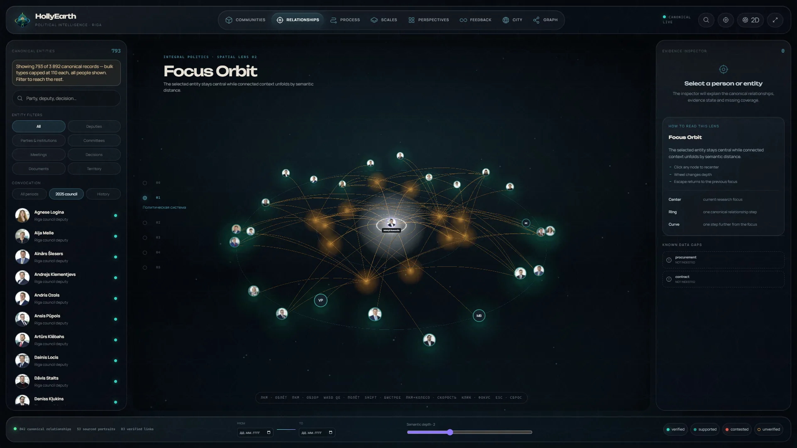</a>

**One record in the centre, its context by distance.** Select a deputy and the orbit recentres: committees, candidacy, positions — 12 connected records, each with its evidence state and source reference in the inspector.
**Limits:** without a selection the orbit is generic; one committee name ("several committees") is a data artefact.

### 03 · Evidence & Influence Flow

<a href="../../media/gallery/workspace/03b-evidence-influence-flow-selected.webp">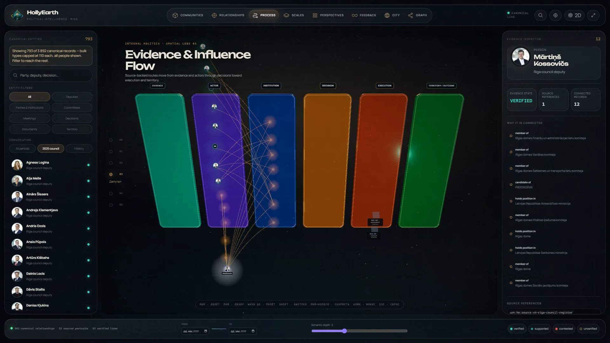</a>

**Six stages:** Evidence → Actor → Institution → Decision → Execution → Territory / Outcome. Source-backed routes run from evidence through people and institutions to decisions. Missing stages say so in place (procurement and contracts not ingested).
**Limits:** the title overlaps the first stage label.

### 04 · Holarchic Observatory

<a href="../../media/gallery/workspace/04b-holarchic-observatory-selected.webp">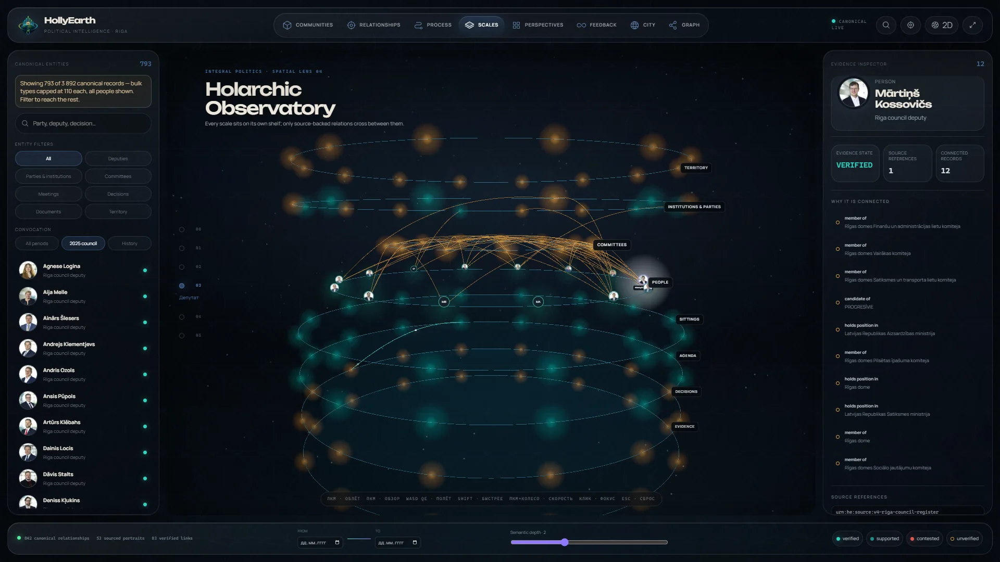</a>

**Every scale on its own shelf** — territory, institutions and parties, committees, people, sittings, agenda, decisions, evidence — with source-backed lines crossing between them. Follow a record up and down the scales. `RESEARCH` lens.

### 05 · Integral Lens Field

**One record, four perspectives.** Records are placed in four quadrants — intention (60, 100% evidenced), action (220, 2%), culture (130, 40%), system (330, 67%). Select a record to see it in all four. The quadrant mapping is a `RESEARCH` lens, not a finding.
**Limits:** the title overlaps the upper-left quadrant label.

### 06 · Living City Torus

**The feedback loop of a city:** Observe → Interpret → Decide → Act → Outcome → Learn / Value. Stage records can be opened; missing data is named (document and contract gaps).
**Limits:** every stage shows 110 — the per-type display cap, not a real distribution; "Learn / Value" has no data.

### 07 · Geo / Twin Bridge

**Politics on the ground.** Geocoded records become ground markers, with the Daugava for orientation. 620 records are counted as "not placed yet" — the address could not be extracted from the text.
**Limits:** abstract grid, no base map.

### 08 · Relationship Graph — `WORKING`

<a href="../../media/gallery/workspace/08-relationship-graph.webp">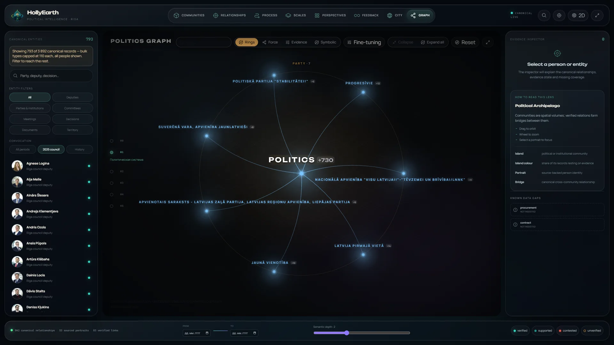</a>

The same graph as the Network module: the politics hub, seven parties, expandable, with Rings / Force / Evidence / Symbolic layouts (884 records, 1,351 links).
**Limits:** its "how to read this lens" card shows the Archipelago legend.
