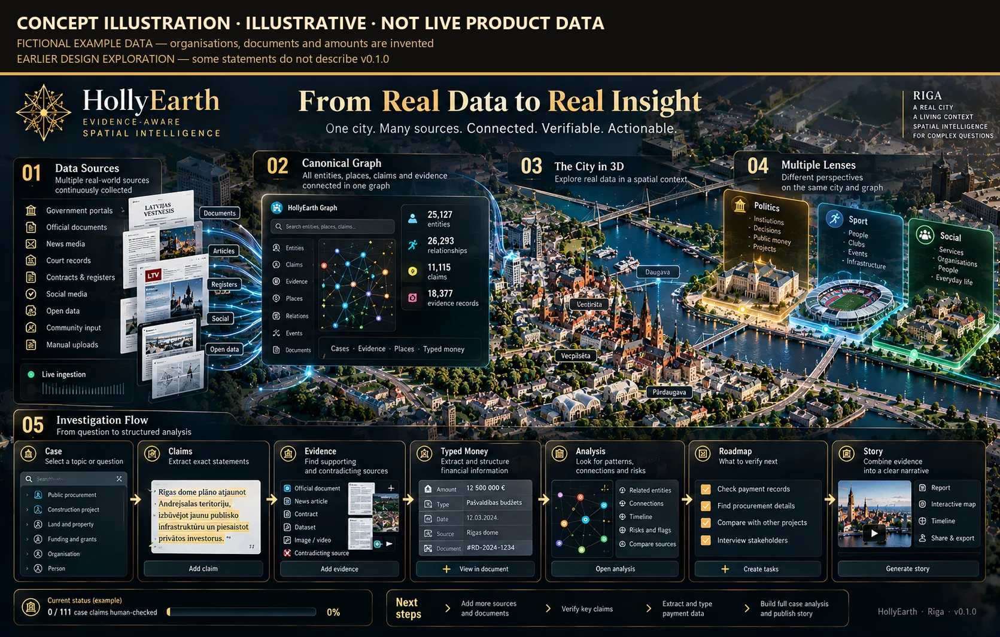
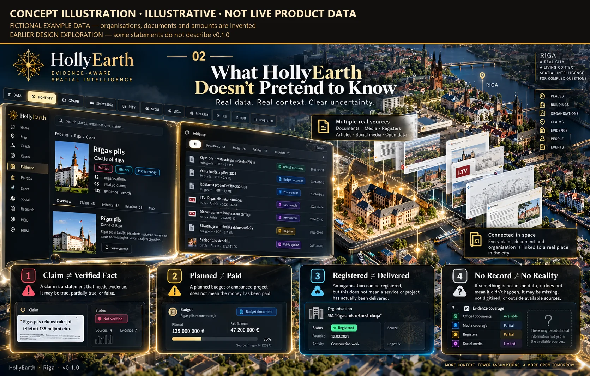
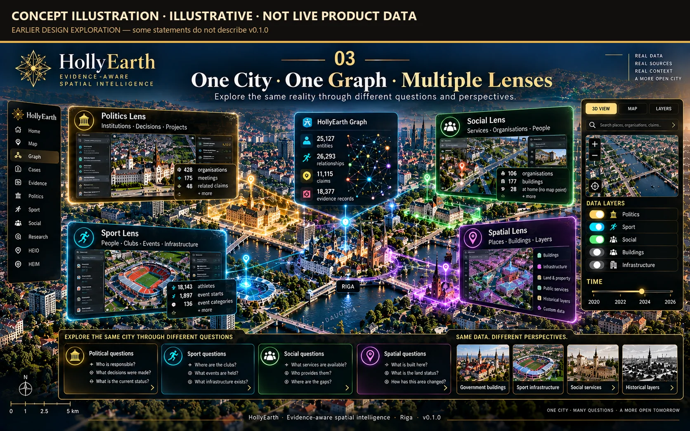
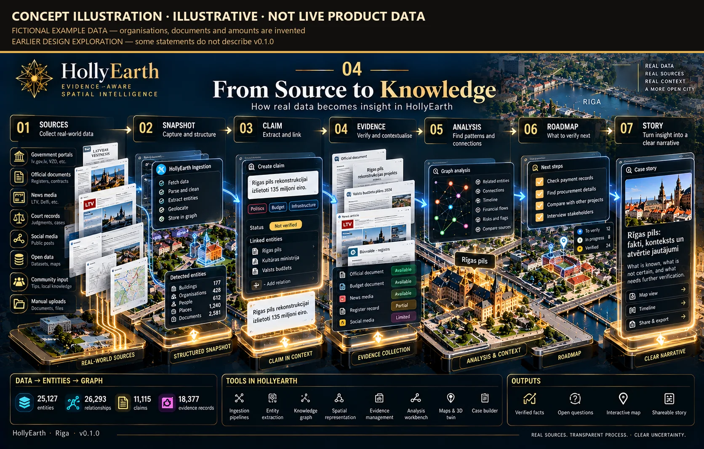
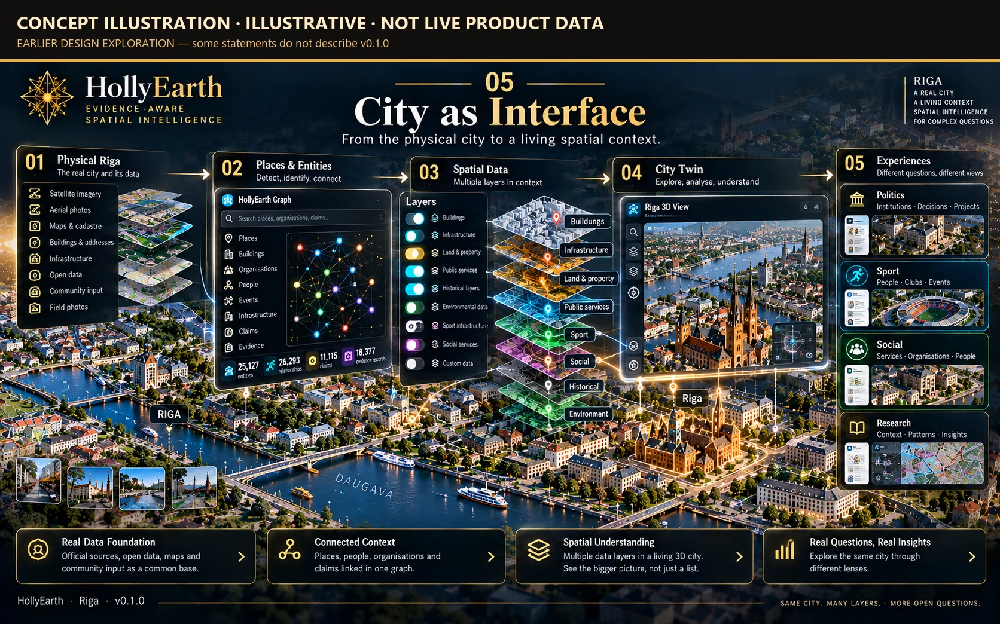
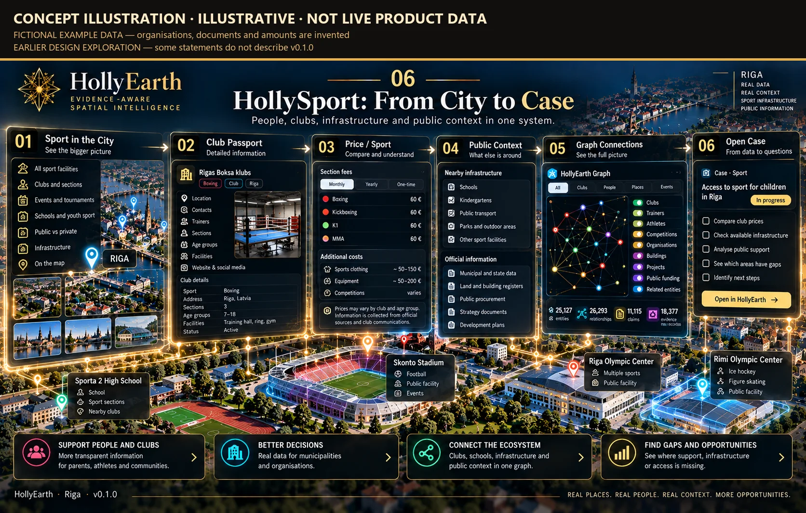
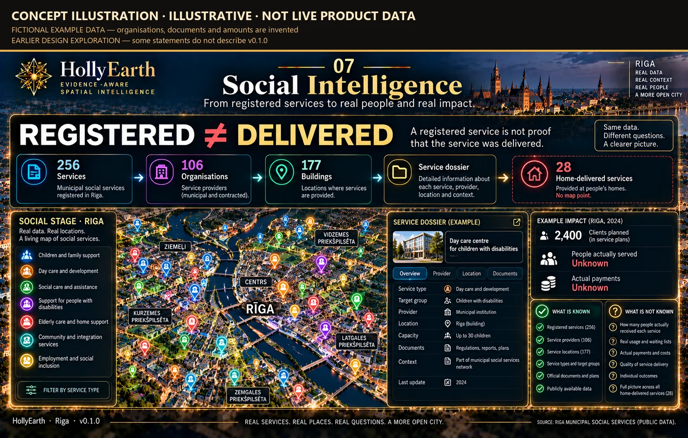
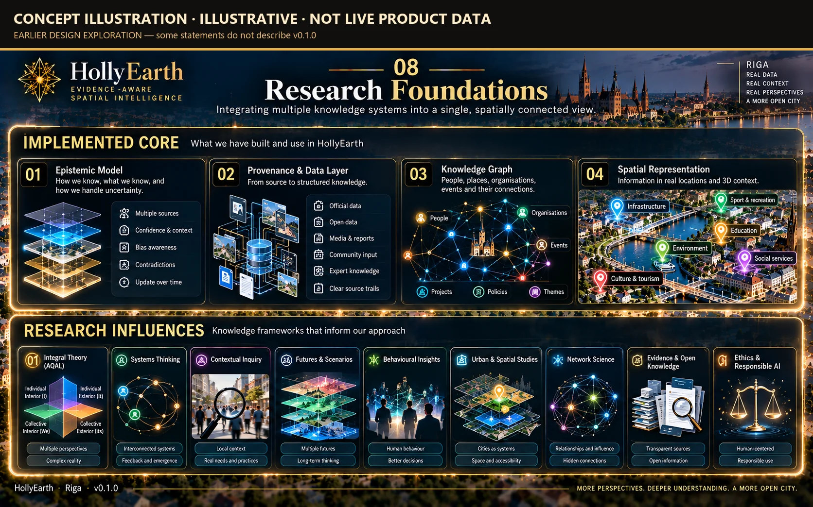

# Research Foundations & Concept Art — gallery

[← Visual Atlas](../GALLERY.md) · Overview: [research.md](../research.md) · Status: [Research](../FEATURE_STATUS.md#research)

> **CONCEPT ILLUSTRATION ≠ PRODUCT SCREENSHOT.**
> Everything on this page is a concept illustration: illustrative, not live product data, and not the working interface. Real screens of HollyEarth are in the other galleries of the [Visual Atlas](../GALLERY.md).

Concept illustrations were made as design explorations during the project and are AI-generated images (they carry a content-credentials manifest). The copies below carry a visible banner. Where an illustration uses invented organisations, documents or amounts, the banner says **FICTIONAL EXAMPLE DATA**. Where it states something about the product that v0.1.0 does not do, the banner says **EARLIER DESIGN EXPLORATION**. Originals are kept unchanged outside this repository.

---

## Research foundations — `RESEARCH`

### HEIO — HollyEarth Integral Ontology (v0.1)

An internal research document on a shared ontology for the city: from data, evidence and a reality graph to time and causality, perspectives, meaning, decisions, governed action and spatial experience. Research concept architecture — **not implemented as a system**. Some of its principles (provenance on everything, no unconditional fact) match v0.1.0.

### HEIM — HollyEarth Integrative Metatheory & Context System (v0.2)

An internal research document on how to ask complex questions: context, lenses, competing explanations, evidence and uncertainty, and an open inquiry. **Not implemented in v0.1.0.**

Research influences — Integral theory / AQAL, Spiral Dynamics (context only, never people), Integral City — are design lenses, not scientific claims, and are never used to rate people, parties or districts.

---

## Concept art / design explorations

### HollyEarth — from real data to real insight

The idea of the chain Reality → Evidence → Intelligence → Experience. **FICTIONAL EXAMPLE DATA · EARLIER DESIGN EXPLORATION** — the example case, document number and amount are invented; "live ingestion" and "all entities connected in one graph" do not describe v0.1.0.

### What HollyEarth doesn't pretend to know

The four principles: claim ≠ verified fact, planned ≠ paid, registered ≠ delivered, no record ≠ no reality. **FICTIONAL EXAMPLE DATA** — the case, company and "paid (known)" figure are invented; v0.1.0 holds no payment records.

### One city · one graph · multiple lenses

The vision of one graph with many lenses. **EARLIER DESIGN EXPLORATION** — in v0.1.0 the social register is not part of the canonical graph, and politics and sport are not yet linked; some figures and controls shown here do not exist.

### From source to knowledge

Source → snapshot → claim → evidence. **FICTIONAL EXAMPLE DATA · EARLIER DESIGN EXPLORATION** — the example claim and the entity counts are invented; HollyEarth does not output "verified facts".

### City as interface

The physical city as places, layers and lenses. **EARLIER DESIGN EXPLORATION** — several layers and sources shown (land and property, historical, community input) do not exist in v0.1.0, and not everything is linked in one graph.

### HollySport — from city to case

From the sport city to a club passport and its case. **FICTIONAL EXAMPLE DATA** — the club, prices and the example case are invented; there is no public-funding data for sport in v0.1.0.

### Social Intelligence — registered vs delivered

Registered ≠ delivered. **FICTIONAL EXAMPLE DATA · EARLIER DESIGN EXPLORATION** — the real source is the Ministry of Welfare's register of social service providers (not "municipal social services"), and the example impact figures are invented.

### Research foundations

What is built and what is research. **EARLIER DESIGN EXPLORATION** — some items listed as built (community input, expert knowledge, several topic layers) are not part of v0.1.0. What is actually implemented: [research.md](../research.md).

### Ecosystem — where it goes next

Exists today · in development · research · future. **EARLIER DESIGN EXPLORATION** — the language labels are corrected in this copy to RU · LV · EN (the original showed wrong flags); "Voice / Agents" overstates v0.1.0, where Holly is not an agent. Current roadmap: [ROADMAP.md](../../ROADMAP.md).
