# Riga Twin — gallery

[← Visual Atlas](../GALLERY.md) · Feature status: [City — Riga Twin](../FEATURE_STATUS.md#city--riga-twin) · Overview: [twin.md](../twin.md)

A photorealistic 3D model of Riga used as the shared map of HollyEarth: district boundaries, council decisions, sport plots, social-service buildings, district news, the council panel and doors to the other worlds. Status: `WORKING`; Research mode and the AQAL overlay are `PROTOTYPE`, Wellbeing pins are `DEMO`. Real screenshots of v0.1.0, mostly Russian interface. Click an image to open it full size.

**Map and 3D sources** (attributions are shown inside the product): GeoRiga photorealistic 3D model of Riga and LOD2 buildings, Latvian Geospatial Information Agency (LGIA) reality model, ArcGIS platform ("Powered by Esri"), OpenStreetMap contributors (CC BY-SA), mesh generated with Agisoft Metashape, neighbourhood boundaries from data.gov.lv, building points from the State Address Register (VZD).

**Today the Twin composes several data models on one map** — council decisions and sport plots from the canonical graph, social buildings from the social register, districts from an open-data snapshot — rather than one shared place graph.

---

## The city

District, sport and social layers on 3D Riga (English interface, partly Russian). The "Wellbeing" pins are labelled `DEMO` — illustrative, not measurements.

The default view: the left rail (council decisions 428, sessions 175, district news, investment plan), map layers, the right panel open on the council network (322 nodes, 607 links, 7 factions), and the dock to the other worlds.

## Layers

<table>
<tr>
<td width="50%"> <b>Clubs and arenas</b> — 14 territories the city granted to sport institutions. `WORKING`</td>
<td width="50%"> <b>Council decisions</b> — 428 acts with an address, grouped by district with published sums. `BETA`</td>
</tr>
<tr>
<td width="50%"><a href="../../media/gallery/twin/04-layer-social-buildings.webp">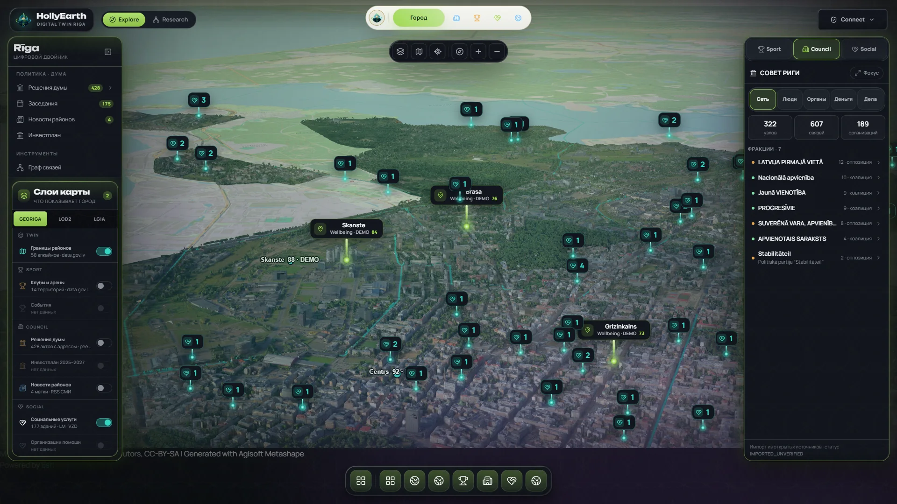</a> <b>Social services</b> — 177 buildings from the official register, numbered by services per building. `WORKING`</td>
<td width="50%"><a href="../../media/gallery/twin/05-layer-district-news.webp">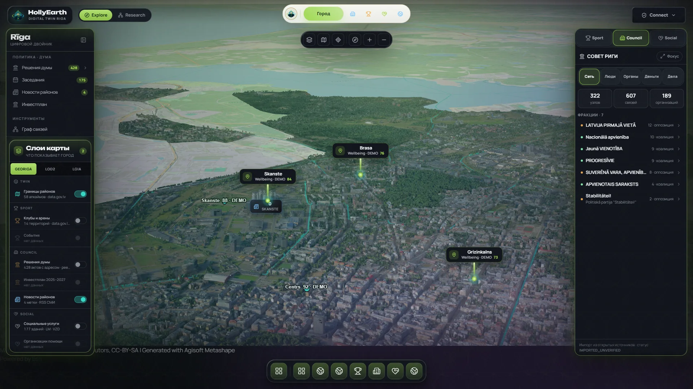</a> <b>District news</b> — headline markers with links, no article text. `BETA`: national headlines sometimes appear as district news.</td>
</tr>
</table>

## Council decisions on the map

<table>
<tr>
<td width="50%"><a href="../../media/gallery/twin/06-decisions-by-district.webp">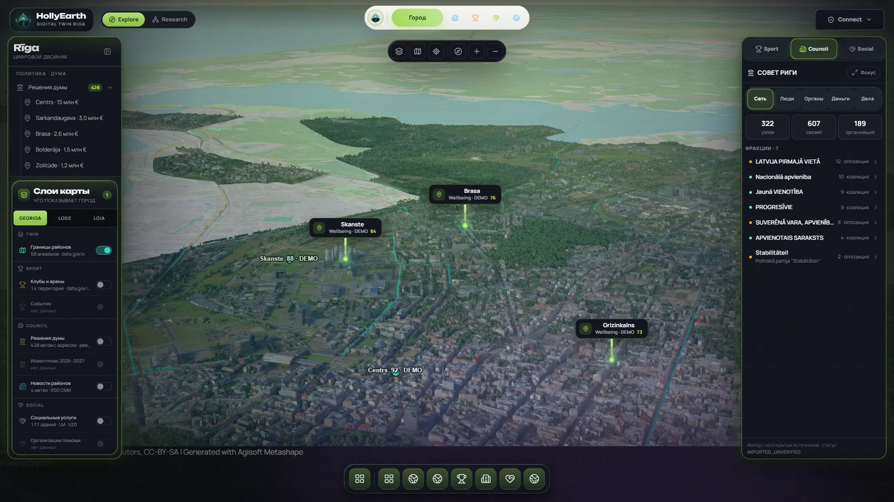</a> District cards: how many decisions, how many with a published sum.</td>
<td width="50%"><a href="../../media/gallery/twin/07-decision-pin.webp">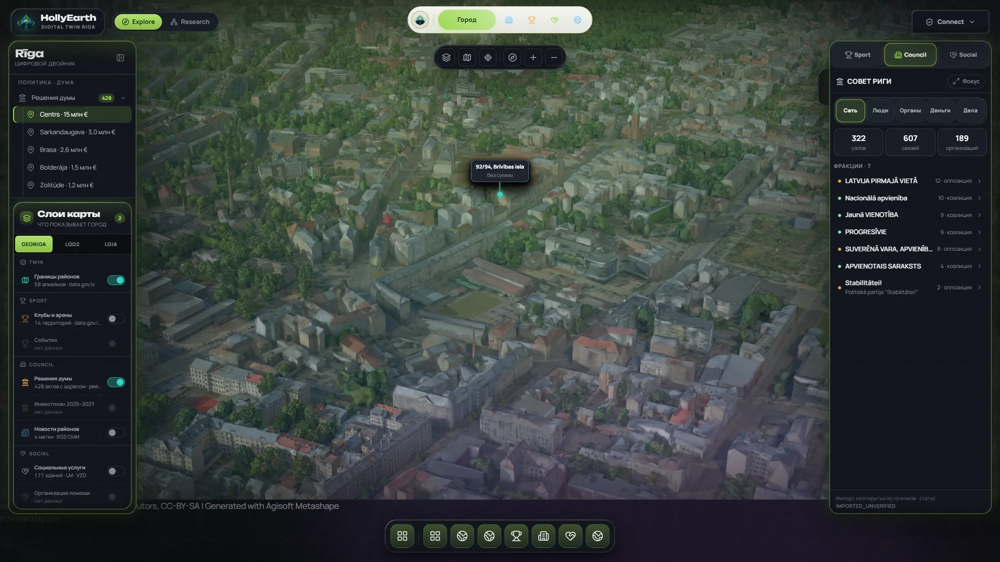</a> A district opened: the decisions placed in it.</td>
</tr>
</table>

<a href="../../media/gallery/twin/08-decision-card.webp">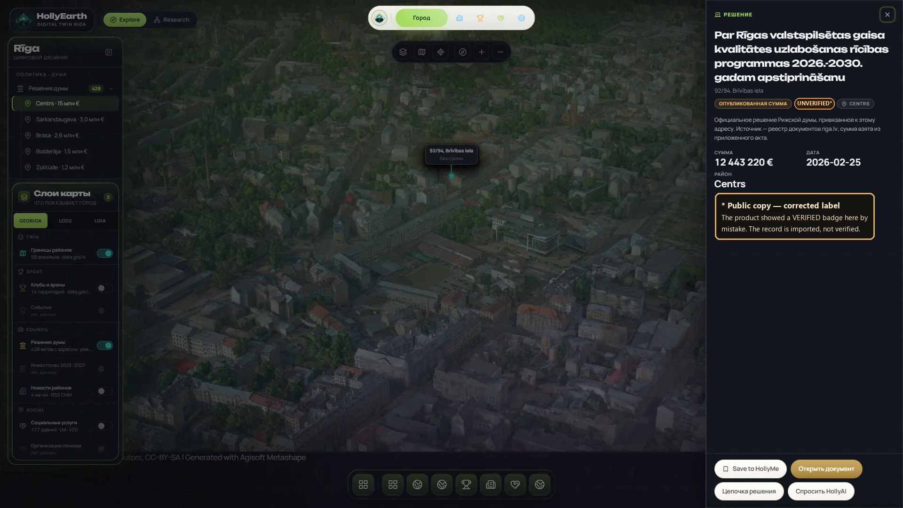</a>

**Decision card** — title, address, published amount, date, district and a source sentence (riga.lv register, amount taken from the attached act). **Public copy with one corrected label:** the product shows a "VERIFIED" badge on this card by mistake; the record is imported, not verified, so this copy marks it "UNVERIFIED*" and says so on the image.

## Council panel

<table>
<tr>
<td width="50%"><a href="../../media/gallery/twin/09-council-money.webp">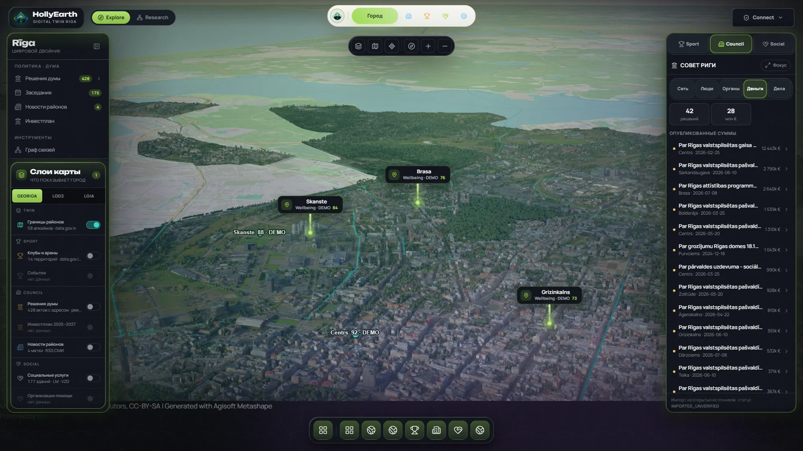</a> <b>Money</b> — 42 decisions with published sums.</td>
<td width="50%"> <b>People</b> — 113 deputies with party.</td>
</tr>
<tr>
<td width="50%"><a href="../../media/gallery/twin/11-council-committees.webp">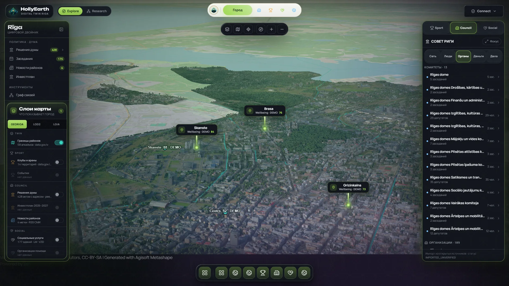</a> <b>Committees</b> — 13 committees with meeting counts.</td>
<td width="50%"><a href="../../media/gallery/twin/12-council-cases.webp">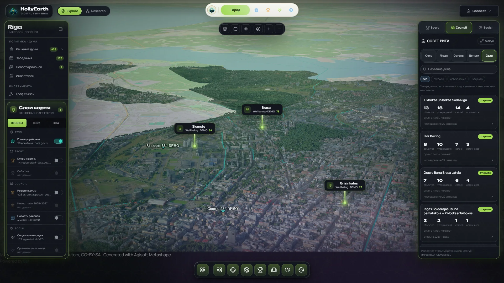</a> <b>Cases</b> — the 9 investigation cases, filterable.</td>
</tr>
<tr>
<td width="50%"><a href="../../media/gallery/twin/13-faction-dossier.webp">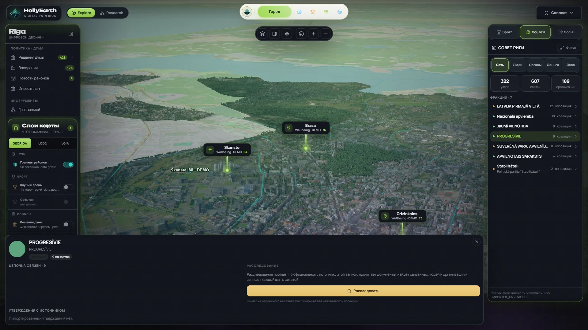</a> <b>Faction dossier</b> — mandates and a chain of links; seat totals here (54) differ from the election results (60). `BETA`</td>
<td width="50%"><a href="../../media/gallery/twin/14-case-over-twin.webp">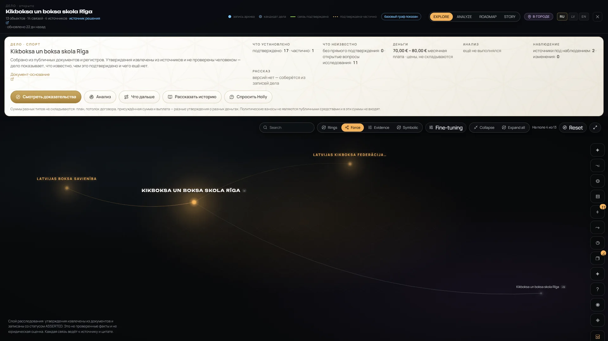</a> <b>Case from the Twin</b> — the case workspace opens over the city. Cases do not yet land on the map. `PROTOTYPE`</td>
</tr>
</table>

## Objects, news and lenses

<table>
<tr>
<td width="50%"><a href="../../media/gallery/twin/15-sport-plot-selected.webp">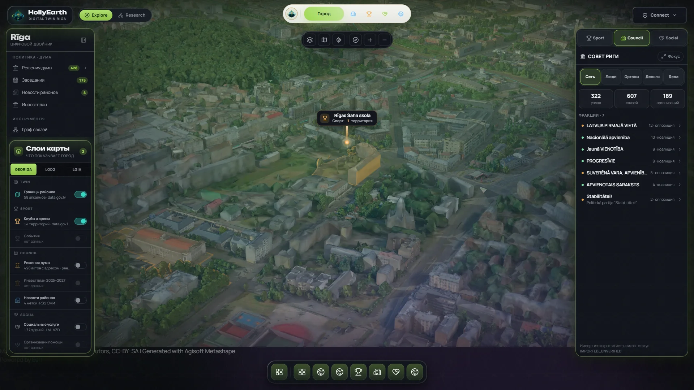</a> A sport plot selected: the map flies to it and highlights the territory. No passport link yet.</td>
<td width="50%"><a href="../../media/gallery/twin/16-news-intelligence.webp">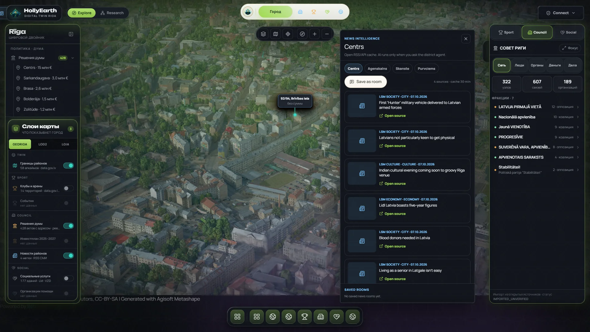</a> News intelligence for a district, with "open source" per headline.</td>
</tr>
<tr>
<td width="50%"> <b>AQAL overlay</b> — `PROTOTYPE` research lens: live rows (air quality, weather, LOD2, open datasets), demo rows and offline rows, each labelled.</td>
<td width="50%"><a href="../../media/gallery/twin/18-research-mode.webp">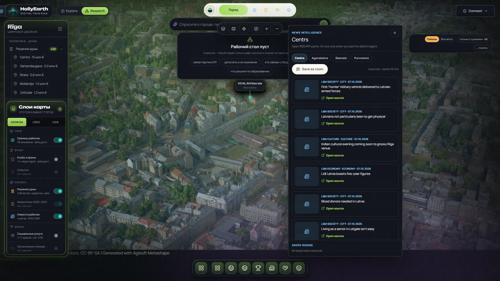</a> <b>Research mode</b> — `PROTOTYPE`: a question bar and example prompts; it cannot answer questions in v0.1.0.</td>
</tr>
</table>
