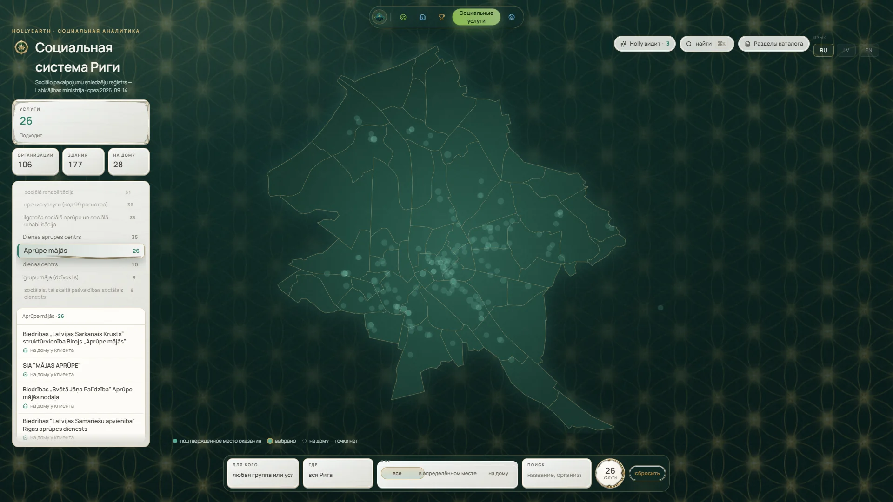
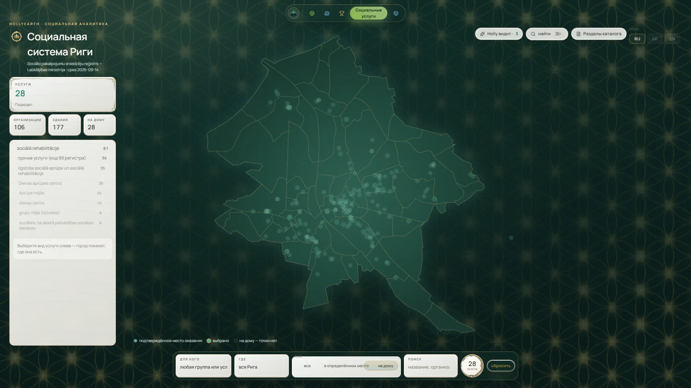
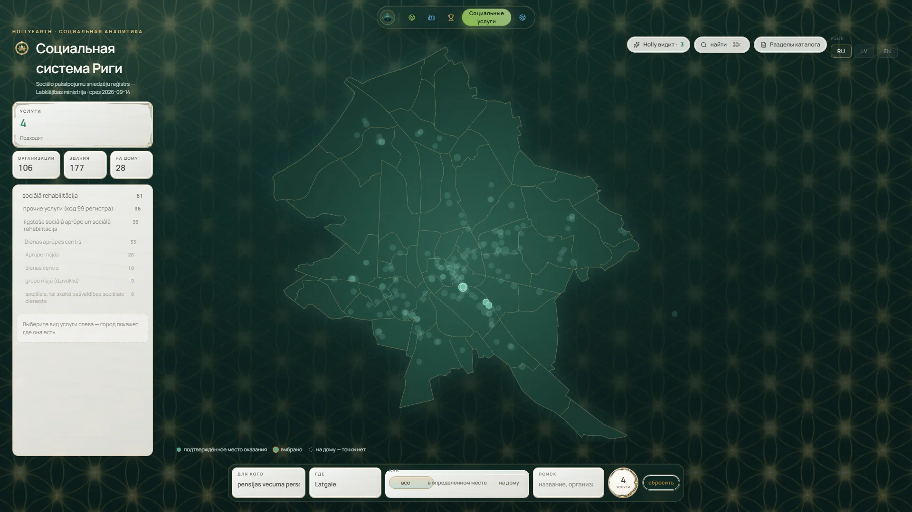
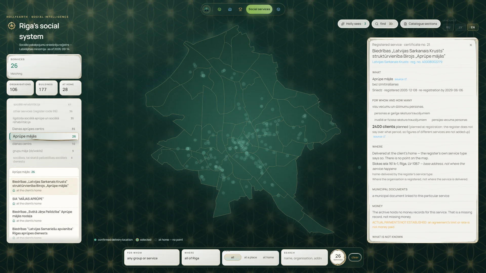
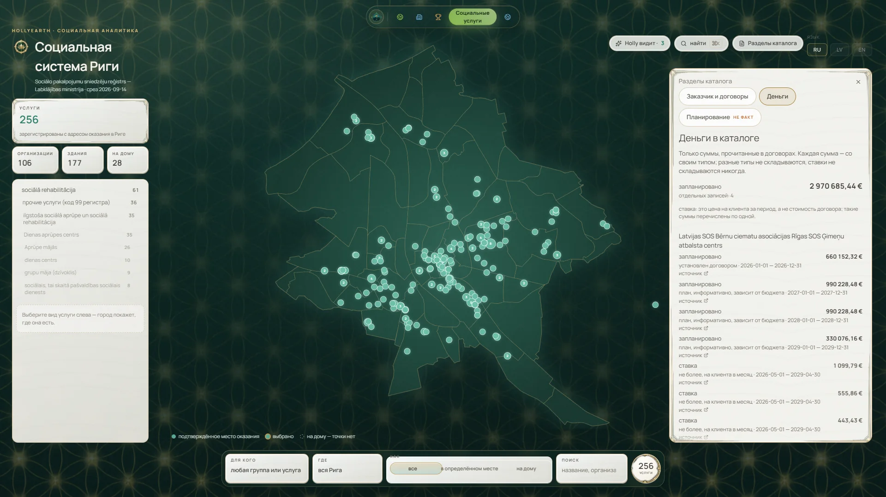
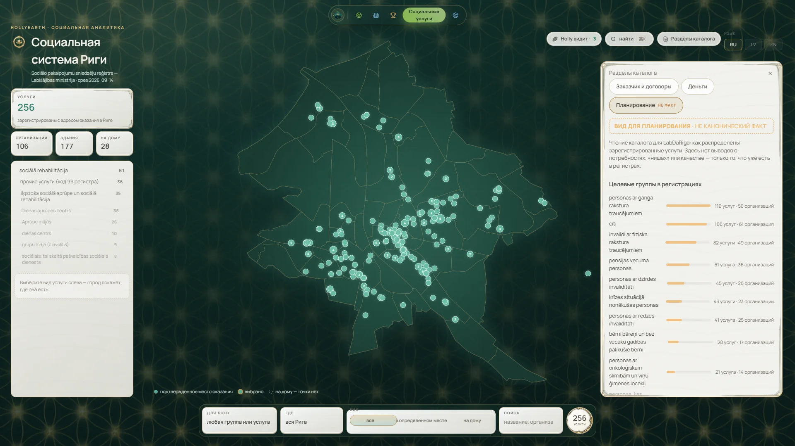

# Social Intelligence — gallery

[← Visual Atlas](../GALLERY.md) · Feature status: [Social Intelligence](../FEATURE_STATUS.md#social-intelligence) · Overview: [social.md](../social.md)

Riga's social services from the official **register of social service providers** of the Ministry of Welfare (Labklājības ministrija), snapshot of 14 September 2026: **256 services · 106 providers · 177 buildings · 28 services delivered at home.** Real screenshots of v0.1.0 (English and Russian interface; service names stay in Latvian as the register publishes them). Click an image to open it full size.

> **REGISTERED ≠ DELIVERED · UNKNOWN ≠ ZERO.**
> The register says what is registered, where and for whom. It does not say how many people were served, what was paid or how good the service was — HollyEarth shows those as unknown for all 256 services, never as zero. A home-delivered service has no point on the map.

Map: drawn by HollyEarth from Riga neighbourhood boundaries (data.gov.lv) and building points of the State Address Register (Valsts zemes dienests). Screens that show the addresses of crisis centres, shelters or other sensitive services are not published.

---

## The stage

`SHOWCASE_READY` — the city as the interface: metrics, 19 service types from the register, a map of 177 buildings, and filters for whom, where and how.

## Categories, filters and "Holly sees"

<table>
<tr>
<td width="50%"> A category chosen — home care: 26 services, listed, with no points on the map because they happen at home.</td>
<td width="50%"> "How" = at home: 28 services, and the map honestly highlights nothing.</td>
</tr>
<tr>
<td width="50%"> For whom = pensioners, where = Latgale → 4 services.</td>
<td width="50%"> "Holly sees · 3" — three counts the register itself computes, with "these are register counts, not an assessment". Deterministic, no model.</td>
</tr>
</table>

## Dossiers

<table>
<tr>
<td width="50%"> Service dossier: 2,400 clients planned at registration (no period) — actual payments, people served and quality unknown.</td>
<td width="50%"> The same dossier's header: register certificate, provider registration number, type, form, status and dates — each with its source.</td>
</tr>
</table>

Organisation dossiers (`WORKING`) list a provider's services and buildings and flag register conflicts; they are not shown here because they list the addresses of shelters and crisis centres.

## Agreements, money and planning

<table>
<tr>
<td width="33%"> <b>Commissioner and agreements</b> — the municipality's delegation documents with the match method shown (through a case document / name-match candidate, not confirmed). `WORKING`</td>
<td width="33%"> <b>Money</b> — limits, conditional plans and maximum per-client rates, each typed; rates are never summed. `BETA`: the headline adds a firm 2026 limit to conditional future plans. None of it is money paid.</td>
<td width="33%"> <b>Planning</b> — registered services by target group, labelled "not a canonical fact". Aggregate register counts; not a measure of need. `BETA`</td>
</tr>
</table>

## Social ↔ Twin and Social ↔ Cases

- **Twin** — the Twin draws the same 177 buildings as a layer ([Riga Twin gallery](RIGA_TWIN.md#layers)). Opening the catalogue from a building lands on the default view; a dossier does not yet lead back to the Twin.
- **Cases** — one service (1 of 256) links to an investigation case about a council decision to delegate social work ([Investigation gallery](INVESTIGATION.md#social-delegation-case)).
- **Main graph** — providers and buildings are kept in the social register's own model; they are not yet canonical organisations or places.
