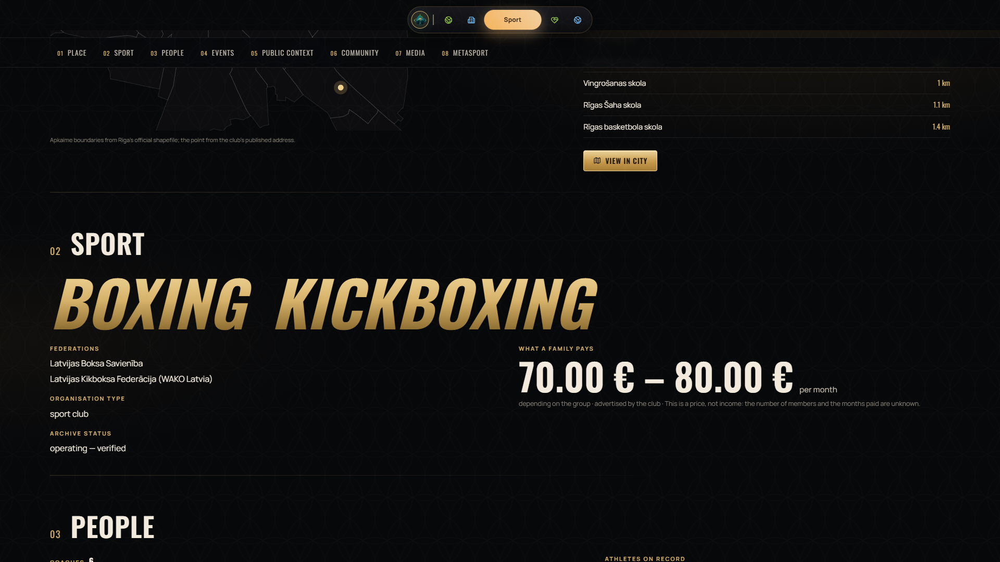
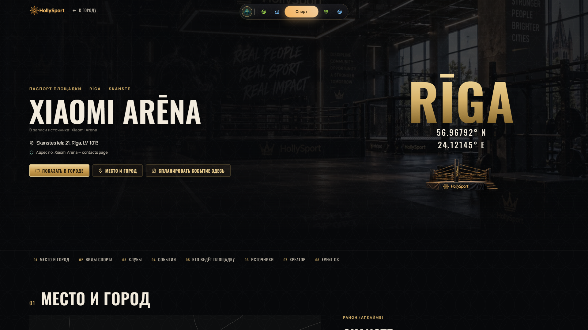
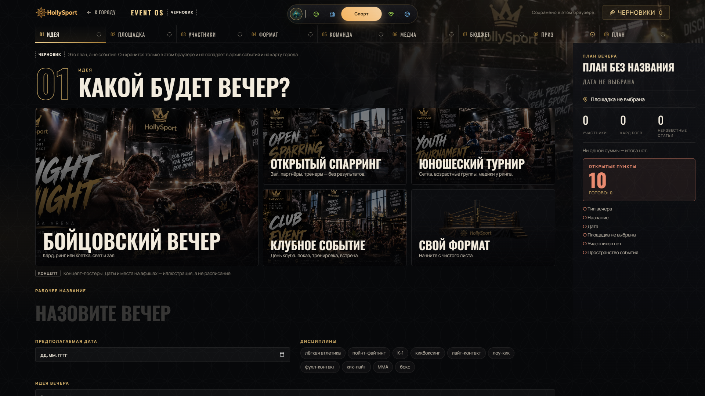

# Sport — HollySport

HollySport is the sport world: Latvian sport records turned into a navigable city, with passports for clubs, athletes, events and venues.

## Real data — `WORKING`

- **18,143 athletes · 227 events · 1,326 bouts · 8,401 placings · 297 clubs and federations · 133 venues** (106 with an address-register point).
- From **federation registers**, **official result books** and **public event archives** (see [DATA_SOURCES.md](../DATA_SOURCES.md)).
- Venue points come from the State Address Register when an address matches exactly one building; otherwise the venue is listed, not drawn.
- People are joined only through stable source identifiers; possible matches go to human review.
- **No stored competition results of minors** under the current project policy; the event passport explains why some categories do not start at first place.

## Passports

| Passport | Status | What it shows |
|---|---|---|
| **Club** | `SHOWCASE_READY` | Training places, sports, federations, what a family pays (a price, not income), coaches named by the club, seasons from official protocols where available, and a **public context** window into the investigation about the club |
| **Event** | `SHOWCASE_READY` | Results by category, starts and athletes; "no venue recorded" and "no organiser named" where the source is silent |
| **Athlete** | `WORKING` | Bouts as the source printed them (opponent, event, method) and placings from official books; nothing invented about height, weight or club |
| **Venue** | `WORKING` | District, address-register point, what was held there; owner, capacity and hire "not recorded" when unknown |

<table>
<tr>
<td width="50%"> Club passport.</td>
<td width="50%"> What a family pays — a price, not income.</td>
</tr>
<tr>
<td width="50%"> Event passport from official results books.</td>
<td width="50%"> Venue passport (Russian interface).</td>
</tr>
</table>

## HollySport City — `WORKING` (real layer)

A game-styled city view with real counts, real clubs and venues on the map, real archive events and a search for people, clubs and events.

Real screenshot, v0.1.0. Season, missions and district levels are a DEMO preview; posters are concept illustrations. More screens: [HollySport gallery](gallery/HOLLYSPORT.md).

## Archive

Clubs, athletes, events, rankings, sport map and sport graph (18,759 entities, 21,425 relationships) — `WORKING`; the archive overview and rankings are `BETA`. Rankings are computed from the bouts the archive holds and are labelled as **not a federation ranking**.

## Preview layers

| Layer | Status |
|---|---|
| Season, missions, XP, district levels | `DEMO` — nobody has earned points; there are no progression mechanics |
| Fan predictions | `DEMO` — demo points, not money |
| Event OS — planning wizard for an event | `PROTOTYPE` — a draft stays in the browser; it is not an event registration or publishing service |
| Creator, partnerships, outreach, organiser and reviewer accounts | `PROTOTYPE` — test use only |
| Market, wallet, leagues, club tokens, ticketing (MetaSport economy) | `FUTURE` — preview sheets: no accounts, payments or contracts |

<table>
<tr>
<td width="50%"> Event OS (PROTOTYPE, Russian interface): a draft kept only in the browser.</td>
<td width="50%"> Missions — DEMO.</td>
</tr>
</table>

## Sport → investigation

Seven clubs have investigation cases; the club passport opens the case and its story (`WORKING`). There is no link back from a case to the passport yet. No public-money records exist for sport in v0.1.0 — the passport says "no record does not mean no money".

## Known limits

- Some athletes and events exist twice (different spellings; an event archived twice), so some bouts are counted twice; they wait for human review.
- Only one athlete is linked to a club; events are not linked to clubs.
- "198 clubs" covers Latvia, not only Riga; some international events appear in the city panel.
- Federation award titles are shown and are being reviewed against the minors policy.

Details per feature: [FEATURE_STATUS.md](FEATURE_STATUS.md#hollysport).
